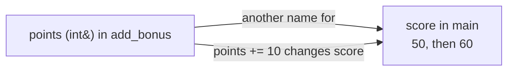

# References and const

References are one of the biggest differences between C and C++. They let functions work on your variables directly, without pointers.

## Pass by value copies

```cpp
#include <iostream>

void add_bonus(int points) {
    points += 10;               // changes the copy only
}

int main() {
    int score = 50;
    add_bonus(score);
    std::cout << score << "\n";
    return 0;
}
```

```output
50
```

## References: another name for the same variable

A reference is declared with `&` after the type. It doesn't hold a copy; it **is** the original under another name.

<!-- diagram -->


```cpp
#include <iostream>

void add_bonus(int& points) {   // int& = reference to int
    points += 10;               // changes the caller's variable
}

int main() {
    int score = 50;
    add_bonus(score);
    std::cout << score << "\n";

    int& alias = score;
    alias = 99;
    std::cout << score << "\n";
    return 0;
}
```

```output
60
99
```

Rules for references:

- A reference must be set when it's created: `int& r;` is an error.
- It can never be changed to refer to something else.
- It can't be "null". So it's safer than a pointer when something must exist.

## Returning several results

A common use: let a function fill in more than one answer.

```cpp
#include <iostream>
#include <vector>

void min_max(const std::vector<int>& v, int& lo, int& hi) {
    lo = hi = v[0];
    for (int x : v) {
        if (x < lo) lo = x;
        if (x > hi) hi = x;
    }
}

int main() {
    std::vector<int> temps{31, 27, 35, 29, 33};
    int lo{}, hi{};
    min_max(temps, lo, hi);
    std::cout << "min " << lo << ", max " << hi << "\n";
    return 0;
}
```

```output
min 27, max 35
```

(You'll meet `std::vector` properly in module 3. It's a list that grows.)

## const references: fast and safe

Copying a big string or a vector of a million numbers is slow. A `const` reference passes the original without copying **and** promises not to change it:

```cpp
void print_report(const std::vector<int>& data);   // no copy, read only
```

The simple rule most C++ programmers follow:

| What you pass | How |
|---|---|
| Small things (int, double, char, bool) | by value: `int x` |
| Big things you only read (string, vector, your classes) | `const T&` |
| Things the function must change | `T&` |

## const everywhere

`const` can protect any variable:

```cpp
const int max_users = 100;
max_users = 200;        // error: assignment of read-only variable
```

If you mark things `const` by default, the compiler catches whole groups of bugs for you, and readers know at a glance what changes and what doesn't.

## A word on pointers

C++ still has C pointers (`int* p = &x;`, `*p = 5;`). You'll need them for some libraries and low-level code, and smart pointers in module 5 build on them. But for passing things to functions, prefer references.

## A trap: dangling references

Never return a reference to a local variable. The variable is destroyed when the function ends, and the reference points at nothing:

```cpp
int& bad() {
    int x = 5;
    return x;      // warning: reference to local variable returned
}
```

With `-Wall` the compiler warns you. Return by value instead: `int good() { return 5; }`. Returning a string or vector by value is cheap in modern C++ (the result is moved or built in place, not copied).

## Summary

- `T&` is another name for an existing variable; changes go to the original.
- Pass big read-only things as `const T&`, small things by value.
- Use `const` by default; never return a reference to a local.

## Optional videos

The lesson above is complete on its own. These videos go deeper, if you like learning by watching.

**References in C++ (The Cherno)**

https://www.youtube.com/watch?v=IzoFn3dfsPA

**Const in C++ (The Cherno)**

https://www.youtube.com/watch?v=4fJBrditnJU
