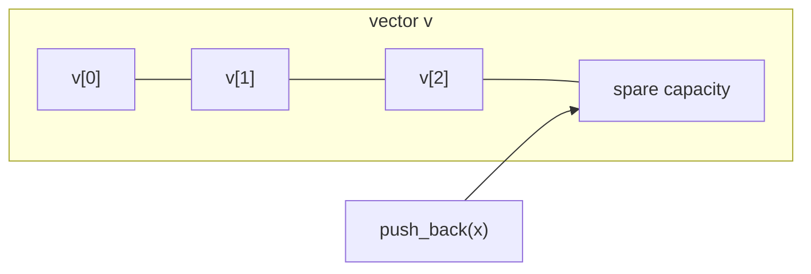

# std::vector: lists that grow

Arrays in C have a fixed size and don't know their length. In C++ you almost always use `std::vector` instead.

## Making and using a vector

<!-- diagram -->


```cpp
#include <iostream>
#include <vector>

int main() {
    std::vector<int> scores{70, 85, 92};

    scores.push_back(64);           // add to the end
    std::cout << "Count: " << scores.size() << "\n";
    std::cout << "First: " << scores[0] << ", last: " << scores.back() << "\n";

    scores[1] = 88;                 // change one
    for (int s : scores) {          // visit each one
        std::cout << s << " ";
    }
    std::cout << "\n";
    return 0;
}
```

```output
Count: 4
First: 70, last: 64
70 88 92 64 
```

- `std::vector<int>` is "a vector of ints". The type in angle brackets can be anything: `std::vector<std::string>`, `std::vector<double>`.
- `push_back` adds at the end; the vector grows as needed.
- `size()` gives the number of items.

## The range-for loop

`for (int s : scores)` reads "for each s in scores". It's shorter than an index loop and can't go out of bounds.

To **change** items in the loop, use a reference; to read big items without copying, use a const reference:

```cpp
#include <iostream>
#include <string>
#include <vector>

int main() {
    std::vector<double> prices{10, 20, 30};
    for (double& p : prices) {
        p *= 1.10;                  // raise each price by 10%
    }
    for (double p : prices) std::cout << p << " ";
    std::cout << "\n";

    std::vector<std::string> names{"Ali", "Mona", "Karim"};
    for (const std::string& n : names) {
        std::cout << n << " has " << n.size() << " letters\n";
    }
    return 0;
}
```

```output
11 22 33 
Ali has 3 letters
Mona has 4 letters
Karim has 5 letters
```

## Index loops when you need the position

```cpp
for (std::size_t i = 0; i < names.size(); ++i) {
    std::cout << i + 1 << ". " << names[i] << "\n";
}
```

`size()` returns an unsigned type (`std::size_t`). Using `int i` gives a warning about comparing signed and unsigned values; `std::size_t` keeps the compiler quiet.

## Safe access with .at()

`v[10]` on a 4-item vector is undefined behavior, as in C. `.at(10)` checks and throws an error you can see:

```cpp
#include <iostream>
#include <stdexcept>
#include <vector>

int main() {
    std::vector<int> v{1, 2, 3};
    try {
        std::cout << v.at(10) << "\n";
    } catch (const std::out_of_range& e) {
        std::cout << "Oops: index out of range\n";
    }
    return 0;
}
```

```output
Oops: index out of range
```

`try` / `catch` handles **exceptions**, C++'s way of reporting errors. You'll use them more in the advanced course.

## Other useful operations

```cpp
v.pop_back();              // remove the last item
v.insert(v.begin(), 5);    // insert at the front
v.erase(v.begin() + 1);    // remove the item at index 1
v.clear();                 // remove everything
v.empty();                 // true if there are no items
std::vector<int> zeros(10, 0);   // 10 items, all 0 (note: round brackets)
```

`v.begin()` is an **iterator**: a position in the vector. Many functions take positions like `v.begin()` and `v.end()` (one past the last item). The next lesson uses them a lot.

## A vector of vectors

A grid, like a small spreadsheet:

```cpp
#include <iostream>
#include <vector>

int main() {
    std::vector<std::vector<int>> grid{
        {1, 2, 3},
        {4, 5, 6},
    };
    int total = 0;
    for (const auto& row : grid)
        for (int x : row)
            total += x;
    std::cout << "rows " << grid.size() << ", total " << total << "\n";
    return 0;
}
```

```output
rows 2, total 21
```

`const auto&` lets the compiler write the long type for you.

## Summary

- `std::vector<T>` grows with push_back and knows its size.
- Range-for: `T x` to read small items, `T& x` to change, `const T& x` to read big ones.
- `.at(i)` checks bounds; `[i]` doesn't.

## Optional videos

The lesson above is complete on its own. These videos go deeper, if you like learning by watching.

**Dynamic arrays in C++: std::vector (The Cherno)**

https://www.youtube.com/watch?v=PocJ5jXv8No
