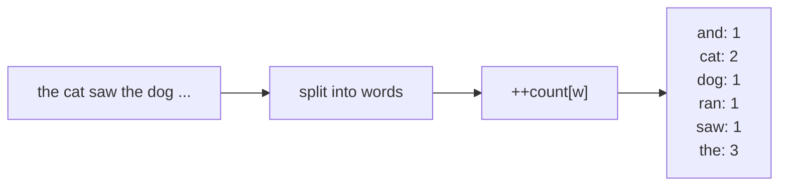

# Maps and the algorithms library

## std::map: look things up by key

A map stores **key → value** pairs, sorted by key. Like a dictionary in Python.

```cpp
#include <iostream>
#include <map>
#include <string>

int main() {
    std::map<std::string, double> price{
        {"tea", 15},
        {"coffee", 30},
    };
    price["juice"] = 25;            // add a new key
    price["tea"] = 18;              // change an existing one

    std::cout << "Coffee costs " << price["coffee"] << "\n";

    for (const auto& [item, p] : price) {   // visits keys in sorted order
        std::cout << item << ": " << p << "\n";
    }

    if (price.contains("cake")) std::cout << "We have cake\n";
    else std::cout << "No cake\n";
    return 0;
}
```

```output
Coffee costs 30
coffee: 30
juice: 25
tea: 18
No cake
```

- `const auto& [item, p]` unpacks each pair into two names.
- `contains` (C++20) checks for a key. Careful: `price["cake"]` would **create** "cake" with value 0 just by reading it.

## Counting words

Maps make counting easy, because a missing number starts at 0:

<!-- diagram -->


```cpp
#include <iostream>
#include <map>
#include <sstream>
#include <string>

int main() {
    std::string text = "the cat saw the dog and the cat ran";
    std::map<std::string, int> count;
    std::istringstream words(text);
    std::string w;
    while (words >> w) {
        ++count[w];
    }
    for (const auto& [word, n] : count) {
        std::cout << word << " " << n << "\n";
    }
    return 0;
}
```

```output
and 1
cat 2
dog 1
ran 1
saw 1
the 3
```

`std::istringstream` lets you read from a string with `>>`, just like from `std::cin`.

`std::unordered_map` does the same job, usually faster, but doesn't keep keys in order.

## <algorithm>: don't write the loop yourself

The standard library has ready-made, well-tested functions for common jobs. They work on a **range**, given as two positions: `begin()` and `end()`.

```cpp
#include <algorithm>
#include <iostream>
#include <numeric>
#include <vector>

int main() {
    std::vector<int> v{42, 7, 19, 88, 3, 19};

    std::sort(v.begin(), v.end());
    for (int x : v) std::cout << x << " ";
    std::cout << "\n";

    int total = std::accumulate(v.begin(), v.end(), 0);
    auto biggest = *std::max_element(v.begin(), v.end());
    auto nineteens = std::count(v.begin(), v.end(), 19);
    std::cout << "total " << total << ", max " << biggest << ", 19s " << nineteens << "\n";

    auto it = std::find(v.begin(), v.end(), 88);
    if (it != v.end()) std::cout << "found 88 at index " << (it - v.begin()) << "\n";
    return 0;
}
```

```output
3 7 19 19 42 88 
total 178, max 88, 19s 2
found 88 at index 5
```

`find` and `max_element` return an iterator (a position); `*it` gives the value there, and `v.end()` means "not found".

## Lambdas: small functions written in place

Many algorithms take a rule. A **lambda** is a function without a name, written right where you need it:

```cpp
#include <algorithm>
#include <iostream>
#include <string>
#include <vector>

int main() {
    std::vector<int> v{42, 7, 19, 88, 3, 19};

    auto big = std::count_if(v.begin(), v.end(), [](int x) { return x > 18; });
    std::cout << big << " numbers above 18\n";

    std::sort(v.begin(), v.end(), [](int a, int b) { return a > b; });  // largest first
    for (int x : v) std::cout << x << " ";
    std::cout << "\n";

    std::vector<std::string> names{"Yasmin", "Ali", "Mohamed", "Ola"};
    std::stable_sort(names.begin(), names.end(),   // stable: equal lengths keep their order
              [](const std::string& a, const std::string& b) { return a.size() < b.size(); });
    for (const auto& n : names) std::cout << n << " ";
    std::cout << "\n";

    int limit = 20;
    auto under = std::count_if(v.begin(), v.end(), [limit](int x) { return x < limit; });
    std::cout << under << " under " << limit << "\n";
    return 0;
}
```

```output
4 numbers above 18
88 42 19 19 7 3 
Ali Ola Yasmin Mohamed 
4 under 20
```

`stable_sort` is used for the names because "Ali" and "Ola" have the same length; plain `sort` may put equal items in any order.

The parts of a lambda: `[captures](parameters) { body }`. The square brackets list outside variables the lambda may use: `[limit]` copies limit in; `[&limit]` would use it by reference.

## Summary

- `std::map<K, V>`: sorted key-value pairs; `contains` checks; `m[k]` creates missing keys.
- `<algorithm>`: sort, stable_sort, find, count, count_if, max_element; `<numeric>`: accumulate.
- Lambdas `[](int x) { return x > 18; }` give algorithms their rules.

## Optional videos

The lesson above is complete on its own. These videos go deeper, if you like learning by watching.

**Maps in C++: std::map and std::unordered_map (The Cherno)**

https://www.youtube.com/watch?v=KiB0vRi2wlc

**Lambdas in C++ (The Cherno)**

https://www.youtube.com/watch?v=mWgmBBz0y8c
