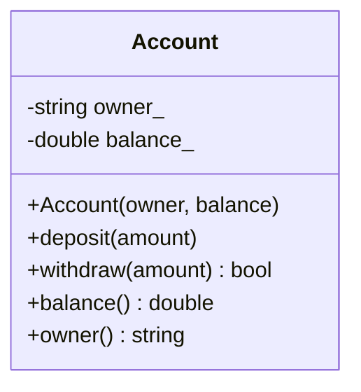

# Classes: your own types

A **class** bundles data and the functions that work on it into one new type. `std::string` and `std::vector` are classes; now you'll write your own.

## A first class

```cpp
#include <iostream>
#include <string>

class Account {
public:
    Account(std::string owner, double balance)
        : owner_(owner), balance_(balance) {}       // constructor

    void deposit(double amount) {
        if (amount > 0) balance_ += amount;
    }

    bool withdraw(double amount) {
        if (amount <= 0 || amount > balance_) return false;
        balance_ -= amount;
        return true;
    }

    double balance() const { return balance_; }
    const std::string& owner() const { return owner_; }

private:
    std::string owner_;
    double balance_;
};

int main() {
    Account acc("Salma", 500);
    acc.deposit(250);
    if (!acc.withdraw(1000)) std::cout << "Not enough money\n";
    acc.withdraw(100);
    std::cout << acc.owner() << " has " << acc.balance() << "\n";
    return 0;
}
```

```output
Not enough money
Salma has 650
```

## The parts

- **Members**: the data (`owner_`, `balance_`) and the functions (`deposit`, `withdraw`...). Many people end data member names with `_` so they're easy to spot.
- **public** members can be used by anyone. **private** members only by the class's own functions.
- The **constructor** has the class's name and no return type. It runs when an object is created. The part after `:` is the **member initializer list**, which sets members directly.
- `acc.deposit(250)` calls a member function on the object `acc`.

<!-- diagram -->


## Why private?

Because the class can then **protect its rules**. Nobody outside can write `acc.balance_ = -1000000;`. The only way to change the balance is through `deposit` and `withdraw`, which check the amounts. This is called **encapsulation**, and it's the main reason classes exist.

## const member functions

`double balance() const` promises the function won't change the object. You can only call const functions on a const object or through a const reference:

```cpp
void show(const Account& a) {
    std::cout << a.balance();   // OK: balance() is const
    a.deposit(5);               // error: deposit() isn't const
}
```

Mark every function that only reads as `const`. Forgetting it is a very common beginner mistake, and you only notice when someone tries to use your class through a `const&`.

## struct

`struct` is the same as `class`, except members are public by default. By custom, use `struct` for simple bundles of data with no rules to protect:

```cpp
#include <iostream>
#include <string>
#include <vector>

struct Product {
    std::string name;
    double price;
    int stock;
};

int main() {
    std::vector<Product> shop{
        {"pen", 7.5, 120},
        {"notebook", 25, 40},
    };
    shop.push_back({"ruler", 10, 0});

    double value = 0;
    for (const auto& p : shop) {
        value += p.price * p.stock;
        if (p.stock == 0) std::cout << p.name << " is sold out\n";
    }
    std::cout << "Stock value: " << value << "\n";
    return 0;
}
```

```output
ruler is sold out
Stock value: 1900
```

## Several constructors and defaults

```cpp
#include <iostream>

class Timer {
public:
    Timer() = default;                       // starts at 0
    explicit Timer(int seconds) : seconds_(seconds) {}

    void tick() { ++seconds_; }
    int minutes() const { return seconds_ / 60; }
    int seconds() const { return seconds_ % 60; }

private:
    int seconds_ = 0;                        // default value
};

int main() {
    Timer a;
    Timer b(125);
    a.tick();
    std::cout << a.minutes() << ":" << a.seconds() << "\n";
    std::cout << b.minutes() << ":" << b.seconds() << "\n";
    return 0;
}
```

```output
0:1
2:5
```

- `= default` asks the compiler to write the normal constructor.
- `int seconds_ = 0;` gives the member a default value used by every constructor that doesn't set it.
- `explicit` stops accidental conversions such as `Timer t = 5;`. Use it on constructors that take one argument.

## Summary

- A class bundles data and functions; private data protects the class's rules.
- Constructors set up objects; use the initializer list `: a_(a)`.
- Mark read-only member functions `const`; use `struct` for plain data.

## Optional videos

The lesson above is complete on its own. These videos go deeper, if you like learning by watching.

**Classes in C++ (The Cherno)**

https://www.youtube.com/watch?v=2BP8NhxjrO0

**Const in C++ (The Cherno)**

https://www.youtube.com/watch?v=4fJBrditnJU
