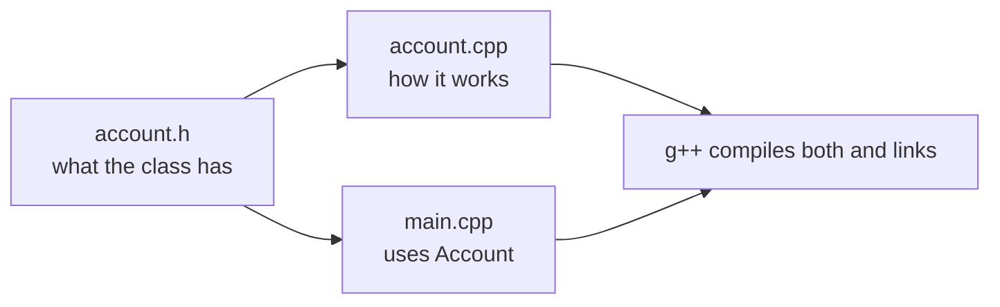

# More on classes: operators, static and splitting files

## Printing your own types

To make `std::cout << obj` work, write an `operator<<` function:

```cpp
#include <iostream>

struct Money {
    long piasters;              // store money as whole units: no rounding errors
};

std::ostream& operator<<(std::ostream& out, const Money& m) {
    out << m.piasters / 100 << "." << (m.piasters % 100 < 10 ? "0" : "") << m.piasters % 100 << " EGP";
    return out;
}

Money operator+(Money a, Money b) { return {a.piasters + b.piasters}; }
bool operator<(Money a, Money b) { return a.piasters < b.piasters; }

int main() {
    Money tea{1550}, cake{4005};
    Money total = tea + cake;
    std::cout << total << "\n";
    std::cout << (tea < cake ? "tea is cheaper\n" : "cake is cheaper\n");
    return 0;
}
```

```output
55.55 EGP
tea is cheaper
```

This is **operator overloading**: giving `+`, `<`, `<<` and friends a meaning for your type. Use it only when the meaning is obvious (adding money, comparing dates). `operator<<` returns the stream so you can chain `std::cout << a << b`.

Why `long piasters` and not `double pounds`? Doubles can't store most decimal fractions exactly (`0.1 + 0.2` isn't exactly `0.3`). For money, store whole units.

## Comparing everything at once

C++20 can write all six comparisons for you with `operator<=>` (nicknamed the spaceship):

```cpp
#include <compare>
#include <iostream>

struct Date {
    int year, month, day;
    auto operator<=>(const Date&) const = default;   // compares year, then month, then day
};

int main() {
    Date a{2026, 3, 15}, b{2026, 11, 2};
    std::cout << (a < b) << (a == b) << (a >= b) << "\n";
    return 0;
}
```

```output
100
```

## static members: shared by all objects

A `static` data member belongs to the class, not to each object:

```cpp
#include <iostream>
#include <string>

class Ticket {
public:
    Ticket() : number_(++issued_) {}
    int number() const { return number_; }
    static int issued() { return issued_; }

private:
    int number_;
    static inline int issued_ = 0;     // one counter for the whole class
};

int main() {
    Ticket a, b, c;
    std::cout << "c is ticket " << c.number() << "\n";
    std::cout << Ticket::issued() << " tickets issued\n";
    return 0;
}
```

```output
c is ticket 3
3 tickets issued
```

`static inline` lets you set the starting value right inside the class (C++17 and later). Static functions are called on the class: `Ticket::issued()`.

## Splitting a class into files

Real programs put each class in two files:

<!-- diagram -->


- the **header** `account.h` with the class declaration (what it has)
- the **source** `account.cpp` with the function bodies (how it works)

```cpp
// account.h
#pragma once
#include <string>

class Account {
public:
    Account(std::string owner, double balance);
    void deposit(double amount);
    double balance() const;

private:
    std::string owner_;
    double balance_;
};
```

```cpp
// account.cpp
#include "account.h"

Account::Account(std::string owner, double balance)
    : owner_(owner), balance_(balance) {}

void Account::deposit(double amount) {
    if (amount > 0) balance_ += amount;
}

double Account::balance() const { return balance_; }
```

<!-- skip -->
```cpp
// main.cpp
#include <iostream>
#include "account.h"

int main() {
    Account a("Hany", 100);
    a.deposit(50);
    std::cout << a.balance() << "\n";
    return 0;
}
```

```bash
g++ -std=c++20 -Wall -Wextra main.cpp account.cpp -o bank
./bank
```

```text
150
```

- `#pragma once` stops a header being included twice (like C's include guards, shorter).
- `Account::deposit` means "the deposit that belongs to Account".
- `#include "account.h"` with quotes looks in your folder; `<...>` looks in the system's folders.

Module 6 shows how CMake builds multi-file projects so you don't have to list every file by hand.

## Summary

- Overload operators when the meaning is obvious; `operator<<` makes your type printable.
- `= default` on `operator<=>` gives you all comparisons.
- static members are shared; headers declare, .cpp files define.

## Optional videos

The lesson above is complete on its own. These videos go deeper, if you like learning by watching.

**Operators and operator overloading in C++ (The Cherno)**

https://www.youtube.com/watch?v=mS9755gF66w

**Static in C++ (The Cherno)**

https://www.youtube.com/watch?v=f3FVU-iwNuA
