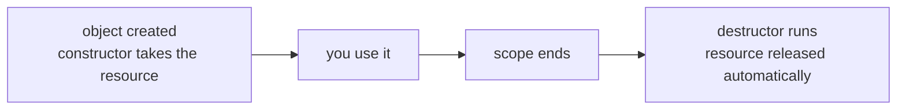

# Destructors, RAII and smart pointers

This lesson is the heart of C++. It's how C++ programs manage memory and files safely without a garbage collector.

## Destructors

A **destructor** runs automatically when an object is destroyed. Its name is `~` plus the class name:

```cpp
#include <iostream>
#include <string>

class Noisy {
public:
    explicit Noisy(std::string name) : name_(name) { std::cout << "hello " << name_ << "\n"; }
    ~Noisy() { std::cout << "bye " << name_ << "\n"; }

private:
    std::string name_;
};

int main() {
    Noisy a("a");
    {
        Noisy b("b");
        std::cout << "inside the block\n";
    }                                   // b is destroyed here
    std::cout << "end of main\n";
    return 0;
}                                       // a is destroyed here
```

```output
hello a
hello b
inside the block
bye b
end of main
bye a
```

A local object is destroyed when its block `{ }` ends, always, even if the block is left early by `return` or an exception.

## RAII

**RAII** ("Resource Acquisition Is Initialization") is a scary name for a simple idea:

<!-- diagram -->


> Get a resource in a constructor. Give it back in the destructor.

Then you can never forget to give it back. The standard library is built this way:

- `std::string` and `std::vector` free their memory in their destructors.
- `std::ofstream` and `std::ifstream` close their file in their destructors.
- `std::lock_guard` unlocks a mutex in its destructor.

```cpp
#include <fstream>
#include <iostream>
#include <string>

int main() {
    {
        std::ofstream out("notes.txt");     // opens the file
        out << "buy milk\n" << "call Sara\n";
    }                                       // closed here, automatically

    std::ifstream in("notes.txt");
    std::string line;
    int n = 0;
    while (std::getline(in, line)) {
        std::cout << ++n << ": " << line << "\n";
    }
    return 0;
}
```

```output
1: buy milk
2: call Sara
```

No `fclose`, no `free`. That's the whole point.

## new and delete (and why you'll avoid them)

`new` creates an object on the heap and gives you a pointer; `delete` destroys it. Forget the delete and you leak memory; delete twice and you crash. In modern C++ you almost never write them yourself. You use **smart pointers**.

## std::unique_ptr: one owner

A `unique_ptr` owns a heap object and deletes it in its destructor:

```cpp
#include <iostream>
#include <memory>
#include <string>

struct Image {
    std::string file;
    explicit Image(std::string f) : file(f) { std::cout << "load " << file << "\n"; }
    ~Image() { std::cout << "free " << file << "\n"; }
};

int main() {
    auto img = std::make_unique<Image>("cat.png");
    std::cout << "showing " << img->file << "\n";

    std::unique_ptr<Image> other = std::move(img);   // ownership moves; img is now empty
    std::cout << (img ? "img still owns it\n" : "img is empty\n");
    return 0;
}                                                    // other deletes the Image here
```

```output
load cat.png
showing cat.png
img is empty
free cat.png
```

- `std::make_unique<T>(args)` creates the object and the owner in one step.
- `->` reaches members through a pointer.
- A unique_ptr **can't be copied** (two owners would delete twice), only **moved** with `std::move`.

## std::shared_ptr: shared ownership

When several parts of a program must share one object and it's not clear who finishes last, use `std::shared_ptr`. It counts owners and deletes the object when the last one goes:

```cpp
#include <iostream>
#include <memory>

int main() {
    auto a = std::make_shared<int>(42);
    {
        auto b = a;                               // two owners now
        std::cout << "owners: " << a.use_count() << "\n";
    }
    std::cout << "owners: " << a.use_count() << "\n";
    return 0;
}
```

```output
owners: 2
owners: 1
```

Prefer `unique_ptr`. Reach for `shared_ptr` only when ownership really is shared; it's slower and makes it harder to see who owns what.

## The rule of zero

If your class's members are all things that clean up after themselves (strings, vectors, smart pointers), you don't write a destructor at all. The compiler-made one destroys each member, and each member cleans up. That's the **rule of zero**, and most of your classes should follow it.

## Summary

- Destructors run automatically when objects go out of scope.
- RAII: acquire in the constructor, release in the destructor. Files and memory clean themselves up.
- Use `std::make_unique` (one owner) or `std::make_shared` (shared), never raw `new`/`delete`.

## Optional videos

The lesson above is complete on its own. These videos go deeper, if you like learning by watching.

**Destructors in C++ (The Cherno)**

https://www.youtube.com/watch?v=D8cWquReFqw

**Smart pointers in C++: unique_ptr, shared_ptr, weak_ptr (The Cherno)**

https://www.youtube.com/watch?v=UOB7-B2MfwA
