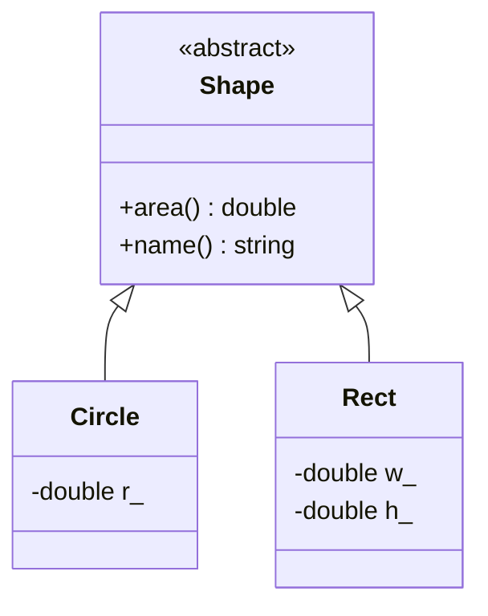

# Inheritance and polymorphism

Sometimes several types are kinds of one general thing: circles and rectangles are shapes; cash and card payments are payments. Inheritance lets you write code for the general thing and have each kind behave its own way.

## A base class and derived classes

<!-- diagram -->


```cpp
#include <iostream>
#include <memory>
#include <string>
#include <vector>

class Shape {
public:
    virtual ~Shape() = default;
    virtual double area() const = 0;              // every shape must say how
    virtual std::string name() const = 0;
};

class Circle : public Shape {
public:
    explicit Circle(double r) : r_(r) {}
    double area() const override { return 3.14159 * r_ * r_; }
    std::string name() const override { return "circle"; }

private:
    double r_;
};

class Rect : public Shape {
public:
    Rect(double w, double h) : w_(w), h_(h) {}
    double area() const override { return w_ * h_; }
    std::string name() const override { return "rectangle"; }

private:
    double w_, h_;
};

int main() {
    std::vector<std::unique_ptr<Shape>> shapes;
    shapes.push_back(std::make_unique<Circle>(1.0));
    shapes.push_back(std::make_unique<Rect>(3, 4));
    shapes.push_back(std::make_unique<Circle>(2.0));

    double total = 0;
    for (const auto& s : shapes) {
        std::cout << s->name() << ": " << s->area() << "\n";
        total += s->area();
    }
    std::cout << "total: " << total << "\n";
    return 0;
}
```

```output
circle: 3.14159
rectangle: 12
circle: 12.5664
total: 27.708
```

## What each piece does

- `class Circle : public Shape` means a Circle **is a** Shape and has everything Shape has.
- `virtual` means "the derived class can replace this". When you call `s->area()` through a `Shape` pointer, C++ looks at the **real** object and runs Circle's or Rect's version. That's **polymorphism**.
- `= 0` makes a function **pure virtual**: Shape doesn't say how; each derived class must. A class with a pure virtual function is **abstract**: you can't create a plain `Shape`.
- `override` asks the compiler to check that you really are replacing a base function. Spell a name wrong and you get an error instead of a silent bug. Always write it.
- `virtual ~Shape() = default;` is required when you delete derived objects through a base pointer (which unique_ptr does). Without it, only the Shape part is destroyed.

## Calling the base class's version

A derived class can reuse the base's code and add to it:

```cpp
#include <iostream>
#include <string>

class Employee {
public:
    Employee(std::string name, double salary) : name_(name), salary_(salary) {}
    virtual ~Employee() = default;
    virtual double monthly_pay() const { return salary_; }
    const std::string& name() const { return name_; }

private:
    std::string name_;
    double salary_;
};

class SalesPerson : public Employee {
public:
    SalesPerson(std::string name, double salary, double sales)
        : Employee(name, salary), sales_(sales) {}          // build the base part first
    double monthly_pay() const override {
        return Employee::monthly_pay() + sales_ * 0.05;     // base pay + 5% commission
    }

private:
    double sales_;
};

void pay_slip(const Employee& e) {                          // works for any Employee
    std::cout << e.name() << ": " << e.monthly_pay() << "\n";
}

int main() {
    Employee a("Reem", 9000);
    SalesPerson b("Tarek", 7000, 60000);
    pay_slip(a);
    pay_slip(b);
    return 0;
}
```

```output
Reem: 9000
Tarek: 10000
```

Polymorphism works through **references and pointers**. If `pay_slip` took `Employee e` by value, it would copy only the Employee part ("slicing") and Tarek would be paid 7000.

## When not to use inheritance

Inheritance is often overused. Ask: is the new type really **a kind of** the base, usable anywhere the base is? If it just **has** or **uses** something, make it a member instead ("composition"). A `Car` has an `Engine`; it isn't one.

Use inheritance when you need different behaviours behind one interface, like the shapes above, and keep the hierarchies shallow.

## Summary

- `class D : public B` makes D a kind of B; `virtual` + `override` give each kind its own behaviour.
- Pure virtual (`= 0`) functions make an abstract interface; give it a virtual destructor.
- Use base pointers or references for polymorphism; prefer composition when it's "has a".

## Optional videos

The lesson above is complete on its own. These videos go deeper, if you like learning by watching.

**Inheritance in C++ (The Cherno)**

https://www.youtube.com/watch?v=X8nYM8wdNRE

**Virtual functions in C++ (The Cherno)**

https://www.youtube.com/watch?v=oIV2KchSyGQ
