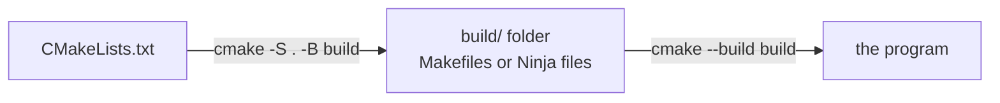

# Templates and building with CMake

## Function templates

You've used `std::vector<int>` and `std::vector<std::string>`: one piece of code that works for many types. That's a **template**, and you can write your own:

```cpp
#include <iostream>
#include <string>
#include <vector>

template <typename T>
T largest(const std::vector<T>& items) {
    T best = items[0];
    for (const T& x : items)
        if (best < x) best = x;
    return best;
}

int main() {
    std::vector<int> nums{4, 19, 7};
    std::vector<std::string> words{"pear", "apple", "zucchini", "fig"};
    std::cout << largest(nums) << "\n";
    std::cout << largest(words) << "\n";
    return 0;
}
```

```output
19
zucchini
```

`template <typename T>` says "T is a type to be filled in later". When you call `largest(nums)`, the compiler sees `T = int` and writes an int version for you; for `words` it writes a string version. The only requirement is that `<` works for T. Strings compare alphabetically, so "zucchini" wins.

## Class templates

```cpp
#include <iostream>
#include <string>

template <typename T>
class Pair {
public:
    Pair(T a, T b) : a_(a), b_(b) {}
    T first() const { return a_; }
    T second() const { return b_; }
    void swap() { T tmp = a_; a_ = b_; b_ = tmp; }

private:
    T a_, b_;
};

int main() {
    Pair<int> p(1, 2);
    p.swap();
    std::cout << p.first() << " " << p.second() << "\n";

    Pair<std::string> names("Ali", "Huda");
    std::cout << names.first() << " & " << names.second() << "\n";
    return 0;
}
```

```output
2 1
Ali & Huda
```

Templates normally live entirely in header files, because the compiler needs the full code to make each version.

You'll mostly **use** templates (all of the standard library) rather than write them. The advanced course goes deeper, including C++20 **concepts** for clearer rules and error messages.

## Why a build tool?

With three files you can type `g++ main.cpp account.cpp shop.cpp -o app`. With thirty files, libraries, tests and different compilers on Windows and Linux, you need a tool. The standard one for C++ is **CMake**.

<!-- diagram -->


A project folder:

```text
bank/
  CMakeLists.txt
  src/
    main.cpp
    account.cpp
    account.h
```

`CMakeLists.txt`:

```cmake
cmake_minimum_required(VERSION 3.20)
project(bank CXX)

set(CMAKE_CXX_STANDARD 20)
set(CMAKE_CXX_STANDARD_REQUIRED ON)

add_executable(bank src/main.cpp src/account.cpp)

if(NOT MSVC)
  target_compile_options(bank PRIVATE -Wall -Wextra)
endif()
```

Build it:

```bash
cmake -S . -B build        # set up a build folder (once)
cmake --build build        # compile; run again after every change
./build/bank
```

- `-S .` is the source folder, `-B build` the build folder. All generated files stay in `build/`, so your source stays clean (and you add `build/` to `.gitignore`).
- The same `CMakeLists.txt` works on Windows with Visual Studio, on macOS and on Linux. VS Code (with the CMake Tools extension), CLion and Visual Studio all open CMake projects directly.

## Debug and release builds

```bash
cmake -S . -B build -DCMAKE_BUILD_TYPE=Debug     # debug info, no optimizing: for gdb
cmake -S . -B build-rel -DCMAKE_BUILD_TYPE=Release   # optimized: for speed
```

## Catching memory bugs: sanitizers

Add this while developing on Linux or macOS and many memory bugs stop the program with a clear report instead of corrupting data silently:

```cmake
target_compile_options(bank PRIVATE -fsanitize=address,undefined)
target_link_options(bank PRIVATE -fsanitize=address,undefined)
```

## Summary

- `template <typename T>` writes code once for many types; templates go in headers.
- CMake describes a project once and builds it on every system.
- `cmake -S . -B build` then `cmake --build build`; use Debug builds and sanitizers while developing.

## Optional videos

The lesson above is complete on its own. These videos go deeper, if you like learning by watching.

**Templates in C++ (The Cherno)**

https://www.youtube.com/watch?v=I-hZkUa9mIs
