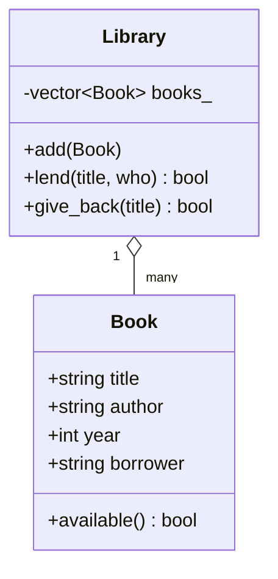

# Project: a small library manager

Let's put everything together: classes, vectors, maps, algorithms, lambdas, smart pointers and files. You'll build a tiny system to manage borrowed books.

## What it does

- Keeps a list of books (title, author, year, and who borrowed it, if anyone).
- Lends and returns books by title, with checks.
- Lists books, sorted, and shows who has what.
- Saves to and loads from a text file.

<!-- diagram -->


## The code

```cpp
#include <algorithm>
#include <fstream>
#include <iostream>
#include <map>
#include <optional>
#include <sstream>
#include <string>
#include <vector>

struct Book {
    std::string title;
    std::string author;
    int year = 0;
    std::string borrower;          // empty: on the shelf

    bool available() const { return borrower.empty(); }
};

class Library {
public:
    void add(Book b) { books_.push_back(std::move(b)); }

    bool lend(const std::string& title, const std::string& who) {
        Book* b = find(title);
        if (!b || !b->available()) return false;
        b->borrower = who;
        return true;
    }

    bool give_back(const std::string& title) {
        Book* b = find(title);
        if (!b || b->available()) return false;
        b->borrower.clear();
        return true;
    }

    void list() const {
        std::vector<const Book*> sorted;
        for (const auto& b : books_) sorted.push_back(&b);
        std::sort(sorted.begin(), sorted.end(),
                  [](const Book* a, const Book* b) { return a->year < b->year; });
        for (const Book* b : sorted) {
            std::cout << b->year << "  " << b->title << " (" << b->author << ")"
                      << (b->available() ? "" : "  -> " + b->borrower) << "\n";
        }
    }

    std::map<std::string, int> loans_per_person() const {
        std::map<std::string, int> out;
        for (const auto& b : books_)
            if (!b.available()) ++out[b.borrower];
        return out;
    }

    void save(const std::string& path) const {
        std::ofstream f(path);
        for (const auto& b : books_)
            f << b.title << '|' << b.author << '|' << b.year << '|' << b.borrower << '\n';
    }

    static Library load(const std::string& path) {
        Library lib;
        std::ifstream f(path);
        std::string line;
        while (std::getline(f, line)) {
            std::istringstream parts(line);
            Book b;
            std::string year;
            std::getline(parts, b.title, '|');
            std::getline(parts, b.author, '|');
            std::getline(parts, year, '|');
            std::getline(parts, b.borrower);
            b.year = std::stoi(year);
            lib.add(b);
        }
        return lib;
    }

    std::size_t size() const { return books_.size(); }

private:
    Book* find(const std::string& title) {
        auto it = std::find_if(books_.begin(), books_.end(),
                               [&title](const Book& b) { return b.title == title; });
        return it == books_.end() ? nullptr : &*it;
    }

    std::vector<Book> books_;
};

int main() {
    Library lib;
    lib.add({"The Cairo Trilogy", "Naguib Mahfouz", 1956, ""});
    lib.add({"Season of Migration to the North", "Tayeb Salih", 1966, ""});
    lib.add({"The Yacoubian Building", "Alaa Al Aswany", 2002, ""});
    lib.add({"Men in the Sun", "Ghassan Kanafani", 1963, ""});

    lib.lend("Men in the Sun", "Laila");
    lib.lend("The Cairo Trilogy", "Laila");
    lib.lend("The Yacoubian Building", "Ziad");
    if (!lib.lend("Men in the Sun", "Ziad")) std::cout << "Men in the Sun is already out\n";
    if (!lib.lend("Unknown Book", "Ziad")) std::cout << "No such book\n";
    lib.give_back("The Yacoubian Building");

    lib.list();
    for (const auto& [who, n] : lib.loans_per_person())
        std::cout << who << " has " << n << " book(s)\n";

    lib.save("library.txt");
    Library again = Library::load("library.txt");
    std::cout << "Loaded " << again.size() << " books back from the file\n";
    return 0;
}
```

```output
Men in the Sun is already out
No such book
1956  The Cairo Trilogy (Naguib Mahfouz)  -> Laila
1963  Men in the Sun (Ghassan Kanafani)  -> Laila
1966  Season of Migration to the North (Tayeb Salih)
2002  The Yacoubian Building (Alaa Al Aswany)
Laila has 2 book(s)
Loaded 4 books back from the file
```

## Things to notice

- `Book` is a plain `struct` with one helper; `Library` is a `class` that protects its rules (you can't lend a book that's out).
- `find` is private and returns a pointer, or `nullptr` when there's no match. Callers check `if (!b ...)`.
- `list()` sorts **pointers** to the books, so the real list keeps its order and nothing is copied.
- `std::getline(parts, b.title, '|')` reads up to the next `|`: an easy file format.
- `load` is `static`: you call it on the class, `Library::load(...)`, and it returns a new Library.
- No `new`, no `delete`, no destructor: the rule of zero. The vector and strings clean up after themselves.

## Debugging when it goes wrong

1. **Compile with warnings and sanitizers**: `g++ -std=c++20 -Wall -Wextra -g -fsanitize=address,undefined lib.cpp -o lib`. A wrong index or a dangling pointer gets reported with the exact line.
2. **Print** what you think is true (`std::cerr << "count=" << n << "\n";`). `std::cerr` goes to the error stream, so it isn't mixed into normal output files.
3. **Use a debugger**: `gdb ./lib`, then `break Library::lend`, `run`, `next`, `print title`, `bt`. VS Code and CLion give you the same with clicks.

A warning about pointers into a vector: `push_back` can move all the books to new memory, so a `Book*` you saved earlier may point at nothing. The sanitizer catches that; the habit is not to keep such pointers across changes to the vector.

## Your turn

1. Split it into `book.h`, `library.h`, `library.cpp` and `main.cpp`, with a `CMakeLists.txt`.
2. Add a menu loop in `main` (`add`, `lend`, `return`, `list`, `quit`) that loads `library.txt` at the start and saves at the end.
3. Add a due date to each loan and a command that lists overdue books.
4. Add `search(word)` that finds books whose title or author contains a word, using `std::copy_if` and a lambda.

## Where to go next

The **advanced C++** course picks up from here: move semantics, templates and concepts, ranges, concurrency with threads, error handling with `std::expected`, and testing. Or continue the systems path with **Rust**, which takes the ownership ideas you met with `unique_ptr` and makes the compiler enforce them.

## Summary

- A real program combines structs, a class that protects its rules, the standard containers and algorithms.
- Return `nullptr` or `std::optional` for "not found"; sort pointers or indexes to avoid copies.
- Warnings, sanitizers and a debugger find most bugs quickly.

## Optional videos

The lesson above is complete on its own. These videos go deeper, if you like learning by watching.

**Dynamic arrays in C++: std::vector (The Cherno)**

https://www.youtube.com/watch?v=PocJ5jXv8No

**Debugging: GDB tutorial (Chris Bourke)**

https://www.youtube.com/watch?v=bWH-nL7v5F4
