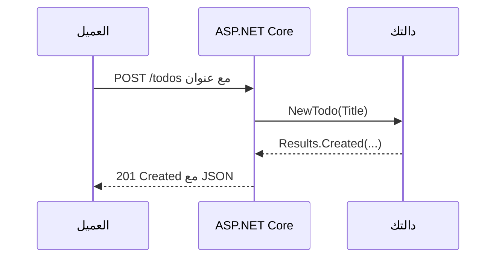

# واجهة Minimal API مع ASP.NET Core

**ASP.NET Core** إطار الويب في .NET. و**Minimal API** يربط عنوان URL وطريقة HTTP بدالة صغيرة، ويحوّل ما تُرجعه إلى JSON:

```bash
dotnet new web -o TodoApi
cd TodoApi
dotnet watch
```

```csharp
// Program.cs
var builder = WebApplication.CreateBuilder(args);
var app = builder.Build();

var todos = new List<Todo>();
var nextId = 1;

app.MapGet("/todos", () => todos);

app.MapGet("/todos/{id:int}", (int id) =>
    todos.FirstOrDefault(t => t.Id == id) is { } todo
        ? Results.Ok(todo)
        : Results.NotFound());

app.MapPost("/todos", (NewTodo input) =>
{
    if (string.IsNullOrWhiteSpace(input.Title))
        return Results.BadRequest("Title is required.");
    var todo = new Todo(nextId++, input.Title, false);
    todos.Add(todo);
    return Results.Created($"/todos/{todo.Id}", todo);
});

app.MapDelete("/todos/{id:int}", (int id) =>
    todos.RemoveAll(t => t.Id == id) > 0 ? Results.NoContent() : Results.NotFound());

app.Run();

record Todo(int Id, string Title, bool Done);
record NewTodo(string Title);
```



## جرّبه

افتح العنوان الذي يطبعه `dotnet watch` (مثل `http://localhost:5000/todos`) في المتصفح لطلبات GET. ولطلب POST استخدم إضافة REST Client في VS Code مع ملف `.http`، أو الطرفية:

```bash
curl -X POST http://localhost:5000/todos -H "Content-Type: application/json" -d "{\"title\": \"Learn C#\"}"
```

القائمة في الذاكرة، فتُفرغ حين يُعاد تشغيل التطبيق. والخطوة التالية قاعدة بيانات عبر **Entity Framework Core**، ويضيفها درس مايكروسوفت. وأكواد الحالة مهمة: `200 OK` و`201 Created` و`204 No Content` و`400 Bad Request` و`404 Not Found`.

اقرأ المزيد (بالإنجليزية): [Tutorial: create a minimal API](https://learn.microsoft.com/aspnet/core/tutorials/min-web-api).
