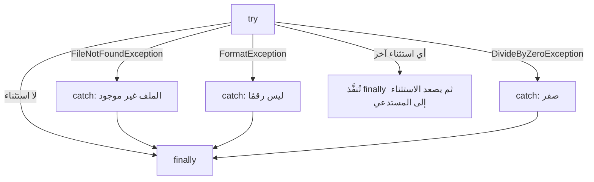

# الاستثناءات

حين يحدث خطأ أثناء التشغيل **تطلق** .NET استثناءً. وإن لم **يلتقطه** شيء يتوقف البرنامج. التقط الاستثناءات المحددة التي تتوقعها:

> **فيديو اختياري في الأعلى.** جزء من دورة freeCodeCamp «Learn C#: Full Course with Mini-Projects» (من 6:01:09 إلى 6:26:00، نحو 25 دقيقة)، يبرمج الأفكار نفسها في Visual Studio. كل ما تحتاجه موجود في النص أدناه، فشاهده فقط إن كان يفيدك: يحفظ inPace المكان الذي توقفت عنده.
>
> الفيديو بالإنجليزية: إن أردت مشاهدته فشغّل الترجمة (**CC**)، ثم **الإعدادات ← الترجمة ← ترجمة تلقائية ← العربية**.

```csharp
try
{
    string text = File.ReadAllText("notes.txt");
    int n = int.Parse(text);
    Console.WriteLine(100 / n);
}
catch (FileNotFoundException)
{
    Console.WriteLine("notes.txt is missing.");
}
catch (FormatException)
{
    Console.WriteLine("The file doesn't hold a number.");
}
catch (DivideByZeroException)
{
    Console.WriteLine("The number can't be 0.");
}
finally
{
    Console.WriteLine("Done.");     // always runs
}
```



## إطلاق استثناءاتك

يجب أن ترفض الدالة المدخلات السيئة بوضوح بدل أن تُرجع إجابة خاطئة:

```csharp
decimal Withdraw(decimal balance, decimal amount)
{
    ArgumentOutOfRangeException.ThrowIfNegativeOrZero(amount);
    if (amount > balance)
        throw new InvalidOperationException("Not enough money.");
    return balance - amount;
}
```

## الاستثناءات لغير المتوقع

للأشياء التي تحدث كثيرًا (مستخدم يكتب حروفًا) افحص أولًا: `TryParse` و`File.Exists` و`TryGetValue`. فالاستثناءات أبطأ وتجعل المسار العادي أصعب قراءة. ولا تكتب أبدًا `catch { }` فارغة: إنها تخفي الأخطاء.

اقرأ المزيد (بالإنجليزية): [Exceptions and exception handling](https://learn.microsoft.com/dotnet/csharp/fundamentals/exceptions/).
