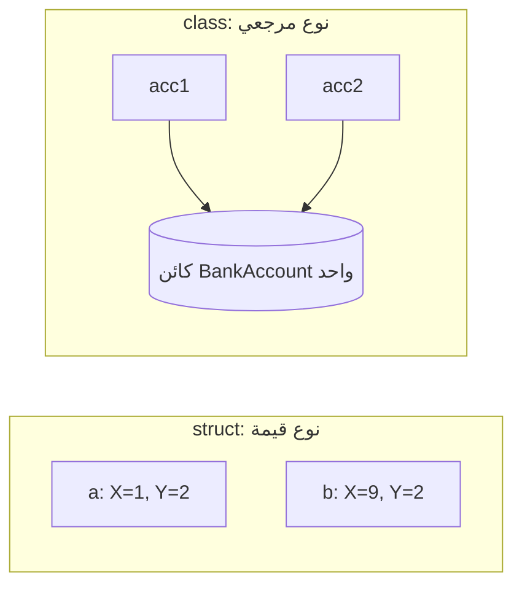

# الهياكل والسجلات والواجهات والوراثة

## قيمة أم مرجع؟

`struct` **نوع قيمة**: إسناده ينسخه. و`class` **نوع مرجعي**: إسناده ينسخ مؤشرًا إلى الكائن نفسه.

> **فيديو اختياري في الأعلى.** جزء من دورة freeCodeCamp «Learn C#: Full Course with Mini-Projects» (من 6:50:14 إلى 7:15:56، نحو 26 دقيقة)، يبرمج الأفكار نفسها في Visual Studio. كل ما تحتاجه موجود في النص أدناه، فشاهده فقط إن كان يفيدك: يحفظ inPace المكان الذي توقفت عنده.
>
> الفيديو بالإنجليزية: إن أردت مشاهدته فشغّل الترجمة (**CC**)، ثم **الإعدادات ← الترجمة ← ترجمة تلقائية ← العربية**.

```csharp
// BankAccount is the class from the last lesson
var a = new Point(1, 2);
var b = a;          // a copy
b.X = 9;            // a.X is still 1

var acc1 = new BankAccount("Mona");
var acc2 = acc1;    // the same object
acc2.Deposit(100);  // acc1.Balance is 100 too

struct Point(int x, int y) { public int X = x; public int Y = y; }
```



## السجلات

`record` صنف مصنوع للبيانات: سطر واحد يعطيك المُنشئ والخصائص و`ToString` والمقارنة بالقيمة. استخدمه لأشياء مثل طلبات الواجهات البرمجية ونتائجها:

```csharp
var p = new Product("Tea", 25m);
Console.WriteLine(p);                              // Product { Name = Tea, Price = 25 }
Console.WriteLine(p == new Product("Tea", 25m));   // True

public record Product(string Name, decimal Price);
```

## الواجهات والوراثة

**الواجهة** (interface) وعد: كل صنف يطبّقها فيه هذه الأعضاء. ويمكن للصنف أن **يرث** من صنف أساسي واحد ويغيّر توابعه `virtual` بـ `override`:

```csharp
List<IShape> shapes = [new Circle(1), new Square(2)];
Console.WriteLine(shapes.Sum(s => s.Area()));   // about 7.14

public interface IShape { double Area(); }

public class Circle(double r) : IShape { public double Area() => Math.PI * r * r; }
public class Square(double side) : IShape { public double Area() => side * side; }
```

## null

قد يشير المرجع إلى لا شيء: `null`. وتفعّل المشاريع الجديدة **الأنواع المرجعية القابلة لـ null**، فتعني `string?` «قد تكون null»، ويحذّرك المترجم قبل استعمالها. اقرأ هذه التحذيرات: فهي تمنع أشهر تعطل في .NET، وهو `NullReferenceException`.
