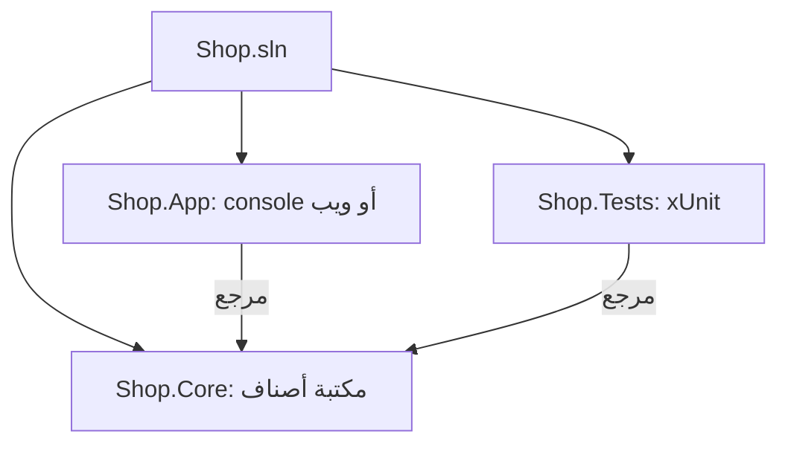

# أدوات .NET والمشاريع والحلول

يؤدي الأمر `dotnet` كل ما تفعله بيئة التطوير، وهو ما تستخدمه خوادم البناء وDocker:

| الأمر | ماذا يفعل |
|---|---|
| `dotnet new list` | يعرض القوالب (console وclasslib وweb وwebapi وxunit...) |
| `dotnet new console -o App` | ينشئ مشروعًا في مجلد جديد |
| `dotnet build` | يترجم الكود |
| `dotnet run` | يبني ويشغّل |
| `dotnet watch` | يعيد التشغيل كلما حفظت |
| `dotnet test` | يشغّل الاختبارات |
| `dotnet publish -c Release` | يجهّز الملفات للنشر |

## المشاريع والحلول

**المشروع** (`.csproj`) يبني شيئًا واحدًا: تطبيقًا أو **مكتبة أصناف** (`classlib`) لكود مشترك. و**الحل** (`.sln`، أو `.slnx` في الإصدارات الأحدث) يجمع المشاريع. والتطبيق الحقيقي غالبًا فيه التطبيق، ومكتبة فيها المنطق، ومشروع اختبارات:

```bash
dotnet new sln -o Shop
cd Shop
dotnet new classlib -o Shop.Core
dotnet new console -o Shop.App
dotnet sln add Shop.Core Shop.App
dotnet add Shop.App reference Shop.Core
```



ويحدد `.csproj` إصدار .NET الذي يستهدفه المشروع (`<TargetFramework>net10.0</TargetFramework>`) والحزم التي يستخدمها.

اقرأ المزيد (بالإنجليزية): [.NET CLI overview](https://learn.microsoft.com/dotnet/core/tools/).
