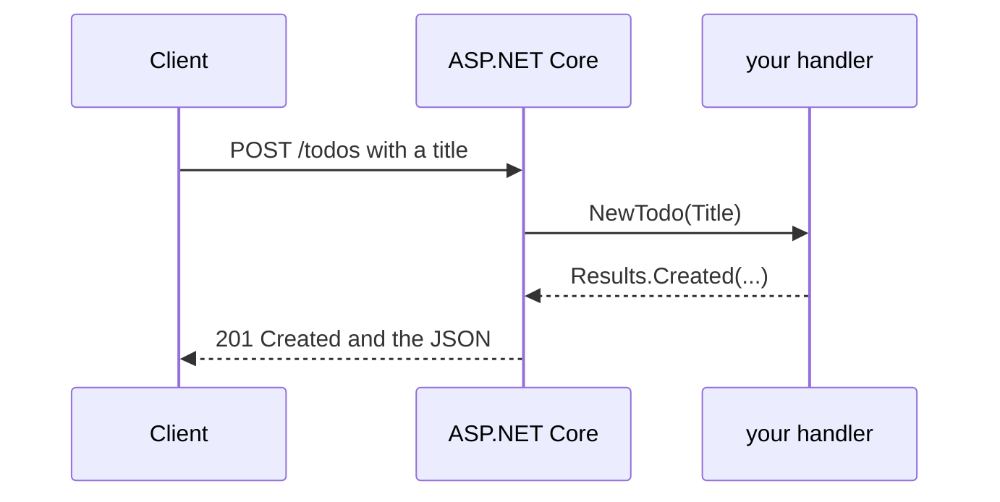

# A minimal API with ASP.NET Core

**ASP.NET Core** is .NET's web framework. A **minimal API** maps a URL and an HTTP method to a small function, and turns what it returns into JSON:

```bash
dotnet new web -o TodoApi
cd TodoApi
dotnet watch
```

```csharp
// Program.cs
var builder = WebApplication.CreateBuilder(args);
var app = builder.Build();

var todos = new List<Todo>();
var nextId = 1;

app.MapGet("/todos", () => todos);

app.MapGet("/todos/{id:int}", (int id) =>
    todos.FirstOrDefault(t => t.Id == id) is { } todo
        ? Results.Ok(todo)
        : Results.NotFound());

app.MapPost("/todos", (NewTodo input) =>
{
    if (string.IsNullOrWhiteSpace(input.Title))
        return Results.BadRequest("Title is required.");
    var todo = new Todo(nextId++, input.Title, false);
    todos.Add(todo);
    return Results.Created($"/todos/{todo.Id}", todo);
});

app.MapDelete("/todos/{id:int}", (int id) =>
    todos.RemoveAll(t => t.Id == id) > 0 ? Results.NoContent() : Results.NotFound());

app.Run();

record Todo(int Id, string Title, bool Done);
record NewTodo(string Title);
```



## Try it

Open the address `dotnet watch` prints (like `http://localhost:5000/todos`) in a browser for the GET routes. For POST, use VS Code's REST Client extension with an `.http` file, or the terminal:

```bash
curl -X POST http://localhost:5000/todos -H "Content-Type: application/json" -d "{\"title\": \"Learn C#\"}"
```

The list lives in memory, so it empties when the app restarts. The next step is a database with **Entity Framework Core**, which Microsoft's tutorial adds. The status codes matter: `200 OK`, `201 Created`, `204 No Content`, `400 Bad Request`, `404 Not Found`.

Read more: [Tutorial: create a minimal API with ASP.NET Core](https://learn.microsoft.com/aspnet/core/tutorials/min-web-api).
