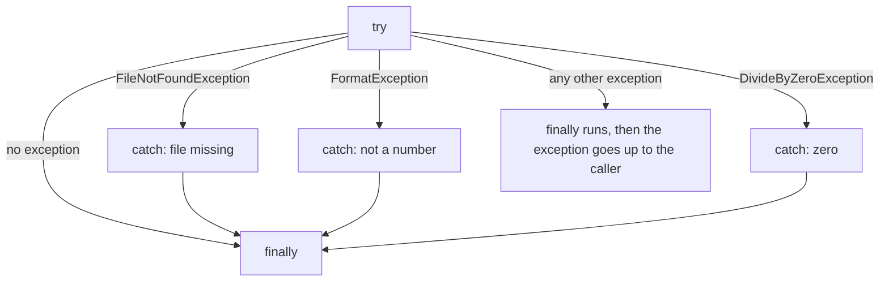

# Exceptions

When something goes wrong at run time, .NET **throws** an exception. If nothing **catches** it, the program stops. Catch the specific exceptions you expect:

> **Optional video above.** Part of freeCodeCamp's *Learn C#: Full Course with Mini-Projects* (6:01:09 to 6:26:00, about 25 min), coding the same ideas in Visual Studio. Everything you need is in the text below, so watch it only if it helps you: inPace remembers where you stopped.

```csharp
try
{
    string text = File.ReadAllText("notes.txt");
    int n = int.Parse(text);
    Console.WriteLine(100 / n);
}
catch (FileNotFoundException)
{
    Console.WriteLine("notes.txt is missing.");
}
catch (FormatException)
{
    Console.WriteLine("The file doesn't hold a number.");
}
catch (DivideByZeroException)
{
    Console.WriteLine("The number can't be 0.");
}
finally
{
    Console.WriteLine("Done.");     // always runs
}
```



## Throwing your own

A method should refuse bad input loudly instead of returning a wrong answer:

```csharp
decimal Withdraw(decimal balance, decimal amount)
{
    ArgumentOutOfRangeException.ThrowIfNegativeOrZero(amount);
    if (amount > balance)
        throw new InvalidOperationException("Not enough money.");
    return balance - amount;
}
```

## Exceptions are for the unexpected

For things that happen often (a user typing letters), check first: `TryParse`, `File.Exists`, `TryGetValue`. Exceptions are slower and make the normal path harder to read. And never write an empty `catch { }`: it hides bugs.

Read more: [Exceptions and exception handling](https://learn.microsoft.com/dotnet/csharp/fundamentals/exceptions/).
