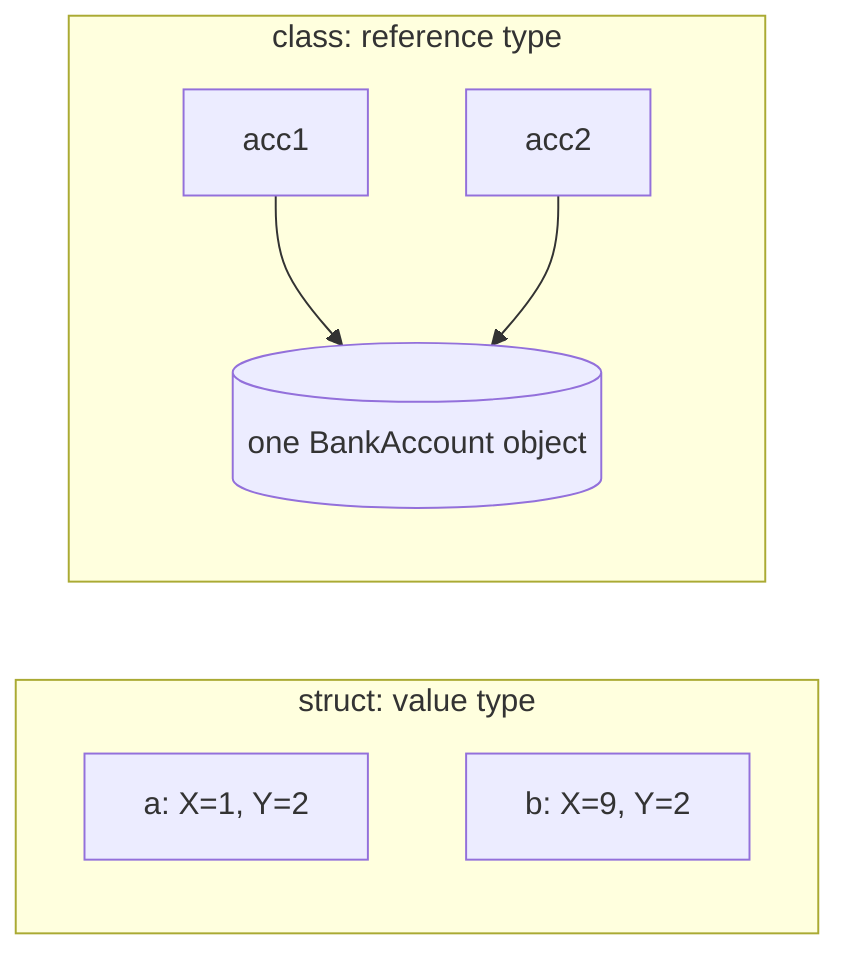

# Structs, records, interfaces and inheritance

## Value or reference?

A `struct` is a **value type**: assigning it copies it. A `class` is a **reference type**: assigning it copies a pointer to the same object.

> **Optional video above.** Part of freeCodeCamp's *Learn C#: Full Course with Mini-Projects* (6:50:14 to 7:15:56, about 26 min), coding the same ideas in Visual Studio. Everything you need is in the text below, so watch it only if it helps you: inPace remembers where you stopped.

```csharp
// BankAccount is the class from the last lesson
var a = new Point(1, 2);
var b = a;          // a copy
b.X = 9;            // a.X is still 1

var acc1 = new BankAccount("Mona");
var acc2 = acc1;    // the same object
acc2.Deposit(100);  // acc1.Balance is 100 too

struct Point(int x, int y) { public int X = x; public int Y = y; }
```



## Records

A `record` is a class made for data: one line gives you a constructor, properties, `ToString` and comparison by value. Use it for things like API requests and results:

```csharp
var p = new Product("Tea", 25m);
Console.WriteLine(p);                              // Product { Name = Tea, Price = 25 }
Console.WriteLine(p == new Product("Tea", 25m));   // True

public record Product(string Name, decimal Price);
```

## Interfaces and inheritance

An **interface** is a promise: any class that implements it has these members. A class can **inherit** from one base class and change its `virtual` methods with `override`:

```csharp
List<IShape> shapes = [new Circle(1), new Square(2)];
Console.WriteLine(shapes.Sum(s => s.Area()));   // about 7.14

public interface IShape { double Area(); }

public class Circle(double r) : IShape { public double Area() => Math.PI * r * r; }
public class Square(double side) : IShape { public double Area() => side * side; }
```

## null

A reference can point to nothing: `null`. New projects turn on **nullable reference types**, so `string?` means "might be null" and the compiler warns you before you use it. Read those warnings: they prevent the most common crash in .NET, the `NullReferenceException`.
