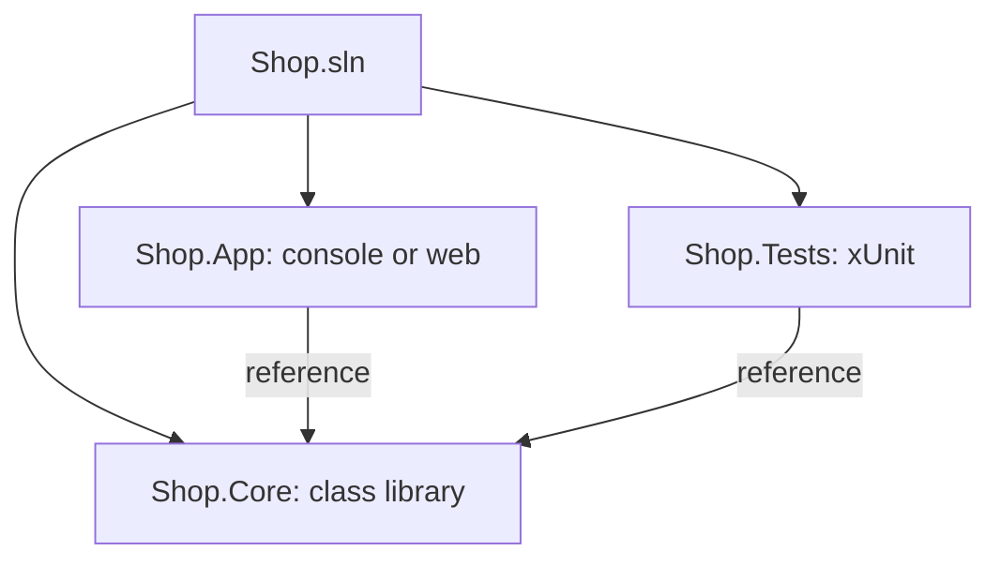

# The .NET CLI, projects and solutions

The `dotnet` command does everything an IDE does, which is what build servers and Docker use:

| Command | Does |
|---|---|
| `dotnet new list` | shows the templates (console, classlib, web, webapi, xunit...) |
| `dotnet new console -o App` | makes a project in a new folder |
| `dotnet build` | compiles |
| `dotnet run` | builds and runs |
| `dotnet watch` | reruns every time you save |
| `dotnet test` | runs the tests |
| `dotnet publish -c Release` | makes the files to deploy |

## Projects and solutions

A **project** (`.csproj`) builds one thing: an app or a **class library** (`classlib`) of code to share. A **solution** (`.sln`, or `.slnx` in newer SDKs) groups projects. A real app usually has the app, a library with the logic, and a test project:

```bash
dotnet new sln -o Shop
cd Shop
dotnet new classlib -o Shop.Core
dotnet new console -o Shop.App
dotnet sln add Shop.Core Shop.App
dotnet add Shop.App reference Shop.Core
```



The `.csproj` says which .NET version the project targets (`<TargetFramework>net10.0</TargetFramework>`) and which packages it uses.

Read more: [.NET CLI overview](https://learn.microsoft.com/dotnet/core/tools/).
