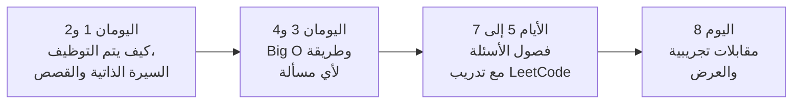

# ابدأ من هنا: كيف يوصلك هذا الكورس إلى الوظيفة

يأخذك هذا الكورس في رحلة التوظيف كاملةً لمهندس البرمجيات، من أول طلب تقدّمه حتى توقيع العرض. وهو يسير مع كتاب
**Cracking the Coding Interview** (الطبعة السادسة) لـ Gayle Laakmann McDowell، وهو الكتاب الذي يستعد به أغلب المهندسين.
كل درس قراءة، وكل درس فصل، يفتح الصفحات المطلوبة من نسختك من الكتاب. وباقي الدروس تشرح الأفكار، وتعرض كود Python يعمل، وتعطيك مسائل من LeetCode
لتتدرب على المهارات نفسها.

لا تحتاج أي خبرة سابقة بالمقابلات. لكن تحتاج أن تكتب برامج بسيطة بلغة واحدة: الحلقات والدوال والقوائم والقواميس. الكود
هنا بلغة Python، ويمكنك أن تتدرب بأي لغة.

## الكتاب غير مرفق

تحتاج نسختك الخاصة من الكتاب (ملف PDF للطبعة السادسة من 708 صفحة). يفتح لك الكورس الجزء أو الفصل المطلوب، ويشرح الأفكار بكلماته هو. ولا ينسخ أسئلة الكتاب ولا
حلوله أبدًا.

## الخطة

| اليوم | ماذا تفعل | الكتاب |
|---|---|---|
| 1 | كيف توظّف شركات التقنية وكيف يقيّمونك | الأجزاء I إلى III |
| 2 | الخبرة، سيرتك الذاتية، الأسئلة السلوكية | الجزآن IV وV |
| 3 | Big O، مع كود يعدّ العمل | الجزء VI |
| 4 | طريقة لأي سؤال تقني | الجزء VII |
| 5 | arrays وstrings وlinked lists وstacks وqueues وtrees وgraphs | الفصول 1 إلى 4 |
| 6 | bits والرياضيات والـ recursion والـ dynamic programming والترتيب والبحث | الفصول 5 و6 و8 و10 |
| 7 | تصميم الكائنات، تصميم الأنظمة، الاختبار، قواعد البيانات، الـ threads | الفصول 7 و9 و11 و14 و15 |
| 8 | مقابلات تجريبية، العروض والتفاوض | الجزء VIII |

يأخذ كل يوم نحو ساعة للقراءة والتعلم، والتدريب يأخذ ما تعطيه من وقت. أغلب من يحصلون على الوظيفة يتدربون **أسابيع**
بعد كورس كهذا، بضع مسائل كل يوم. ويعطيك اليوم 8 خطة لذلك.

## كيف تتدرب

1. اقرأ جزء الكتاب الخاص باليوم، والدرس بجوارك.
2. شغّل كود الدرس وغيّره. الكود الذي كسرته ثم أصلحته هو كود فهمته.
3. حلّ مسائل LeetCode **بصوت عالٍ**، كأن أحدًا يسمعك. المقابلات تختبر طريقة تفكيرك بقدر ما تختبر هل أنهيت الحل.
4. إذا علقت 20 دقيقة، اقرأ تلميحًا (في الكتاب قسم للتلميحات)، لا الحل كاملًا. ثم حاول مرة أخرى.
5. احتفظ بسجل: المسألة، والوقت الذي أخذته، وما فاتك. بعد أسبوع سترى نقاط ضعفك.

## الخلاصة

- يسير الكورس مع الكتاب جزءًا جزءًا، ويضع مسائل تدريب لكل فصل.
- الهدف ليس حفظ الإجابات، بل أن تتقن حل مسائل لم ترها من قبل وأنت تشرح تفكيرك.
