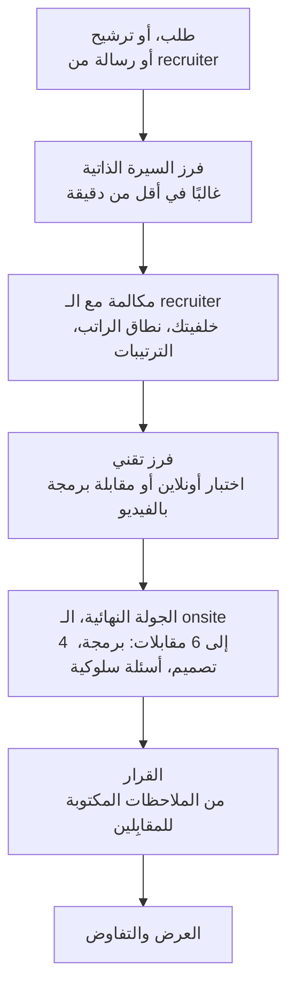

# مسار التوظيف، وما يحكم عليه المقابِلون

كل توظيف لمهندس برمجيات يمر بالقمع نفسه. حين تعرف كل خطوة، تعرف ماذا تجهّز، وأين يخرج أغلب الناس.

## ماذا تختبر كل خطوة

| الخطوة | ماذا يفحصون | كيف تستعد |
|---|---|---|
| فرز السيرة الذاتية | خبرة ومشاريع مناسبة، ونتائج واضحة | اليوم 2 |
| مكالمة الـ recruiter | الدافع، التواصل، نطاق الراتب | قصتك، ونطاق راتب مدروس |
| الفرز التقني | هل تكتب حلًا صحيحًا لمسألة متوسطة في الوقت؟ | الأيام 3 إلى 6، تدريب LeetCode |
| مقابلات البرمجة | حل المشكلات، جودة الكود، التواصل | الأيام 3 إلى 6 |
| مقابلة التصميم | هل تخطط لنظام أكبر أو لمجموعة classes؟ | اليوم 7 |
| المقابلة السلوكية | تحمّل المسؤولية، العمل في فريق، التعامل مع الخلاف والفشل | اليوم 2 |
| العرض | كم تستحق، وهل تقبل | اليوم 8 |

## الأشياء الأربعة التي يكتبها مقابِل البرمجة

بعد مقابلة البرمجة، يكتب المقابِل ملاحظاته. وهي عادةً تغطي أربعة أشياء، ويمكنك أن تُظهر كل واحد منها عن قصد:

1. **حل المشكلات.** هل فهمت المسألة، وسألت أسئلة مفيدة، ووجدت طريقة جيدة؟ أظهر ذلك بشرح الأمثلة والخيارات قبل
   كتابة الكود.
2. **البرمجة.** هل الكود صحيح وواضح ومنظم؟ أظهر ذلك بأسماء جيدة، ودوال مساعدة صغيرة، ومعالجة الحالات الحدّية.
3. **التحقق.** هل اختبرت كودك بنفسك ووجدت أخطاءك؟ أظهر ذلك بتتبع مثال يدويًا حين تنتهي.
4. **التواصل.** هل استطاع المقابِل أن يتابع تفكيرك، وهل استفدت من تلميحاته؟ أظهر ذلك بالتفكير بصوت عالٍ، وبتقبل
   التلميحات جيدًا.

المرشح الذي يصل إلى حل جيد وهو صامت يحصل غالبًا على تقييم **أقل** ممن يصل إلى الحل نفسه وهو يشرح كل خطوة، لأن المقابِل
لا يجد ما يكتبه في ثلاثة من الخانات الأربع.

## لماذا يفشل الناس

- يبدؤون الكود قبل أن يفهموا المسألة، فيحلّون مسألة أخرى.
- يصمتون حين يعلقون. ولا يستطيع المقابِل أن يساعد شخصًا لا يرى تفكيره.
- لا يختبرون كودهم أبدًا، فيتركون أخطاء يضطر المقابِل أن يشير إليها.
- استعدوا بقراءة الحلول فقط. قراءة إجابة تعطيك إحساس الفهم؛ أما إنتاجها تحت ضغط الوقت فمهارة أخرى.

## الخلاصة

- المسار: فرز السيرة الذاتية، مكالمة الـ recruiter، فرز تقني، مقابلات نهائية، قرار، عرض.
- تُقيَّم مقابلات البرمجة على حل المشكلات والبرمجة والتحقق والتواصل، لا على الإجابة النهائية وحدها.
- التفكير بصوت عالٍ مهارة. تدرب عليها من أول مسألة LeetCode.
