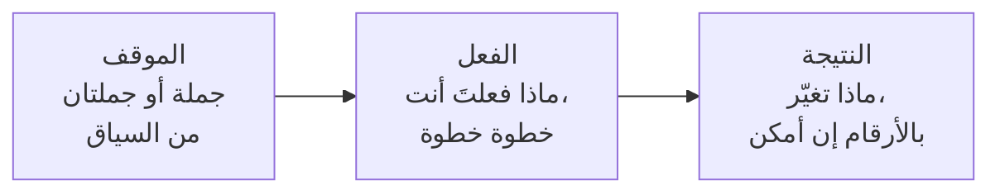

# الأسئلة السلوكية: قصصك جاهزة قبل المقابلة (الجزء V)

اقرأ **الجزء V** من الكتاب: *Interview preparation grid* و*Know your technical projects* و*Responding to behavioral
questions* و*So, tell me about yourself*. ثم استخدم هذا الدرس لتجهيز إجاباتك.

الأسئلة السلوكية تسأل عن ماضيك: "احكِ لي عن مرة اختلفت فيها مع زميل"، "ما أصعب خطأ أصلحته؟"، "لماذا تريد العمل هنا؟".
يريد المقابِل دليلًا على طريقة عملك. والاستعداد الجيد يحوّلها من أكثر الأسئلة إخافةً إلى أسهلها.

## الخطوة 1: ابنِ جدولك

اعمل جدولًا. ضع مشاريعك أو وظائفك الرئيسية (3 إلى 5) في الأعلى، وموضوعات الأسئلة الشائعة على الجانب. واملأ كل خانة
بكلمات قليلة تذكّرك بقصة حقيقية.

| الموضوع | المشروع A | المشروع B | الوظيفة C |
|---|---|---|---|
| أصعب تحدٍّ | | | |
| خطأ أو فشل | | | |
| أكثر ما استمتعت به | | | |
| قيادة الآخرين أو التأثير فيهم | | | |
| خلاف أو اختلاف في الرأي | | | |
| ما كنت ستفعله بشكل مختلف | | | |

لن تملأ كل خانة. خمس إلى ثماني قصص قوية تغطي أي سؤال تقريبًا، لأن القصة الواحدة تجيب عن أكثر من موضوع.

## الخطوة 2: احكِ كل قصة ببناء واضح

يعطيك الكتاب بناءين يمكن جمعهما: **nugget first** (ابدأ بجملة تقول عمّ تدور القصة) و**S.A.R.** (الموقف، الفعل،
النتيجة):

- **ابدأ بالخلاصة.** جملة واحدة تلخص القصة، ليعرف السامع إلى أين تتجه.
- **اقضِ أغلب الوقت على أفعالك.** قل "أنا"، لا "نحن": المقابِل يوظّفك أنت، لا فريقك.
- **انتهِ بالنتيجة**، وبما تعلمته.
- **اجعلها نحو دقيقتين.** وسيطلب المقابِل المزيد إن أراد.

مثال: *"اكتشفت تسريبًا في الذاكرة كان يُسقط تطبيقنا كل بضعة أيام، وأصلحته. كانت تقارير الأعطال تشير إلى شاشة الصور،
فحلّلت أداءها ورأيت أن كل صورة نعرضها تبقى في الذاكرة. أضفت cache بحد أقصى للحجم، وكتبت اختبارًا يفتح 500 صورة. توقفت
الأعطال، وانخفض استهلاك الذاكرة 70%."*

## الخطوة 3: اعرف مشاريعك التقنية بعمق

لأفضل مشروعين عندك، كن جاهزًا لهذه الأسئلة:

- ما أصعب مشكلة تقنية، وكيف حللتها؟
- ما البدائل، ولماذا اخترت طريقتك؟
- ماذا ستغيّر لو بدأت من جديد؟
- كيف سيتعامل مع عشرة أضعاف المستخدمين أو البيانات؟

## الخطوة 4: "Tell me about yourself"

هذا غالبًا أول سؤال، فجهّزه كلمةً كلمة، ثم تدرب حتى يبدو طبيعيًا. شكل جيد، نحو دقيقة: ماذا تعمل الآن، ونقطة أو نقطتان
مميزتان من قبل، وماذا تريد بعد ذلك (ويجب أن يناسب الوظيفة).

## نقاط الضعف والفشل

اختر نقطة ضعف أو فشلًا حقيقيًا، لا ميزة متخفية ("أعمل أكثر من اللازم"). ثم أظهر ماذا فعلت حياله. الاعتراف بالخطأ بشكل
جيد يدل على النضج.

## أسئلة تسألها أنت

يترك أغلب المقابِلين وقتًا لأسئلتك، والأسئلة الجيدة تُحسب لك. يقترح الكتاب ثلاثة أنواع:

- **أسئلة حقيقية**: ما تريد معرفته فعلًا ("ما أصعب ما واجهته هنا؟").
- **أسئلة تُظهر الفهم**: أسئلة تُظهر أنك بحثت عن الشركة وتقنياتها.
- **أسئلة شغف**: أسئلة تُظهر رغبتك في التعلم ("ما فرص تعلّم الـ scalability هنا؟").

جهّز سؤالين أو ثلاثة من كل نوع قبل المقابلة.

## الخلاصة

- جهّز 5 إلى 8 قصص حقيقية في جدول قبل أي مقابلة.
- احكِها موقفًا ثم فعلًا ثم نتيجة، مبتدئًا بالخلاصة ومركّزًا على ما فعلته أنت.
- اعرف أفضل مشاريعك بعمق، وجهّز "tell me about yourself" كلمةً كلمة.
