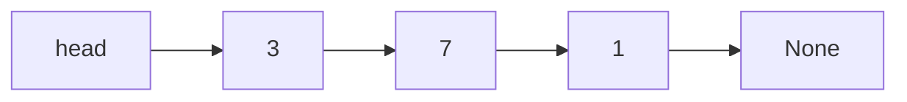

# الـ linked lists والـ stacks والـ queues (الفصلان 2 و3)

اقرأ مقدمتي **الفصل 2، Linked lists**، و**الفصل 3، Stacks and queues**. هذه الهياكل بسيطة، لكن أسئلة المقابلات عنها تختبر
الدقة في التعامل مع المؤشرات والحالات الحدّية.

## الـ linked lists

الـ linked list سلسلة من العُقد (nodes)، كل عقدة تحمل قيمة ومؤشرًا إلى العقدة التالية. الإضافة أو الحذف في البداية O(1)؛
والوصول إلى العنصر رقم k هو O(k)، لأنك يجب أن تمشي إليه.



```python
class Node:
    def __init__(self, val, next=None):
        self.val, self.next = val, next

def build(values):
    head = None
    for v in reversed(values):
        head = Node(v, head)
    return head

def to_list(head):
    out = []
    while head:
        out.append(head.val); head = head.next
    return out

def reverse(head):
    prev = None
    while head:
        head.next, prev, head = prev, head, head.next    # point back, then step forward
    return prev

print(to_list(reverse(build([3, 7, 1, 9]))))
```

```output
[9, 1, 7, 3]
```

### تقنية الـ runner

مؤشران يتحركان بسرعتين مختلفتين يحلّان أسئلة كثيرة عن القوائم في مرور واحد وبذاكرة O(1). مؤشر **بطيء** يتحرك خطوة،
ومؤشر **سريع** يتحرك خطوتين:

- حين يصل السريع إلى النهاية، يكون البطيء في **المنتصف**؛
- إذا كان في القائمة **دائرة** (cycle)، يلحق السريع بالبطيء في النهاية.

```python
def middle(head):
    slow = fast = head
    while fast and fast.next:
        slow, fast = slow.next, fast.next.next
    return slow.val

def has_cycle(head):
    slow = fast = head
    while fast and fast.next:
        slow, fast = slow.next, fast.next.next
        if slow is fast:
            return True
    return False

head = build([1, 2, 3, 4, 5])
print("middle:", middle(head), "| cycle:", has_cycle(head))
head.next.next.next.next.next = head.next          # make the last node point back to the second
print("cycle after linking the end back:", has_cycle(head))
```

```output
middle: 3 | cycle: False
cycle after linking the end back: True
```

نصائح للـ linked lists: ارسم العقد على ورق، وافحص القائمة الفارغة، والقائمة ذات العقدة الواحدة، والتغييرات عند الـ head.
وعقدة **dummy** قبل الـ head كثيرًا ما تزيل الحالات الخاصة.

## الـ stacks والـ queues

الـ **stack** آخر من يدخل أول من يخرج (مثل الأطباق). والـ **queue** أول من يدخل أول من يخرج (مثل طابور في محل). في Python،
تعمل الـ list كـ stack (`append` و`pop`)، ويعمل `collections.deque` كـ queue (`append` و`popleft`).

سؤال كلاسيكي عن الـ stack: stack تُرجع أيضًا أصغر قيمة فيها في O(1). خزّن مع كل عنصر أصغر قيمة حتى الآن.

```python
class MinStack:
    def __init__(self):
        self.items = []                         # pairs: (value, minimum of the stack up to here)
    def push(self, x):
        low = min(x, self.items[-1][1]) if self.items else x
        self.items.append((x, low))
    def pop(self):
        return self.items.pop()[0]
    def min(self):
        return self.items[-1][1]

s = MinStack()
for x in [5, 3, 8, 1]:
    s.push(x)
print("min:", s.min()); s.pop(); print("after one pop, min:", s.min())
```

```output
min: 1
after one pop, min: 3
```

والـ stacks تفحص الأقواس أيضًا: ادفع كل قوس فاتح، وكل قوس مغلق يجب أن يطابق القمة.

```python
def balanced(text):
    pairs, stack = {")": "(", "]": "[", "}": "{"}, []
    for ch in text:
        if ch in "([{":
            stack.append(ch)
        elif ch in pairs:
            if not stack or stack.pop() != pairs[ch]:
                return False
    return not stack

print([balanced(t) for t in ["(a[b]{c})", "(]", "((", "{[()()]}"]])
```

```output
[True, False, False, True]
```

## تدرّب

حلّ أسئلة الفصلين من الكتاب، ثم هذه:

| المسألة | الفكرة |
|---|---|
| [Reverse Linked List](https://leetcode.com/problems/reverse-linked-list/) | ثلاثة مؤشرات |
| [Remove Nth Node From End of List](https://leetcode.com/problems/remove-nth-node-from-end-of-list/) | مؤشران بينهما n، وعقدة dummy |
| [Add Two Numbers](https://leetcode.com/problems/add-two-numbers/) | المرور على قائمتين مع الحمل (carry) |
| [Intersection of Two Linked Lists](https://leetcode.com/problems/intersection-of-two-linked-lists/) | قارن الأطوال، أو بدّل الرأسين |
| [Linked List Cycle II](https://leetcode.com/problems/linked-list-cycle-ii/) | تقنية الـ runner، ثم أوجد البداية |
| [Valid Parentheses](https://leetcode.com/problems/valid-parentheses/) | stack للأقواس المفتوحة |
| [Min Stack](https://leetcode.com/problems/min-stack/) | احتفظ بالأصغر مع كل عنصر |
| [Evaluate Reverse Polish Notation](https://leetcode.com/problems/evaluate-reverse-polish-notation/) | stack للأرقام |
| [Daily Temperatures](https://leetcode.com/problems/daily-temperatures/) | stack للأيام التي ما زالت تنتظر يومًا أدفأ |

## الخلاصة

- الـ linked lists: ارسمها، واستخدم dummy head، وافحص القائمة الفارغة وذات العقدة الواحدة.
- المؤشران البطيء والسريع يجدان المنتصف ويكتشفان الدوائر بذاكرة O(1).
- الـ stack آخر من يدخل أول من يخرج؛ وتحل مسائل "آخر شيء لم يُطابَق بعد" مثل الأقواس.
