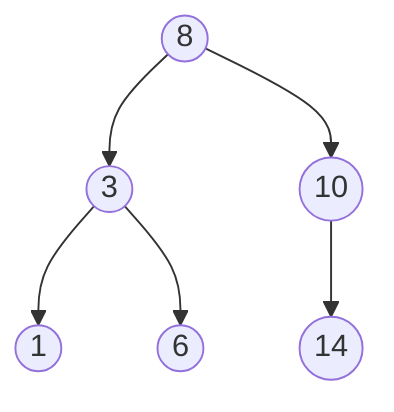

# الـ trees والـ graphs (الفصل 4)

اقرأ مقدمة **الفصل 4، Trees and graphs**. أسئلته من أكثر الأسئلة شيوعًا في المقابلات، وتكاد كلها ترجع إلى طريقتين لزيارة
العقد: depth-first وbreadth-first.

## الـ trees

الـ **binary tree** مجموعة عقد، لكل عقدة طفلان على الأكثر، أيسر وأيمن. والـ **binary search tree** (BST) تضيف قاعدة: كل ما
في الشجرة الفرعية اليسرى أصغر من العقدة، وكل ما في اليمنى أكبر. وتكون الشجرة **متوازنة** (balanced) حين لا يكون فرع أعمق
كثيرًا من غيره؛ وعندها يكون ارتفاعها نحو log n.



```python
class TreeNode:
    def __init__(self, val, left=None, right=None):
        self.val, self.left, self.right = val, left, right

def from_sorted(values):
    """A balanced BST from a sorted list: the middle value becomes the root, recursively."""
    if not values:
        return None
    mid = len(values) // 2
    return TreeNode(values[mid], from_sorted(values[:mid]), from_sorted(values[mid + 1:]))

def in_order(node):
    """Left, node, right: a BST comes out sorted."""
    return in_order(node.left) + [node.val] + in_order(node.right) if node else []

def height(node):
    return 1 + max(height(node.left), height(node.right)) if node else 0

root = from_sorted([1, 3, 6, 8, 10, 14, 15])
print("in order:", in_order(root), "| root:", root.val, "| height:", height(root))
```

```output
in order: [1, 3, 6, 8, 10, 14, 15] | root: 8 | height: 3
```

سبع قيم تعطي شجرة ارتفاعها 3، لأن الشجرة المتوازنة يتضاعف عرضها في كل مستوى.

### هل هي BST صحيحة؟

خطأ شائع أن تفحص كل عقدة مقابل طفليها فقط. القاعدة عن **الأشجار الفرعية كاملة**، فمرّر إلى الأسفل النطاق الذي يجب أن تقع
فيه كل عقدة.

```python
def is_bst(node, low=float("-inf"), high=float("inf")):
    if not node:
        return True
    if not (low < node.val < high):
        return False
    return is_bst(node.left, low, node.val) and is_bst(node.right, node.val, high)

bad = TreeNode(8, TreeNode(3, None, TreeNode(9)), TreeNode(10))   # 9 sits left of 8: each parent-child pair looks fine
print(is_bst(root), is_bst(bad))
```

```output
True False
```

## الـ graphs

الـ graph مجموعة عقد تربطها حواف (edges)، والـ tree نوع خاص من الـ graph. في المقابلات، خزّن الـ graph كـ **adjacency list**:
dictionary من كل عقدة إلى جيرانها.

- **Depth-first search (DFS)** يتعمق قدر ما يستطيع قبل أن يرجع. استخدمه لزيارة كل شيء أو لاستكشاف كل المسارات. بالـ
  recursion أو بـ stack.
- **Breadth-first search (BFS)** يزور العقد بترتيب بُعدها عن البداية. استخدمه لـ **أقصر المسارات** حين تكون كل الحواف
  بالطول نفسه. بـ queue.

كلاهما O(V + E): كل عقدة وكل حافة تُعالج مرة واحدة. علّم العقد التي زرتها، وإلا ستدور الدائرة إلى الأبد.

```python
from collections import deque

graph = {"A": ["B", "C"], "B": ["D"], "C": ["D", "E"], "D": ["F"], "E": ["F"], "F": []}

def bfs_path(graph, start, goal):
    queue, came_from = deque([start]), {start: None}
    while queue:
        node = queue.popleft()
        if node == goal:
            path = []
            while node:
                path.append(node); node = came_from[node]
            return path[::-1]
        for nxt in graph[node]:
            if nxt not in came_from:            # visited check
                came_from[nxt] = node
                queue.append(nxt)
    return None

def dfs_order(graph, node, seen=None):
    seen = seen if seen is not None else []
    seen.append(node)
    for nxt in graph[node]:
        if nxt not in seen:
            dfs_order(graph, nxt, seen)
    return seen

print("shortest path A to F:", bfs_path(graph, "A", "F"))
print("DFS visiting order:  ", dfs_order(graph, "A"))
```

```output
shortest path A to F: ['A', 'B', 'D', 'F']
DFS visiting order:   ['A', 'B', 'D', 'F', 'C', 'E']
```

### الترتيب مع الاعتماديات: الـ topological sort

حين يجب أن تسبق بعض المهام غيرها ("build order"، أو متطلبات الكورسات)، خذ في كل مرة مهمة لم يبقَ لها متطلبات. وإذا علقت
قبل أن تضع كل المهام، ففيها دائرة ولا يوجد ترتيب.

```python
def build_order(tasks, deps):
    """deps: (before, after) pairs. Returns an order, or None if there is a cycle."""
    after = {t: [] for t in tasks}
    waiting = {t: 0 for t in tasks}             # how many prerequisites each task still waits for
    for a, b in deps:
        after[a].append(b); waiting[b] += 1
    ready = deque(t for t in tasks if waiting[t] == 0)
    order = []
    while ready:
        t = ready.popleft(); order.append(t)
        for nxt in after[t]:
            waiting[nxt] -= 1
            if waiting[nxt] == 0:
                ready.append(nxt)
    return order if len(order) == len(tasks) else None

print(build_order(list("abcdef"), [("a", "d"), ("f", "b"), ("b", "d"), ("f", "a"), ("d", "c")]))
print(build_order(list("abc"), [("a", "b"), ("b", "c"), ("c", "a")]))
```

```output
['e', 'f', 'b', 'a', 'd', 'c']
None
```

## تدرّب

حلّ أسئلة الفصل من الكتاب، ثم هذه:

| المسألة | الفكرة |
|---|---|
| [Maximum Depth of Binary Tree](https://leetcode.com/problems/maximum-depth-of-binary-tree/) | recursion على اليسار واليمين |
| [Balanced Binary Tree](https://leetcode.com/problems/balanced-binary-tree/) | أرجع الارتفاع، أو إشارة أنها غير متوازنة |
| [Convert Sorted Array to Binary Search Tree](https://leetcode.com/problems/convert-sorted-array-to-binary-search-tree/) | العنصر الأوسط جذرًا |
| [Binary Tree Level Order Traversal](https://leetcode.com/problems/binary-tree-level-order-traversal/) | BFS، مستوى بعد مستوى |
| [Validate Binary Search Tree](https://leetcode.com/problems/validate-binary-search-tree/) | مرّر النطاق المسموح |
| [Lowest Common Ancestor of a Binary Tree](https://leetcode.com/problems/lowest-common-ancestor-of-a-binary-tree/) | اسأل كل شجرة فرعية ماذا وجدت |
| [Subtree of Another Tree](https://leetcode.com/problems/subtree-of-another-tree/) | قارن الأشجار بالـ recursion |
| [Number of Islands](https://leetcode.com/problems/number-of-islands/) | DFS أو BFS على شبكة |
| [Course Schedule II](https://leetcode.com/problems/course-schedule-ii/) | topological sort |

## الخلاصة

- في الـ BST، الزيارة in-order مرتبة، والصحة تتعلق بالنطاقات، لا بالأب والابن فقط.
- الـ DFS يستكشف بعمق (recursion أو stack)؛ والـ BFS يجد أقصر المسارات في الـ graphs غير الموزونة (queue).
- تابع دائمًا العقد التي زرتها في الـ graph؛ والـ topological sort يرتب المهام ذات الاعتماديات.
