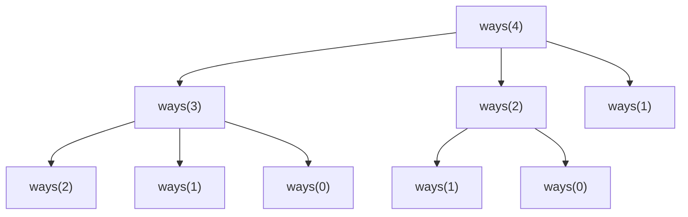

# الـ recursion والـ dynamic programming (الفصل 8)

اقرأ مقدمة **الفصل 8، Recursion and dynamic programming**. يجد كثيرون هذا الفصل الأصعب. والخبر الجيد: أغلب أسئلته تتبع
أنماطًا قليلة، وحين تستطيع كتابة الـ recursion، تكون نسخة الـ dynamic programming خطوة صغيرة.

## كيف تفكر بالـ recursion

افترض أن الدالة تعمل بالفعل للمدخلات الأصغر. ثم اسأل: كيف أبني إجابة n من إجابات الحالات الأصغر؟ وما أصغر حالة، التي
أجيب فيها مباشرةً (الـ base case)؟

مثال: طفل يصعد n درجة، بخطوة أو اثنتين أو ثلاث في كل مرة. كم طريقة هناك؟ آخر حركة كانت 1 أو 2 أو 3 درجات، إذن:
ways(n) = ways(n − 1) + ways(n − 2) + ways(n − 3)، مع ways(0) = 1 (الوقوف في الأسفل طريقة واحدة).



`ways(2)` ظهرت مرتين بالفعل، ومع n أكبر ينفجر التكرار. هذه إشارة الـ dynamic programming.

## ثلاث نسخ من الحل نفسه

```python
from functools import lru_cache

calls = 0
def ways_plain(n):
    global calls
    calls += 1
    if n < 0:
        return 0
    if n == 0:
        return 1
    return ways_plain(n - 1) + ways_plain(n - 2) + ways_plain(n - 3)

@lru_cache(maxsize=None)              # top-down DP (memoization): remember every answer
def ways_memo(n):
    if n < 0:
        return 0
    if n == 0:
        return 1
    return ways_memo(n - 1) + ways_memo(n - 2) + ways_memo(n - 3)

def ways_table(n):                    # bottom-up DP: fill a table from the smallest case
    table = [1] + [0] * n
    for i in range(1, n + 1):
        table[i] = sum(table[i - k] for k in (1, 2, 3) if i - k >= 0)
    return table[n]

for n in [5, 10, 20]:
    calls = 0
    print(f"n = {n:2d}: {ways_plain(n):7,d} ways, {calls:9,d} calls without memory;"
          f" memo {ways_memo(n):,d}; table {ways_table(n):,d}")
```

```output
n =  5:      13 ways,        46 calls without memory; memo 13; table 13
n = 10:     274 ways,       979 calls without memory; memo 274; table 274
n = 20: 121,415 ways,   433,993 calls without memory; memo 121,415; table 121,415
```

الثلاث تعطي الإجابات نفسها. بدون ذاكرة، تنمو الاستدعاءات أُسّيًا؛ ومع الـ memoization أو الجدول، يصبح العمل O(n). قل هذا
التدرج في المقابلة: "هذا هو الـ recursion. يكرر العمل، فسأستخدم memoization، فيصبح O(n). ويمكنني أيضًا أن أبنيه من
الأسفل للأعلى وأحتفظ بآخر ثلاث قيم فقط، لذاكرة O(1)."

## الـ backtracking: ابنِ كل خيار

بعض الأسئلة تطلب **كل** الإجابات: كل مجموعة جزئية، كل ترتيب، كل توزيع صحيح. ابنِ إجابة جزئية، ووسّعها باختيار واحد في
كل مرة، وتراجع عن الاختيار بعد استكشافه.

```python
def subsets(items):
    result, current = [], []
    def explore(i):
        if i == len(items):
            result.append(current.copy()); return
        explore(i + 1)                       # leave items[i] out
        current.append(items[i])
        explore(i + 1)                       # put items[i] in
        current.pop()                        # undo the choice
    explore(0)
    return result

def permutations(items):
    if len(items) <= 1:
        return [items[:]]
    return [[items[i]] + rest for i in range(len(items)) for rest in permutations(items[:i] + items[i + 1:])]

print(subsets([1, 2, 3]))
print(permutations(["a", "b", "c"]))
```

```output
[[], [3], [2], [2, 3], [1], [1, 3], [1, 2], [1, 2, 3]]
[['a', 'b', 'c'], ['a', 'c', 'b'], ['b', 'a', 'c'], ['b', 'c', 'a'], ['c', 'a', 'b'], ['c', 'b', 'a']]
```

مجموعة من n عنصرًا لها 2ⁿ مجموعة جزئية وn! ترتيبًا، فهذه الإجابات أُسّية بطبيعتها: لا توجد حيلة تُغنيك عن كتابتها كلها.

## DP على شبكة

عدّ المسارات في شبكة مثال كلاسيكي آخر. روبوت يتحرك يمينًا أو لأسفل فقط، وبعض الخانات مغلقة. عدد طرق الوصول إلى خانة =
طرق الوصول إلى الخانة التي فوقها + طرق الوصول إلى الخانة التي على يسارها.

```python
def grid_paths(grid):
    rows, cols = len(grid), len(grid[0])
    ways = [[0] * cols for _ in range(rows)]
    for r in range(rows):
        for c in range(cols):
            if grid[r][c] == "#":
                continue                       # blocked: zero ways
            if r == 0 and c == 0:
                ways[r][c] = 1
            else:
                ways[r][c] = (ways[r - 1][c] if r else 0) + (ways[r][c - 1] if c else 0)
    return ways[-1][-1]

print(grid_paths(["...", "...", "..."]), grid_paths(["...", ".#.", "..."]))
```

```output
6 2
```

## تدرّب

حلّ أسئلة الفصل من الكتاب، ثم هذه:

| المسألة | الفكرة |
|---|---|
| [Climbing Stairs](https://leetcode.com/problems/climbing-stairs/) | recursion الدرج بخطوة أو اثنتين |
| [Unique Paths II](https://leetcode.com/problems/unique-paths-ii/) | الـ DP على شبكة فيها خانات مغلقة |
| [Subsets](https://leetcode.com/problems/subsets/) | backtracking: داخل أو خارج |
| [Permutations](https://leetcode.com/problems/permutations/) | backtracking على الاختيارات |
| [Generate Parentheses](https://leetcode.com/problems/generate-parentheses/) | backtracking مع قاعدة |
| [Coin Change II](https://leetcode.com/problems/coin-change-ii/) | عدّ التركيبات، عملةً عملة |
| [N-Queens](https://leetcode.com/problems/n-queens/) | backtracking مع فحوص |

## الخلاصة

- اكتب الـ recursion أولًا: حالة n من الحالات الأصغر، مع base case.
- المسائل الفرعية المكررة تعني dynamic programming: memoization من الأعلى، أو جدول من الأسفل.
- الـ backtracking يبني كل الإجابات بالاختيار ثم الاستكشاف ثم التراجع.
