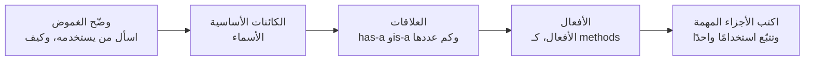

# تصميم الكائنات، Object-oriented design (الفصل 7)

اقرأ مقدمة **الفصل 7، Object-oriented design**. هذه الأسئلة تطلب منك تصميم الـ classes لنظام من الواقع: موقف سيارات،
مجموعة أوراق لعب، تطبيق محادثة، مكتبة أونلاين. لا توجد إجابة صحيحة واحدة. يريد المقابِلون أن يروك توضّح طلبًا غامضًا،
وتجد الكائنات الرئيسية، وتعطي كل واحد منها مهمة واضحة.

## طريقة لأسئلة التصميم



1. **اسأل أولًا.** "صمّم موقف سيارات": طابق واحد أم أكثر؟ أي أحجام للمركبات؟ هل يأخذ مدفوعات؟ اكتب الإجابات كمتطلبات.
2. **أوجد الكائنات الأساسية**، وهي غالبًا الأسماء: الموقف، الطابق، المكان، المركبة، التذكرة.
3. **العلاقات**: الموقف *يحتوي* طوابق، والطابق *يحتوي* أماكن؛ والسيارة *هي* مركبة. فضّل الاحتواء (composition) على
   الوراثة إلا إذا كانت علاقة "هو" حقيقية.
4. **الأفعال**، وهي غالبًا الأفعال اللغوية: يركن، يغادر، يجد مكانًا فارغًا. ضع كل فعل على الكائن الذي يملك البيانات التي
   يحتاجها.
5. **اكتب الأجزاء المهمة** وتتبّع استخدامًا حقيقيًا واحدًا، مثل سيارة تصل ثم تغادر.

## موقف سيارات صغير

المتطلبات التي اتفقنا عليها: موقف واحد، وأماكن بثلاثة أحجام؛ المركبة تدخل مكانًا بحجمها أو أكبر؛ الركن يُرجع تذكرة؛
والمغادرة تُخلي المكان.

```python
from enum import IntEnum

class Size(IntEnum):
    SMALL = 1
    MEDIUM = 2
    LARGE = 3

class Vehicle:
    size = Size.MEDIUM
    def __init__(self, plate):
        self.plate = plate

class Motorbike(Vehicle):
    size = Size.SMALL

class Car(Vehicle):
    size = Size.MEDIUM

class Bus(Vehicle):
    size = Size.LARGE

class Spot:
    def __init__(self, number, size):
        self.number, self.size, self.vehicle = number, size, None
    def fits(self, vehicle):
        return self.vehicle is None and vehicle.size <= self.size

class ParkingLot:
    def __init__(self, sizes):
        self.spots = [Spot(i, s) for i, s in enumerate(sizes)]
        self.tickets = {}                                   # ticket number -> spot
        self.next_ticket = 1
    def park(self, vehicle):
        candidates = [s for s in self.spots if s.fits(vehicle)]
        if not candidates:
            return None
        spot = min(candidates, key=lambda s: s.size)        # use the smallest spot that fits
        spot.vehicle = vehicle
        ticket, self.next_ticket = self.next_ticket, self.next_ticket + 1
        self.tickets[ticket] = spot
        return ticket
    def leave(self, ticket):
        spot = self.tickets.pop(ticket)
        vehicle, spot.vehicle = spot.vehicle, None
        return vehicle.plate
    def free(self):
        return sum(s.vehicle is None for s in self.spots)

lot = ParkingLot([Size.SMALL, Size.MEDIUM, Size.MEDIUM, Size.LARGE])
t1 = lot.park(Motorbike("M-1"))
t2 = lot.park(Bus("B-7"))
t3 = lot.park(Car("C-3"))
print("tickets:", t1, t2, t3, "| free spots:", lot.free())
print("a second bus gets:", lot.park(Bus("B-8")))
print("left:", lot.leave(t2), "| free spots:", lot.free())
```

```output
tickets: 1 2 3 | free spots: 1
a second bus gets: None
left: B-7 | free spots: 2
```

أشياء تشير إليها وأنت تكتب الكود: لكل class مهمة واحدة؛ `Spot.fits` تُبقي قاعدة الحجم في مكان واحد؛ واختيار أصغر مكان
مناسب يُبقي الأماكن الكبيرة فارغة للحافلات. ثم قل ماذا ستضيف بعد ذلك (طوابق، مدفوعات، طريقة أسرع لإيجاد مكان فارغ بدل
المرور على كل الأماكن) وكيف يجعل التصميم ذلك سهلًا.

## أنماط تصميم تستحق أن تسمّيها

لا تحتاج الكثير. اثنان يظهران كثيرًا:

- **Singleton**: نسخة واحدة فقط موجودة (موقف واحد، كائن إعدادات واحد). استخدمه بحذر، لأنه يعمل كمتغير عام ويجعل
  الاختبار أصعب.
- **Factory**: method تقرر أي class تنشئ (`make_vehicle("bus", plate)`)، فلا يحتاج من يستدعيها أن يعرف كل الـ classes.

## تدرّب

حلّ سؤالين من أسئلة التصميم في الفصل على الورق، بالطريقة بالأعلى. ثم هذين، وهما صغيران بما يكفي لتكتبهما كاملين:

| المسألة | الفكرة |
|---|---|
| [Design Parking System](https://leetcode.com/problems/design-parking-system/) | مثال اليوم، مبسّطًا |
| [LRU Cache](https://leetcode.com/problems/lru-cache/) | dictionary مع قائمة تحفظ الترتيب (أو `OrderedDict`) |

## الخلاصة

- وضّح المتطلبات قبل التصميم.
- الأسماء تصبح classes، والأفعال تصبح methods؛ وأعطِ كل class مهمة واحدة واضحة.
- اكتب الأجزاء المهمة، وتتبّع استخدامًا حقيقيًا واحدًا، واشرح كيف سيكبر التصميم.
