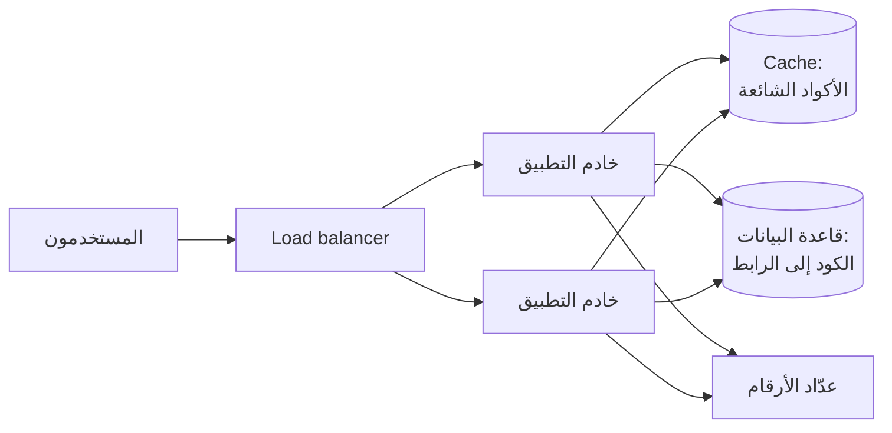

# تصميم الأنظمة والقابلية للتوسع (الفصل 9)

اقرأ مقدمة **الفصل 9، System design and scalability**. هذه الأسئلة تطلب منك تصميم شيء كبير: مُقصّر روابط، أو news feed،
أو web crawler. يحصل المبتدئون على نسخ أبسط؛ ويُحكم على أصحاب الخبرة بها كثيرًا. وكما في تصميم الكائنات، لا توجد إجابة صحيحة
واحدة. يراقب المقابِل كيف تتخذ المقايضات وتشرحها.

## طريقة

1. **حدّد نطاق المسألة.** ماذا يجب أن يفعل؟ من يستخدمه؟ ماذا يمكن أن نتركه؟
2. **افترض افتراضات معقولة، بالأرقام.** كم مستخدمًا، وكم طلبًا في الثانية، وكم بيانات؟
3. **ارسم الأجزاء الرئيسية.** العملاء، الخوادم، قواعد البيانات، الـ caches.
4. **أوجد المشكلات الأساسية.** ما الذي ينكسر أولًا حين يكبر؟ أين البطء؟
5. **أعد التصميم لتلك المشكلات**، واشرح تكلفة كل تغيير.

## أحجار البناء

| الحجر | ماذا يفعل | المقايضة |
|---|---|---|
| Load balancer | يوزّع الطلبات على عدة خوادم | جزء آخر يجب تشغيله |
| التوسع الأفقي | أجهزة أكثر بدل جهاز واحد أكبر | يجب ألا تحتفظ الخوادم بحالة المستخدم محليًا |
| Cache (مثل Redis) | يحفظ الإجابات الشائعة في الذاكرة | قد تكون البيانات قديمة؛ والذاكرة محدودة |
| نسخ قاعدة البيانات (replicas) | نسخ للقراءة | قد تتأخر النسخ عن الأصل |
| Sharding | يقسم البيانات على قواعد بيانات بمفتاح | الاستعلامات عبر الأجزاء تصعب |
| Queue | يسمح للعمل البطيء أن يتم لاحقًا في الخلفية | النتيجة ليست فورية |
| CDN | يقدّم الملفات من خوادم قريبة من المستخدم | غالبًا للمحتوى الثابت |

## مثال محلول: مُقصّر روابط

**النطاق**: حوّل رابطًا طويلًا إلى قصير، ووجّه الزوار. اترك الحسابات والإحصاءات الآن.

**الأرقام** (مفترضة): 100 مليون رابط جديد في الشهر، نحو 40 في الثانية؛ والقراءات أكثر بكثير من الكتابات، لنقل 100 إلى
1. كل رابط نحو 500 بايت، فـ 100 مليون رابط في الشهر نحو 50 GB شهريًا: بضعة تيرابايت على مدى عدة سنوات.

**الأكواد القصيرة**: 7 حروف من `a-z` و`A-Z` و`0-9` تعطي 62⁷، أي نحو 3.5 تريليون كود: أكثر من كافٍ. طريقة بسيطة: أعطِ كل
رابط جديد رقمًا من عدّاد، واكتب هذا الرقم بالأساس 62.

```python
ALPHABET = "0123456789abcdefghijklmnopqrstuvwxyzABCDEFGHIJKLMNOPQRSTUVWXYZ"

def encode(n):
    code = ""
    while n:
        n, r = divmod(n, 62)
        code = ALPHABET[r] + code
    return code or "0"

def decode(code):
    n = 0
    for ch in code:
        n = n * 62 + ALPHABET.index(ch)
    return n

for n in [1, 61, 62, 125_000_000_000]:
    print(f"{n:>15,d} -> {encode(n):>7s} -> {decode(encode(n)):,d}")
print(f"7 characters give {62 ** 7:,d} codes")
```

```output
              1 ->       1 -> 1
             61 ->       Z -> 61
             62 ->      10 -> 62
125,000,000,000 -> 2crtgcg -> 125,000,000,000
7 characters give 3,521,614,606,208 codes
```

**التصميم**:



**المشكلات الأساسية وحلولها**: القراءات هي الغالبة، فضع cache أمام قاعدة البيانات (نسبة صغيرة من الروابط تأخذ أغلب
الزيارات). ويجب ألا يعطي العدّاد الرقم نفسه مرتين عبر الخوادم: يمكن أن يحجز كل خادم مجموعة أرقام في كل مرة. وإذا كبرت
البيانات على قاعدة بيانات واحدة، قسّمها (shard) بالكود.

## ما يستمع إليه المقابِلون

- تسأل قبل أن تصمم، وتكتب افتراضاتك.
- تستخدم الأرقام لتقرر، لا للزينة.
- تسمّي مقايضة كل اختيار ("الـ cache يجعل القراءة سريعة، لكن الرابط الذي تغيّر قد يبقى قديمًا لدقيقة").
- لا تقفز إلى تصميم ضخم. ابدأ بسيطًا، ثم كبّره حيث تقول الأرقام إنك مضطر.

## تدرّب

صمّم نظامين من الفصل على الورق، بالأرقام ورسم والمقايضات. ثم اكتب النواة الصغيرة لأحدهما:

| المسألة | الفكرة |
|---|---|
| [Encode and Decode TinyURL](https://leetcode.com/problems/encode-and-decode-tinyurl/) | أكواد اليوم القصيرة |

## الخلاصة

- حدّد النطاق، افترض أرقامًا، ارسم الأجزاء، أوجد الاختناقات، وأعد التصميم لها.
- اعرف أحجار البناء (load balancers وcaches وreplicas وsharding وqueues) وتكلفة كل منها.
- ابدأ بسيطًا، واشرح كل مقايضة بصوت عالٍ.
