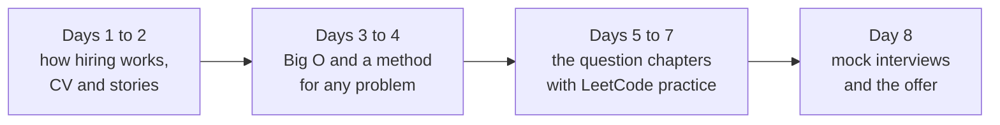

# Start here: how this course gets you hired

This course walks you through the whole software engineering hiring process, from your first application to signing an
offer. It follows **Cracking the Coding Interview** (6th edition) by Gayle Laakmann McDowell, the book most engineers
use to prepare. Each Read lesson, and each chapter lesson, opens the right pages of your copy of the book. The other lessons explain the ideas, show
working Python code, and give you LeetCode problems to practise the same skills.

You don't need any experience with interviews. You do need to be able to write simple programs in one language:
loops, functions, lists and dictionaries. The code here is Python, but you can practise in any language.

## The book is not included

You need your own copy of the book (the 6th edition PDF has 708 pages). The course opens the part or chapter to read, and explains the ideas in its
own words. It never copies the book's questions or solutions.

## The plan

| Day | What you do | Book |
|---|---|---|
| 1 | How tech companies hire and how you're judged | Parts I to III |
| 2 | Experience, your CV, behavioral questions | Parts IV and V |
| 3 | Big O, with code that counts the work | Part VI |
| 4 | A method for any technical question | Part VII |
| 5 | Arrays, strings, linked lists, stacks, queues, trees, graphs | Chapters 1 to 4 |
| 6 | Bits, maths, recursion, dynamic programming, sorting, searching | Chapters 5, 6, 8, 10 |
| 7 | Object-oriented design, system design, testing, databases, threads | Chapters 7, 9, 11, 14, 15 |
| 8 | Mock interviews, offers and negotiation | Part VIII |

Each day takes about an hour to read and learn, and the practice takes as long as you give it. Most people who get
hired practise for **weeks** after a course like this, a few problems a day. Day 8 gives you a plan for that.

## How to practise

1. Read the book part for the day, with the lesson next to you.
2. Run the lesson's code and change it. Code you've broken and fixed is code you understand.
3. Solve the LeetCode problems **out loud**, as if someone were listening. Interviews test how you think as much as
   whether you finish.
4. When you're stuck for 20 minutes, read a hint (the book has a hints section), not the full answer. Then try again.
5. Keep a log: problem, how long it took, what you missed. You'll see your weak spots after a week.

## What to take away

- The course follows the book part by part, and links practice problems for each chapter.
- The goal is not to memorize answers, but to get good at solving problems you haven't seen while explaining your
  thinking.
