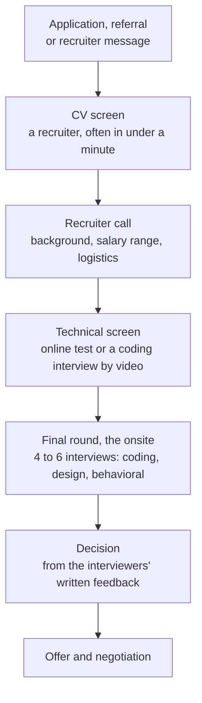

# The hiring loop, and what interviewers judge

Every software engineering hire goes through the same funnel. Knowing each step tells you what to prepare, and where
most people drop out.

## What each step tests

| Step | What they check | How you prepare |
|---|---|---|
| CV screen | Relevant experience and projects, clear results | Day 2 |
| Recruiter call | Motivation, communication, salary range | Your story, a researched range |
| Technical screen | Can you code a medium problem correctly in time? | Days 3 to 6, LeetCode practice |
| Coding interviews | Problem solving, code quality, communication | Days 3 to 6 |
| Design interview | Can you plan a larger system or set of classes? | Day 7 |
| Behavioral interview | Ownership, teamwork, handling conflict and failure | Day 2 |
| Offer | What you're worth, and whether to accept | Day 8 |

## The four things a coding interviewer writes down

After a coding interview, the interviewer writes feedback. It usually covers four things, and you can show each one on
purpose:

1. **Problem solving.** Did you understand the problem, ask useful questions, and find a good approach? Show it by
   talking through examples and options before coding.
2. **Coding.** Is the code correct, clear and well organized? Show it with good names, small helper functions, and
   handling the edge cases.
3. **Verification.** Did you test your own code and find your own bugs? Show it by walking through an example by hand
   when you finish.
4. **Communication.** Could the interviewer follow your thinking, and did you use their hints? Show it by thinking out
   loud, and by taking hints well.

A candidate who reaches a good solution silently often scores **lower** than one who reaches the same solution while
explaining each step, because the interviewer has nothing to write in three of the four boxes.

## Why people fail

- They start coding before understanding the problem, and solve the wrong one.
- They go silent when stuck. The interviewer can't help someone whose thinking they can't see.
- They never test their code, and leave bugs the interviewer then has to point out.
- They prepared only by reading solutions. Reading an answer feels like understanding it; producing one under time
  pressure is a different skill.

## What to take away

- The loop is: CV screen, recruiter call, technical screen, final interviews, decision, offer.
- Coding interviews are judged on problem solving, coding, verification and communication, not just the final answer.
- Thinking out loud is a skill. Practise it from your first LeetCode problem.
