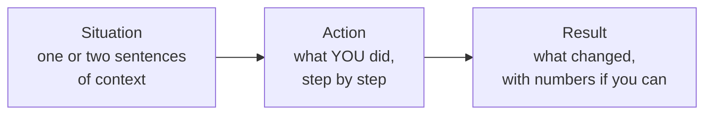

# Behavioral questions: your stories, ready before the interview (Part V)

Read **Part V** of the book: *Interview preparation grid*, *Know your technical projects*, *Responding to behavioral
questions* and *So, tell me about yourself*. Then use this lesson to prepare your own answers.

Behavioral questions ask about your past: "Tell me about a time you disagreed with a teammate", "What's the hardest
bug you've fixed?", "Why do you want to work here?". The interviewer wants evidence of how you work. Good preparation
turns these from the scariest questions into the easiest.

## Step 1: build your grid

Make a table. Put your 3 to 5 main projects or jobs across the top, and common question themes down the side. Fill
each cell with a few words that remind you of a real story.

| Theme | Project A | Project B | Job C |
|---|---|---|---|
| Hardest challenge | | | |
| A mistake or failure | | | |
| What you enjoyed most | | | |
| Leading or influencing others | | | |
| A conflict or disagreement | | | |
| What you'd do differently | | | |

You won't fill every cell. Five to eight solid stories cover almost any question, because one story can answer several
themes.

## Step 2: tell each story with a clear structure

The book gives two structures you can combine: **nugget first** (open with one sentence saying what the story is
about) and **S.A.R.** (situation, action, result):

- **Lead with the point.** Start with one sentence that summarizes the story, so the listener knows where it's going.
- **Spend most of the time on your actions.** Say "I", not "we": the interviewer is hiring you, not your team.
- **End with the result**, and what you learned.
- **Keep it to about two minutes.** The interviewer will ask for more if they want it.

Example: *"I found and fixed a memory leak that was crashing our app every few days. The crash reports pointed to the
image screen, so I profiled it and saw that every image we showed stayed in memory. I added a cache with a size limit
and wrote a test that opened 500 images. The crashes stopped, and memory use fell by 70%."*

## Step 3: know your technical projects deeply

For your two best projects, be ready to answer:

- What was the hardest technical problem, and how did you solve it?
- What were the alternatives, and why did you choose your approach?
- What would you change if you started again?
- How would it handle ten times more users or data?

## Step 4: "Tell me about yourself"

This is usually the first question, so prepare it word for word, then practise until it sounds natural. A good shape,
about one minute: what you do now, one or two highlights from before, and what you want next (which should match the
job).

## Weaknesses and failures

Choose a real weakness or failure, not a hidden strength ("I work too hard"). Then show what you did about it. Owning a
mistake well shows maturity.

## Questions to ask them

Most interviewers leave time for your questions, and good questions count. The book suggests three kinds:

- **Genuine**: what you really want to know ("What has been most challenging for you here?").
- **Insightful**: questions that show you researched the company and its technology.
- **Passion**: questions that show you want to learn ("What chances are there to learn about scalability here?").

Prepare two or three of each before the interview.

## What to take away

- Prepare 5 to 8 real stories in a grid before any interview.
- Tell them as situation, action, result, leading with the point and focusing on what you did.
- Know your best projects deeply, and prepare "tell me about yourself" word for word.
