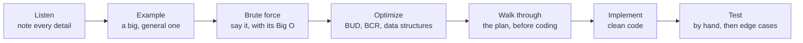

# Build: one problem, from brute force to the best solution

Today you watch the method work on one problem, step by step, the way you'd do it with an interviewer watching. These are
the seven steps of the flowchart in the book's *Walking through a problem*:



## The problem

*Given a list of daily stock prices, find the most money you could make by buying on one day and selling on a later
day. If no profit is possible, return 0.*

### Listen

Details that matter: you must buy **before** you sell; only **one** buy and one sell; the answer is 0 if prices only
fall. Ask questions: can the list be empty? (Say yes, and return 0.) Can prices be decimals? (It doesn't change the
method.)

### Example

Make one that is big enough to be general, not a special case: `[7, 1, 5, 3, 6, 4]`. By hand: buy at 1, sell at 6,
profit 5. Selling at 7 isn't allowed, because 7 comes before 1.

### Brute force

Try every pair (buy day, sell day) with buy before sell. That's O(n²) time, O(1) space. Say it out loud even if you know
it's slow: it proves you understand the problem, and it gives you something to improve.

```python
def max_profit_brute(prices):
    best = 0
    for buy in range(len(prices)):
        for sell in range(buy + 1, len(prices)):
            best = max(best, prices[sell] - prices[buy])
    return best

print(max_profit_brute([7, 1, 5, 3, 6, 4]))
```

```output
5
```

### Optimize

**BCR**: we must look at every price at least once, so nothing beats O(n). Is O(n) possible?

**Unnecessary work** (the U in BUD): for each sell day, the brute force tries every earlier buy day. But we only ever
need the **cheapest** earlier day. If we remember the lowest price so far as we walk through the list, each sell day
takes one step.

### Walk through

Before coding, check the plan on the example: walk left to right, keeping `lowest` and `best`.

| price | 7 | 1 | 5 | 3 | 6 | 4 |
|---|---|---|---|---|---|---|
| lowest so far | 7 | 1 | 1 | 1 | 1 | 1 |
| profit if sold today | 0 | 0 | 4 | 2 | 5 | 3 |
| best | 0 | 0 | 4 | 4 | 5 | 5 |

### Implement

```python
def max_profit(prices):
    lowest = float("inf")
    best = 0
    for price in prices:
        lowest = min(lowest, price)          # the cheapest day to have bought, up to today
        best = max(best, price - lowest)     # the profit if we sold today
    return best

print(max_profit([7, 1, 5, 3, 6, 4]))
```

```output
5
```

O(n) time, O(1) space: it meets the BCR, so we can stop optimizing.

### Test

First by hand on the example (the table above). Then edge cases, and compare with the brute force on random lists. A
brute force you already trust is a free way to test a faster solution.

```python
import random

cases = {"empty": [], "one day": [5], "only falling": [9, 7, 4, 1], "flat": [3, 3, 3], "rise at the end": [5, 4, 3, 10]}
for name, prices in cases.items():
    print(f"{name:16s} {max_profit(prices)}")

rng = random.Random(0)
for _ in range(1000):
    prices = [rng.randint(1, 50) for _ in range(rng.randint(0, 30))]
    assert max_profit(prices) == max_profit_brute(prices)
print("1000 random lists: fast and brute force agree")
```

```output
empty            0
one day          0
only falling     0
flat             0
rise at the end  7
1000 random lists: fast and brute force agree
```

## What you would say out loud

A short version of the talking, in the order you'd say it: "Let me check: one buy, then one sell later, return 0 if
there's no profit. My example gives 5. The simple way is every pair, O(n²). Since every price must be read, the best
possible is O(n). For each day I only need the cheapest earlier price, so I'll keep a running minimum. That's O(n) time
and O(1) space. Let me walk through my example before I code it."

## What to take away

- Follow the flow: listen, example, brute force, optimize, walk through, implement, test.
- State the brute force and its Big O first, then use BCR and BUD to improve it.
- Test with a hand walk-through, edge cases, and a comparison against the brute force.
