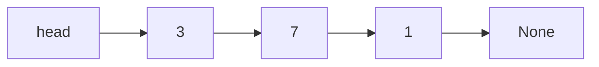

# Linked lists, stacks and queues (chapters 2 and 3)

Read the introductions of **chapter 2, Linked lists**, and **chapter 3, Stacks and queues**. These structures are simple,
but interview questions on them test careful pointer work and edge cases.

## Linked lists

A linked list is a chain of nodes, each holding a value and a pointer to the next node. Adding or removing at the front
is O(1); finding the k-th item is O(k), because you must walk there.



```python
class Node:
    def __init__(self, val, next=None):
        self.val, self.next = val, next

def build(values):
    head = None
    for v in reversed(values):
        head = Node(v, head)
    return head

def to_list(head):
    out = []
    while head:
        out.append(head.val); head = head.next
    return out

def reverse(head):
    prev = None
    while head:
        head.next, prev, head = prev, head, head.next    # point back, then step forward
    return prev

print(to_list(reverse(build([3, 7, 1, 9]))))
```

```output
[9, 1, 7, 3]
```

### The runner technique

Two pointers moving at different speeds solve many list questions in one pass with O(1) memory. A **slow** pointer moves
one step, a **fast** one two steps:

- when fast reaches the end, slow is in the **middle**;
- if the list has a **cycle**, fast eventually catches up with slow.

```python
def middle(head):
    slow = fast = head
    while fast and fast.next:
        slow, fast = slow.next, fast.next.next
    return slow.val

def has_cycle(head):
    slow = fast = head
    while fast and fast.next:
        slow, fast = slow.next, fast.next.next
        if slow is fast:
            return True
    return False

head = build([1, 2, 3, 4, 5])
print("middle:", middle(head), "| cycle:", has_cycle(head))
head.next.next.next.next.next = head.next          # make the last node point back to the second
print("cycle after linking the end back:", has_cycle(head))
```

```output
middle: 3 | cycle: False
cycle after linking the end back: True
```

Linked list tips: draw the nodes on paper, and check the empty list, a one-node list, and changes at the head. A
**dummy** node in front of the head often removes special cases.

## Stacks and queues

A **stack** is last in, first out (like plates). A **queue** is first in, first out (like a line at a shop). In Python,
a list works as a stack (`append`, `pop`), and `collections.deque` works as a queue (`append`, `popleft`).

A classic stack question: a stack that also returns its minimum in O(1). Store, with each item, the minimum so far.

```python
class MinStack:
    def __init__(self):
        self.items = []                         # pairs: (value, minimum of the stack up to here)
    def push(self, x):
        low = min(x, self.items[-1][1]) if self.items else x
        self.items.append((x, low))
    def pop(self):
        return self.items.pop()[0]
    def min(self):
        return self.items[-1][1]

s = MinStack()
for x in [5, 3, 8, 1]:
    s.push(x)
print("min:", s.min()); s.pop(); print("after one pop, min:", s.min())
```

```output
min: 1
after one pop, min: 3
```

Stacks also check brackets: push each opening bracket, and every closing bracket must match the top.

```python
def balanced(text):
    pairs, stack = {")": "(", "]": "[", "}": "{"}, []
    for ch in text:
        if ch in "([{":
            stack.append(ch)
        elif ch in pairs:
            if not stack or stack.pop() != pairs[ch]:
                return False
    return not stack

print([balanced(t) for t in ["(a[b]{c})", "(]", "((", "{[()()]}"]])
```

```output
[True, False, False, True]
```

## Practise

Do the chapters' questions from the book, then these:

| Problem | Idea |
|---|---|
| [Reverse Linked List](https://leetcode.com/problems/reverse-linked-list/) | Three pointers |
| [Remove Nth Node From End of List](https://leetcode.com/problems/remove-nth-node-from-end-of-list/) | Two pointers n apart, and a dummy node |
| [Add Two Numbers](https://leetcode.com/problems/add-two-numbers/) | Walk two lists with a carry |
| [Intersection of Two Linked Lists](https://leetcode.com/problems/intersection-of-two-linked-lists/) | Compare lengths, or switch heads |
| [Linked List Cycle II](https://leetcode.com/problems/linked-list-cycle-ii/) | The runner technique, then find the start |
| [Valid Parentheses](https://leetcode.com/problems/valid-parentheses/) | A stack of open brackets |
| [Min Stack](https://leetcode.com/problems/min-stack/) | Keep the minimum with each item |
| [Evaluate Reverse Polish Notation](https://leetcode.com/problems/evaluate-reverse-polish-notation/) | A stack of numbers |
| [Daily Temperatures](https://leetcode.com/problems/daily-temperatures/) | A stack of days still waiting for a warmer one |

## What to take away

- Linked lists: draw them, use a dummy head, and check empty and one-node lists.
- Slow and fast pointers find the middle and detect cycles with O(1) memory.
- Stacks are last in, first out; they solve "most recent unmatched thing" problems like brackets.
