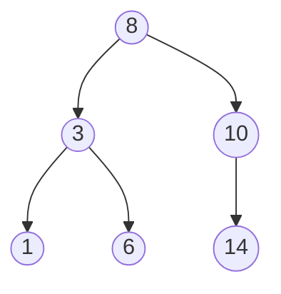

# Trees and graphs (chapter 4)

Read the introduction of **chapter 4, Trees and graphs**. Its questions are some of the most common in interviews, and
they almost all come down to two ways of visiting nodes: depth-first and breadth-first.

## Trees

A **binary tree** is a set of nodes where each node has at most two children, left and right. A **binary search tree**
(BST) adds a rule: everything in the left subtree is smaller than the node, everything in the right subtree is larger.
A tree is **balanced** when no branch is much deeper than another; then its height is about log n.



```python
class TreeNode:
    def __init__(self, val, left=None, right=None):
        self.val, self.left, self.right = val, left, right

def from_sorted(values):
    """A balanced BST from a sorted list: the middle value becomes the root, recursively."""
    if not values:
        return None
    mid = len(values) // 2
    return TreeNode(values[mid], from_sorted(values[:mid]), from_sorted(values[mid + 1:]))

def in_order(node):
    """Left, node, right: a BST comes out sorted."""
    return in_order(node.left) + [node.val] + in_order(node.right) if node else []

def height(node):
    return 1 + max(height(node.left), height(node.right)) if node else 0

root = from_sorted([1, 3, 6, 8, 10, 14, 15])
print("in order:", in_order(root), "| root:", root.val, "| height:", height(root))
```

```output
in order: [1, 3, 6, 8, 10, 14, 15] | root: 8 | height: 3
```

Seven values give a tree of height 3, because a balanced tree doubles its width at each level.

### Is it a valid BST?

A common mistake is to check only each node against its two children. The rule is about **whole subtrees**, so pass down
the range each node must fall in.

```python
def is_bst(node, low=float("-inf"), high=float("inf")):
    if not node:
        return True
    if not (low < node.val < high):
        return False
    return is_bst(node.left, low, node.val) and is_bst(node.right, node.val, high)

bad = TreeNode(8, TreeNode(3, None, TreeNode(9)), TreeNode(10))   # 9 sits left of 8: each parent-child pair looks fine
print(is_bst(root), is_bst(bad))
```

```output
True False
```

## Graphs

A graph is a set of nodes connected by edges, and a tree is a special kind of graph. In interviews, store a graph as an
**adjacency list**: a dictionary from each node to its neighbours.

- **Depth-first search (DFS)** goes as deep as it can before backing up. Use it to visit everything or explore all paths.
  Recursion or a stack.
- **Breadth-first search (BFS)** visits nodes in order of distance from the start. Use it for **shortest paths** when
  every edge has the same length. A queue.

Both are O(V + E): each node and each edge is handled once. Mark nodes as visited, or a cycle will loop forever.

```python
from collections import deque

graph = {"A": ["B", "C"], "B": ["D"], "C": ["D", "E"], "D": ["F"], "E": ["F"], "F": []}

def bfs_path(graph, start, goal):
    queue, came_from = deque([start]), {start: None}
    while queue:
        node = queue.popleft()
        if node == goal:
            path = []
            while node:
                path.append(node); node = came_from[node]
            return path[::-1]
        for nxt in graph[node]:
            if nxt not in came_from:            # visited check
                came_from[nxt] = node
                queue.append(nxt)
    return None

def dfs_order(graph, node, seen=None):
    seen = seen if seen is not None else []
    seen.append(node)
    for nxt in graph[node]:
        if nxt not in seen:
            dfs_order(graph, nxt, seen)
    return seen

print("shortest path A to F:", bfs_path(graph, "A", "F"))
print("DFS visiting order:  ", dfs_order(graph, "A"))
```

```output
shortest path A to F: ['A', 'B', 'D', 'F']
DFS visiting order:   ['A', 'B', 'D', 'F', 'C', 'E']
```

### Order with dependencies: topological sort

When some tasks must come before others ("build order", course prerequisites), repeatedly take a task with no remaining
prerequisites. If you get stuck before every task is placed, there's a cycle and no order exists.

```python
def build_order(tasks, deps):
    """deps: (before, after) pairs. Returns an order, or None if there is a cycle."""
    after = {t: [] for t in tasks}
    waiting = {t: 0 for t in tasks}             # how many prerequisites each task still waits for
    for a, b in deps:
        after[a].append(b); waiting[b] += 1
    ready = deque(t for t in tasks if waiting[t] == 0)
    order = []
    while ready:
        t = ready.popleft(); order.append(t)
        for nxt in after[t]:
            waiting[nxt] -= 1
            if waiting[nxt] == 0:
                ready.append(nxt)
    return order if len(order) == len(tasks) else None

print(build_order(list("abcdef"), [("a", "d"), ("f", "b"), ("b", "d"), ("f", "a"), ("d", "c")]))
print(build_order(list("abc"), [("a", "b"), ("b", "c"), ("c", "a")]))
```

```output
['e', 'f', 'b', 'a', 'd', 'c']
None
```

## Practise

Do the chapter's questions from the book, then these:

| Problem | Idea |
|---|---|
| [Maximum Depth of Binary Tree](https://leetcode.com/problems/maximum-depth-of-binary-tree/) | Recursion on left and right |
| [Balanced Binary Tree](https://leetcode.com/problems/balanced-binary-tree/) | Return the height, or a signal that it's unbalanced |
| [Convert Sorted Array to Binary Search Tree](https://leetcode.com/problems/convert-sorted-array-to-binary-search-tree/) | Middle element as root |
| [Binary Tree Level Order Traversal](https://leetcode.com/problems/binary-tree-level-order-traversal/) | BFS, one level at a time |
| [Validate Binary Search Tree](https://leetcode.com/problems/validate-binary-search-tree/) | Pass down the allowed range |
| [Lowest Common Ancestor of a Binary Tree](https://leetcode.com/problems/lowest-common-ancestor-of-a-binary-tree/) | Ask each subtree what it found |
| [Subtree of Another Tree](https://leetcode.com/problems/subtree-of-another-tree/) | Compare trees recursively |
| [Number of Islands](https://leetcode.com/problems/number-of-islands/) | DFS or BFS on a grid |
| [Course Schedule II](https://leetcode.com/problems/course-schedule-ii/) | Topological sort |

## What to take away

- In a BST, in-order traversal is sorted, and validity is about ranges, not just parent and child.
- DFS explores deeply (recursion or a stack); BFS finds shortest paths in unweighted graphs (a queue).
- Always track visited nodes in a graph; topological sort orders tasks with dependencies.
