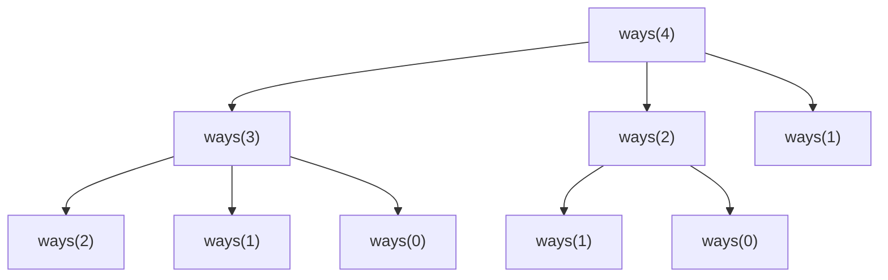

# Recursion and dynamic programming (chapter 8)

Read the introduction of **chapter 8, Recursion and dynamic programming**. Many people find this the hardest chapter.
The good news: most of its questions follow a few patterns, and once you can write the recursion, the dynamic
programming version is a small step.

## How to think recursively

Assume the function already works for smaller inputs. Then ask: how do I build the answer for n from the answers for
smaller cases? And what's the smallest case, where I can answer directly (the base case)?

Example: a child climbs n stairs, taking 1, 2 or 3 steps at a time. How many ways are there? The last move was 1, 2 or
3 steps, so: ways(n) = ways(n − 1) + ways(n − 2) + ways(n − 3), with ways(0) = 1 (standing at the bottom is one way).



`ways(2)` appears twice already, and for bigger n the repeats explode. That's the signal for dynamic programming.

## Three versions of the same solution

```python
from functools import lru_cache

calls = 0
def ways_plain(n):
    global calls
    calls += 1
    if n < 0:
        return 0
    if n == 0:
        return 1
    return ways_plain(n - 1) + ways_plain(n - 2) + ways_plain(n - 3)

@lru_cache(maxsize=None)              # top-down DP (memoization): remember every answer
def ways_memo(n):
    if n < 0:
        return 0
    if n == 0:
        return 1
    return ways_memo(n - 1) + ways_memo(n - 2) + ways_memo(n - 3)

def ways_table(n):                    # bottom-up DP: fill a table from the smallest case
    table = [1] + [0] * n
    for i in range(1, n + 1):
        table[i] = sum(table[i - k] for k in (1, 2, 3) if i - k >= 0)
    return table[n]

for n in [5, 10, 20]:
    calls = 0
    print(f"n = {n:2d}: {ways_plain(n):7,d} ways, {calls:9,d} calls without memory;"
          f" memo {ways_memo(n):,d}; table {ways_table(n):,d}")
```

```output
n =  5:      13 ways,        46 calls without memory; memo 13; table 13
n = 10:     274 ways,       979 calls without memory; memo 274; table 274
n = 20: 121,415 ways,   433,993 calls without memory; memo 121,415; table 121,415
```

All three give the same answers. Without memory, the calls grow exponentially; with memoization or a table, the work is
O(n). Say this progression in an interview: "Here's the recursion. It repeats work, so I'll memoize it, which makes it
O(n). I can also build it bottom-up and keep only the last three values, for O(1) space."

## Backtracking: build every option

Some questions ask for **all** the answers: every subset, every ordering, every valid placement. Build a partial answer,
extend it one choice at a time, and undo the choice after exploring it.

```python
def subsets(items):
    result, current = [], []
    def explore(i):
        if i == len(items):
            result.append(current.copy()); return
        explore(i + 1)                       # leave items[i] out
        current.append(items[i])
        explore(i + 1)                       # put items[i] in
        current.pop()                        # undo the choice
    explore(0)
    return result

def permutations(items):
    if len(items) <= 1:
        return [items[:]]
    return [[items[i]] + rest for i in range(len(items)) for rest in permutations(items[:i] + items[i + 1:])]

print(subsets([1, 2, 3]))
print(permutations(["a", "b", "c"]))
```

```output
[[], [3], [2], [2, 3], [1], [1, 3], [1, 2], [1, 2, 3]]
[['a', 'b', 'c'], ['a', 'c', 'b'], ['b', 'a', 'c'], ['b', 'c', 'a'], ['c', 'a', 'b'], ['c', 'b', 'a']]
```

A set of n items has 2ⁿ subsets and n! orderings, so these answers are exponential by nature: no trick avoids writing
them all out.

## A grid DP

Counting paths in a grid is another classic. A robot moves only right or down, and some cells are blocked. The number of
ways to reach a cell is the ways to reach the cell above plus the ways to reach the cell to its left.

```python
def grid_paths(grid):
    rows, cols = len(grid), len(grid[0])
    ways = [[0] * cols for _ in range(rows)]
    for r in range(rows):
        for c in range(cols):
            if grid[r][c] == "#":
                continue                       # blocked: zero ways
            if r == 0 and c == 0:
                ways[r][c] = 1
            else:
                ways[r][c] = (ways[r - 1][c] if r else 0) + (ways[r][c - 1] if c else 0)
    return ways[-1][-1]

print(grid_paths(["...", "...", "..."]), grid_paths(["...", ".#.", "..."]))
```

```output
6 2
```

## Practise

Do the chapter's questions from the book, then these:

| Problem | Idea |
|---|---|
| [Climbing Stairs](https://leetcode.com/problems/climbing-stairs/) | The stairs recursion with 1 or 2 steps |
| [Unique Paths II](https://leetcode.com/problems/unique-paths-ii/) | The grid DP with blocked cells |
| [Subsets](https://leetcode.com/problems/subsets/) | Backtracking: in or out |
| [Permutations](https://leetcode.com/problems/permutations/) | Backtracking over choices |
| [Generate Parentheses](https://leetcode.com/problems/generate-parentheses/) | Backtracking with a rule |
| [Coin Change II](https://leetcode.com/problems/coin-change-ii/) | Count combinations, coin by coin |
| [N-Queens](https://leetcode.com/problems/n-queens/) | Backtracking with checks |

## What to take away

- Write the recursion first: the case for n from smaller cases, plus a base case.
- Repeated subproblems mean dynamic programming: memoize top-down, or fill a table bottom-up.
- Backtracking builds all answers by choosing, exploring and undoing.
