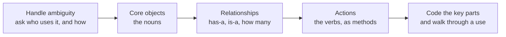

# Object-oriented design (chapter 7)

Read the introduction of **chapter 7, Object-oriented design**. These questions ask you to design the classes for a
real-world system: a parking lot, a deck of cards, a chat app, an online library. There's no single right answer.
Interviewers want to see you clear up a vague request, find the main objects, and give each a clear job.

## A method for design questions



1. **Ask questions first.** "Design a parking lot": one level or many? Which vehicle sizes? Does it take payments? Write
   down the answers as the requirements.
2. **Find the core objects**, usually the nouns: lot, level, spot, vehicle, ticket.
3. **Relationships**: a lot *has* levels, a level *has* spots; a car *is a* vehicle. Prefer having (composition) to
   inheriting unless the "is a" is real.
4. **Actions**, usually the verbs: park, leave, find a free spot. Put each one on the object that owns the data it needs.
5. **Code the important parts** and walk through one real use, like a car arriving and leaving.

## A small parking lot

Requirements we agreed on: one lot, spots of three sizes; a vehicle fits in a spot of its size or larger; parking returns
a ticket; leaving frees the spot.

```python
from enum import IntEnum

class Size(IntEnum):
    SMALL = 1
    MEDIUM = 2
    LARGE = 3

class Vehicle:
    size = Size.MEDIUM
    def __init__(self, plate):
        self.plate = plate

class Motorbike(Vehicle):
    size = Size.SMALL

class Car(Vehicle):
    size = Size.MEDIUM

class Bus(Vehicle):
    size = Size.LARGE

class Spot:
    def __init__(self, number, size):
        self.number, self.size, self.vehicle = number, size, None
    def fits(self, vehicle):
        return self.vehicle is None and vehicle.size <= self.size

class ParkingLot:
    def __init__(self, sizes):
        self.spots = [Spot(i, s) for i, s in enumerate(sizes)]
        self.tickets = {}                                   # ticket number -> spot
        self.next_ticket = 1
    def park(self, vehicle):
        candidates = [s for s in self.spots if s.fits(vehicle)]
        if not candidates:
            return None
        spot = min(candidates, key=lambda s: s.size)        # use the smallest spot that fits
        spot.vehicle = vehicle
        ticket, self.next_ticket = self.next_ticket, self.next_ticket + 1
        self.tickets[ticket] = spot
        return ticket
    def leave(self, ticket):
        spot = self.tickets.pop(ticket)
        vehicle, spot.vehicle = spot.vehicle, None
        return vehicle.plate
    def free(self):
        return sum(s.vehicle is None for s in self.spots)

lot = ParkingLot([Size.SMALL, Size.MEDIUM, Size.MEDIUM, Size.LARGE])
t1 = lot.park(Motorbike("M-1"))
t2 = lot.park(Bus("B-7"))
t3 = lot.park(Car("C-3"))
print("tickets:", t1, t2, t3, "| free spots:", lot.free())
print("a second bus gets:", lot.park(Bus("B-8")))
print("left:", lot.leave(t2), "| free spots:", lot.free())
```

```output
tickets: 1 2 3 | free spots: 1
a second bus gets: None
left: B-7 | free spots: 2
```

Things to point out while you code: each class has one job; `Spot.fits` keeps the size rule in one place; choosing the
smallest spot that fits keeps large spots free for buses. Then say what you'd add next (levels, payments, a faster way
to find a free spot than scanning every spot) and how the design makes that easy.

## Design patterns worth naming

You don't need many. Two come up often:

- **Singleton**: only one instance exists (one parking lot, one settings object). Use it sparingly, as it acts like a
  global variable and makes testing harder.
- **Factory**: a method that decides which class to create (`make_vehicle("bus", plate)`), so callers don't need to know
  every class.

## Practise

Do two of the chapter's design questions from the book on paper, using the method above. Then these, which are small
enough to code fully:

| Problem | Idea |
|---|---|
| [Design Parking System](https://leetcode.com/problems/design-parking-system/) | Today's example, simplified |
| [LRU Cache](https://leetcode.com/problems/lru-cache/) | A dictionary plus a list that keeps order (or `OrderedDict`) |

## What to take away

- Clear up the requirements before designing.
- Nouns become classes, verbs become methods; give each class one clear job.
- Code the key parts, walk through one real use, and explain how the design would grow.
