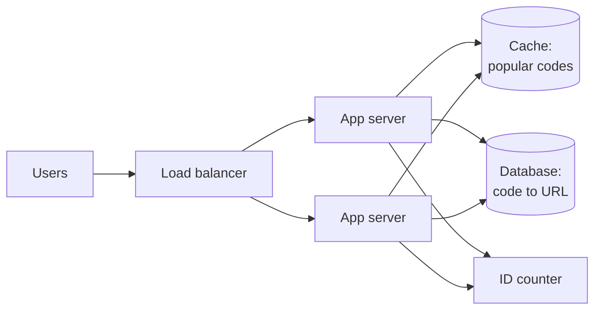

# System design and scalability (chapter 9)

Read the introduction of **chapter 9, System design and scalability**. These questions ask you to design something
large: a URL shortener, a news feed, a web crawler. Junior candidates get simpler versions; experienced candidates are
judged heavily on them. As with object-oriented design, there's no single right answer. The interviewer watches how you
make and explain trade-offs.

## A method

1. **Scope the problem.** What must it do? Who uses it? What can we leave out?
2. **Make reasonable assumptions, with numbers.** How many users, requests per second, and how much data?
3. **Draw the major parts.** Clients, servers, databases, caches.
4. **Find the key issues.** What breaks first as it grows? Where is it slow?
5. **Redesign for those issues**, and explain the cost of each change.

## The building blocks

| Block | What it does | Trade-off |
|---|---|---|
| Load balancer | Spreads requests over several servers | One more part to run |
| Horizontal scaling | More machines instead of one bigger one | Servers must not keep user state locally |
| Cache (for example Redis) | Keeps popular answers in memory | Data can be stale; memory is limited |
| Database replicas | Copies for reading | Copies can lag behind the main one |
| Sharding | Splits data across databases by a key | Queries across shards get hard |
| Queue | Lets slow work happen later, in the background | The result isn't immediate |
| CDN | Serves files from servers near the user | Mostly for static content |

## Worked example: a URL shortener

**Scope**: turn a long URL into a short one, and redirect visitors. Skip accounts and statistics for now.

**Numbers** (assumed): 100 million new links a month, about 40 per second; reads are much more common than writes,
say 100 to 1. Each link is about 500 bytes, so 100 million links a month is about 50 GB a month: a few terabytes over
several years.

**Short codes**: 7 characters from `a-z`, `A-Z`, `0-9` give 62⁷, about 3.5 trillion codes: plenty. One simple way is to
give each new link a number from a counter and write that number in base 62.

```python
ALPHABET = "0123456789abcdefghijklmnopqrstuvwxyzABCDEFGHIJKLMNOPQRSTUVWXYZ"

def encode(n):
    code = ""
    while n:
        n, r = divmod(n, 62)
        code = ALPHABET[r] + code
    return code or "0"

def decode(code):
    n = 0
    for ch in code:
        n = n * 62 + ALPHABET.index(ch)
    return n

for n in [1, 61, 62, 125_000_000_000]:
    print(f"{n:>15,d} -> {encode(n):>7s} -> {decode(encode(n)):,d}")
print(f"7 characters give {62 ** 7:,d} codes")
```

```output
              1 ->       1 -> 1
             61 ->       Z -> 61
             62 ->      10 -> 62
125,000,000,000 -> 2crtgcg -> 125,000,000,000
7 characters give 3,521,614,606,208 codes
```

**Design**:



**Key issues and fixes**: reads dominate, so put a cache in front of the database (a small share of links gets most of
the visits). The counter must never give the same number twice across servers: each server can reserve a block of
numbers at a time. If the data grows too big for one database, shard it by code.

## What interviewers listen for

- You ask before you design, and write your assumptions down.
- You use numbers to decide, not to decorate.
- You name the trade-off of each choice ("a cache makes reads fast, but a changed link could be stale for a minute").
- You don't jump to a huge design. Start simple, then grow it where the numbers say you must.

## Practise

Design two systems from the chapter on paper, with numbers, a diagram and the trade-offs. Then code the small core of
one:

| Problem | Idea |
|---|---|
| [Encode and Decode TinyURL](https://leetcode.com/problems/encode-and-decode-tinyurl/) | Today's short codes |

## What to take away

- Scope, assume numbers, draw the parts, find the bottlenecks, redesign for them.
- Know the building blocks (load balancers, caches, replicas, sharding, queues) and the cost of each.
- Start simple, and explain every trade-off out loud.
