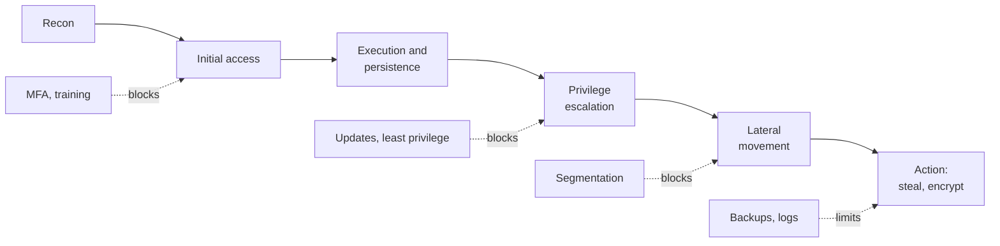

# How attacks really happen

Films show hackers typing fast. Real attacks are usually boring: someone clicks a link, reuses a password, or a server misses an update.

## Social engineering and phishing

**Phishing** tricks people into giving away passwords, codes or money, or running malware. It's how most breaches start.

Warning signs:
- **Urgency or fear**: "Your account will be closed in 2 hours."
- **A sender or link that's almost right**: `paypa1.com`, `micros0ft-support.com`, `instapay-eg.co`.
- **Requests that break the normal process**: "Send the one-time code you just received", "Pay this new account today".
- **Unexpected attachments**: `invoice.pdf.exe`, Office files asking you to "Enable content".

Defences:
- Check the real address by **hovering** over links; type known addresses yourself.
- Never share one-time codes. A real company never asks for them.
- Confirm money requests through **a second channel** (call the person on a number you already have).
- Report it. In a company, one report can warn everyone.

Variations: **smishing** (SMS), **vishing** (phone calls), fake job offers asking you to "install this tool", and fake support chats.

## Malware

| Type | What it does |
|---|---|
| Ransomware | Encrypts files and demands payment; often steals data first |
| Infostealer | Copies saved passwords, browser cookies and crypto wallets |
| Trojan | Looks useful (a cracked game, a "free" app) but hides malware |
| Worm | Spreads by itself across a network |
| Spyware / stalkerware | Watches what you do |

**Cracked software and pirated games** are a top source of infostealers. A stolen browser cookie can let an attacker into your account **without the password or MFA**.

## Password attacks

- **Credential stuffing**: leaked email/password pairs from one site are tried on thousands of others. It works because people reuse passwords.
- **Password spraying**: one common password (`Summer2025!`) tried against many accounts.
- **Brute force**: trying many guesses on one account (slowed down by lockouts and rate limits).

## Attacks on systems

- **Unpatched software**: published vulnerabilities get scanned for within hours or days.
- **Default and exposed services**: a database or admin panel open to the internet with its default password.
- **Misconfiguration**: a public cloud storage bucket, debug mode on in production.
- **Supply chain**: a compromised library or update (you'll meet this in web security).

## The attack chain

Most serious attacks follow steps. Breaking **any** step stops it:

1. **Reconnaissance**: find targets (emails, open services).
2. **Initial access**: phishing, stolen password, unpatched service.
3. **Execution and persistence**: run code, stay in after reboots.
4. **Privilege escalation**: become administrator.
5. **Lateral movement**: spread to other machines.
6. **Action**: steal data, encrypt files, demand ransom.

The **MITRE ATT&CK** framework (attack.mitre.org) lists the real techniques used at each step; defenders use it to check what they can detect.

## What actually stops most attacks

1. **MFA** on every important account (Day 2).
2. **Updates** turned on everywhere (Day 3).
3. **Unique passwords** in a password manager (Day 2).
4. **Backups** you've tested restoring (Day 3).
5. **People who know** what phishing looks like and feel safe reporting it.

Not glamorous, but these five prevent the large majority of real incidents.
