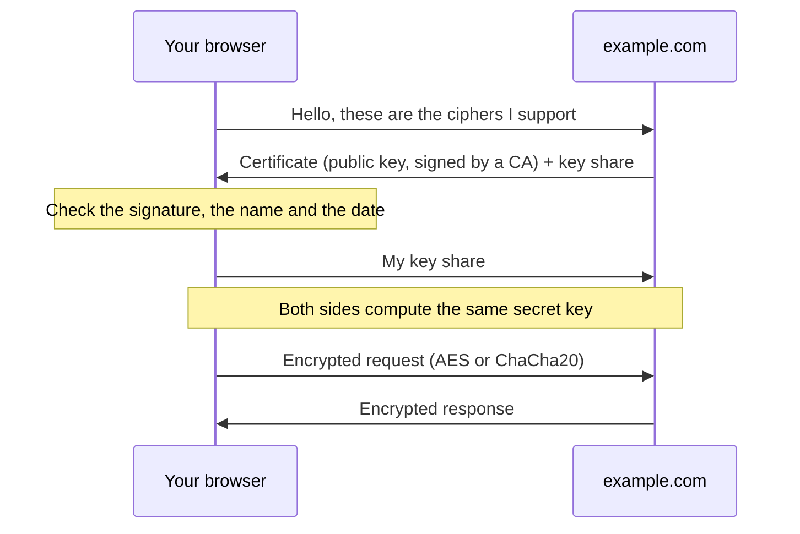

# Cryptography without the maths

You don't need to invent cryptography (you never should). You need to know **which tool does what** and how to use it correctly.

## The four tools

| Tool | Gives you | Example |
|---|---|---|
| **Hash** | A fingerprint; detect changes | SHA-256 of a download, password hashing |
| **Symmetric encryption** | Secrecy with one shared key | AES encrypting a disk or a file |
| **Asymmetric (public-key) encryption** | Secrecy and key exchange without sharing a secret first | TLS starting a secure connection |
| **Digital signature** | Proof of who sent it and that it wasn't changed | Signed software updates, signed Git commits |

## Hashes

A hash function turns any input into a fixed-size output. Change one bit of the input and the output changes completely. You can't go back from the hash to the input.

```bash
sha256sum inpace-installer.deb
# compare with the SHA256SUMS file the project publishes
```

If the numbers match, the file is exactly what was published. (inPace's releases include a SHA256SUMS file for this reason.)

Old hashes **MD5** and **SHA-1** are broken for security uses. Use SHA-256 or better.

## Symmetric encryption

One key both locks and unlocks. **AES** is the standard; it's very fast and very strong. The hard part is **getting the key to the other person safely**, and keeping it secret.

Use authenticated modes (**AES-GCM** or **ChaCha20-Poly1305**): they also detect tampering.

## Public-key cryptography

Each person has a **key pair**:
- A **public key**: share it with everyone.
- A **private key**: never leaves your device.

What one key locks, only the other unlocks. So:
- Anyone can encrypt a message with your **public** key; only your **private** key can read it.
- You **sign** with your private key; anyone can check the signature with your public key.

RSA and elliptic-curve algorithms (like Ed25519) are common. SSH keys work exactly this way (you met them in the Linux courses).

## TLS: the padlock in your browser

HTTPS is HTTP inside **TLS**. When you open a site:

1. Your browser and the server agree on keys using public-key crypto.
2. The server proves its identity with a **certificate**: a signed statement "this public key belongs to example.com", signed by a **certificate authority** your browser trusts.
3. Everything after that is encrypted with fast symmetric keys.




TLS gives **confidentiality** (nobody on the café Wi-Fi can read it), **integrity** (nobody can change it) and **authentication** (you're talking to the real site).

The padlock does **not** mean the site is honest. Phishing sites have valid certificates too. It only means the connection to **that** address is private.

## Encryption at rest

Turn on full-disk encryption: **BitLocker** (Windows), **FileVault** (Mac), **LUKS** (Linux, offered when installing), and the phone's own encryption (on by default with a screen lock). A stolen laptop then gives the thief a brick, not your files.

## The golden rules

1. **Never invent your own crypto** or "encryption" (Base64 is not encryption; it's just a different alphabet).
2. Use well-known libraries and the defaults they recommend.
3. Protect the **keys**: most real failures are leaked keys, not broken algorithms. Never commit keys to Git.
4. Keep software updated: old protocols (SSL, TLS 1.0) get turned off for good reasons.

## Optional videos

The lesson above is complete on its own. These go deeper, if you like learning by watching.

**Public Key Cryptography (Computerphile)**

https://www.youtube.com/watch?v=GSIDS_lvRv4

**Secret Key Exchange, Diffie-Hellman (Computerphile)**

https://www.youtube.com/watch?v=NmM9HA2MQGI
