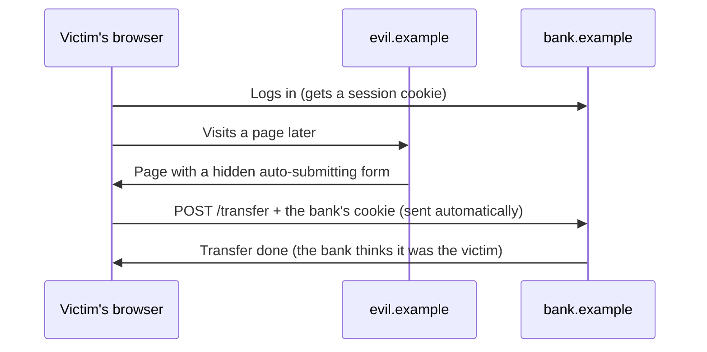

# XSS and CSRF

## Cross-site scripting (XSS)

XSS is injection into a **web page**: an attacker gets their JavaScript to run in **other users'** browsers, on your site. That script can do anything the user can: read the page, make requests as them, show fake login forms.

```html
<!-- ❌ the server puts a comment into the page as raw HTML -->
<div class="comment">{{ comment | safe }}</div>
```

If a comment contains ``, every visitor runs it.

Types:
- **Stored**: saved in the database (comments, profiles) and shown to everyone. The most dangerous.
- **Reflected**: in a link (`/search?q=<script>...`) that the victim is tricked into opening.
- **DOM-based**: the page's own JavaScript puts untrusted data into the page (`element.innerHTML = location.hash`).

### Defences

1. **Escape output** by default. Templates like Jinja2 (with autoescape), React and Vue turn `<` into `&lt;` automatically. The danger is when you switch it off: `| safe`, `dangerouslySetInnerHTML`, `v-html`, `innerHTML`.
2. Use `textContent` instead of `innerHTML` in plain JavaScript.
3. If users may write formatting, use a sanitizer library (DOMPurify) with a strict allow-list.
4. **Content-Security-Policy** without `'unsafe-inline'`: even if an injection slips through, the browser refuses to run inline scripts.
5. `HttpOnly` cookies, so a script can't simply read the session.

## Cross-site request forgery (CSRF)

CSRF makes the victim's browser send a request **they didn't intend**, to a site where they're logged in. The browser attaches their cookies automatically.

```html
<!-- on evil.example -->
<form action="https://bank.example/transfer" method="POST">
  <input type="hidden" name="to" value="attacker">
  <input type="hidden" name="amount" value="5000">
</form>
<script>document.forms[0].submit()</script>
```

If the bank relies only on the session cookie, the transfer happens.




### Defences

1. **SameSite cookies** (`Lax` or `Strict`): the browser doesn't send the cookie with cross-site POSTs. Modern browsers default to Lax, but set it explicitly.
2. **CSRF tokens**: a random value in each form that the attacker's site can't know. Most frameworks (Django, Rails, Laravel) include this; turn it on.
3. Never change data with **GET** requests (`/delete?id=5`): links and images can trigger them.
4. For sensitive actions (changing the email or password, big payments), ask for the password or MFA again.

APIs that use a token in an `Authorization` header (not cookies) aren't exposed to classic CSRF, because the browser doesn't attach that header by itself.

## Clickjacking

Your site is loaded invisibly inside another site, and the user is tricked into clicking your buttons. Defence: `Content-Security-Policy: frame-ancestors 'none'` (or `X-Frame-Options: DENY`).

## Quick comparison

| | XSS | CSRF |
|---|---|---|
| Attacker's code runs | In your site's pages | On the attacker's site |
| Abuses | Your site trusting user input in pages | The browser sending cookies automatically |
| Main defences | Output escaping, CSP | SameSite cookies, CSRF tokens |

## Optional videos

The lesson above is complete on its own. These go deeper, if you like learning by watching.

**Cracking Websites with Cross Site Scripting (Computerphile)**

https://www.youtube.com/watch?v=L5l9lSnNMxg
