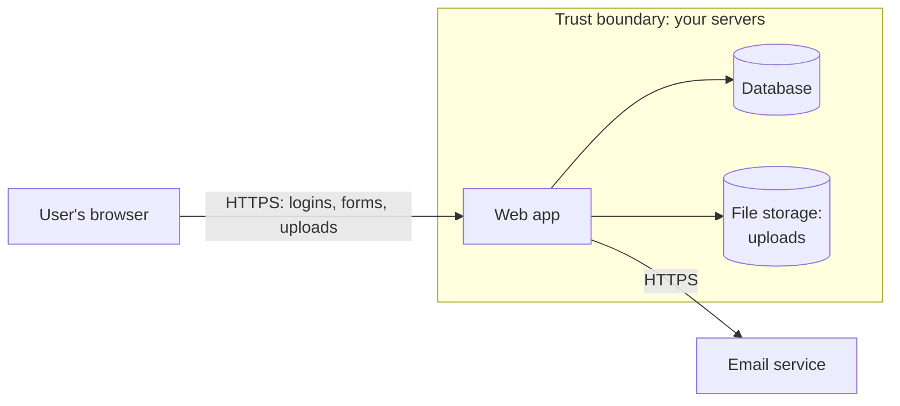

# Threat modelling and secure development

Finding security problems while **designing** is much cheaper than after an attack. **Threat modelling** is a structured way to ask "what could go wrong?" before it does.

## Four questions

1. **What are we building?** Draw it: users, components, data stores, and the data flowing between them.
2. **What can go wrong?** Walk through the drawing with a checklist.
3. **What are we going to do about it?** Fix, reduce, accept or transfer each risk.
4. **Did we do a good job?** Review after building and after changes.

## Draw the system

A data-flow diagram for a simple study app:

Mark the **trust boundaries**: every place where data crosses from something you don't control (the internet, the user's browser) into something you do. Most problems live on those lines.

## STRIDE: a checklist of what can go wrong

| Letter | Threat | Breaks | Example | Typical defence |
|---|---|---|---|---|
| **S** | Spoofing | Authentication | Logging in as someone else | MFA, strong sessions |
| **T** | Tampering | Integrity | Editing the price in a request | Server-side checks, signatures |
| **R** | Repudiation | Accountability | "I never deleted that" | Audit logs |
| **I** | Information disclosure | Confidentiality | Reading other users' files | Access checks, encryption |
| **D** | Denial of service | Availability | Huge uploads filling the disk | Size limits, rate limits |
| **E** | Elevation of privilege | Authorization | A normal user reaching admin | Least privilege, deny by default |

For each component and each arrow, ask the six STRIDE questions. Write each threat down with a decision.

Example for "users upload a profile picture":
- **T/E**: a file named `photo.php` that the server runs → store uploads outside the web root, check type by content, rename files.
- **I**: uploads readable by anyone who guesses the URL → random names, access checks for private files.
- **D**: a 5 GB upload → size limit, rate limit.
- **XSS**: an SVG containing script → don't accept SVG, or serve uploads from a separate domain.

## Secure development habits

- **Validate input** on the server (types, lengths, allowed values), and **encode output** for where it goes (HTML, SQL, shell).
- **Authorization checks** in one shared place, tested with two users.
- **Secrets** out of code; least-privilege database and cloud accounts.
- **Dependencies**: few, maintained, updated (Dependabot).
- **Code review** with security in mind; a short checklist helps (inputs, auth checks, secrets, errors).
- **Automated checks in CI**: tests, dependency audit, static analysis (Semgrep, CodeQL), secret scanning.
- **Errors**: friendly messages to users, details only in logs.
- **Security tests** for the bugs you fix, so they never return.

## Shift left

"Shift left" means moving security earlier in the timeline: in design (threat models), in coding (safe defaults, linters), in CI (automatic scans), instead of only a test just before launch. It's cheaper, and it treats security as everyone's job.
