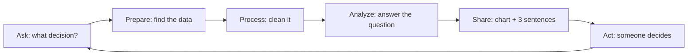

# What a data analyst really does

A data analyst turns **questions** into **answers people can act on**, using data. Tools come second.

## Good questions are specific

| Vague | Specific |
|---|---|
| How are sales? | Which branch missed its monthly target most often in 2025, and by how much? |
| Do people like cold drinks? | How much do cold drinks add to sales in summer compared with winter? |
| Are members better? | Do members spend more per order than guests? |

A specific question names **what** you measure, **for whom**, and **over what time**.

## Measures and dimensions

- **Measures** are numbers you add up or average: sales, quantity, number of orders.
- **Dimensions** are what you slice by: branch, product, category, month, payment type.

Almost every business question is "measure by dimension": *sales by branch*, *orders by month*.
