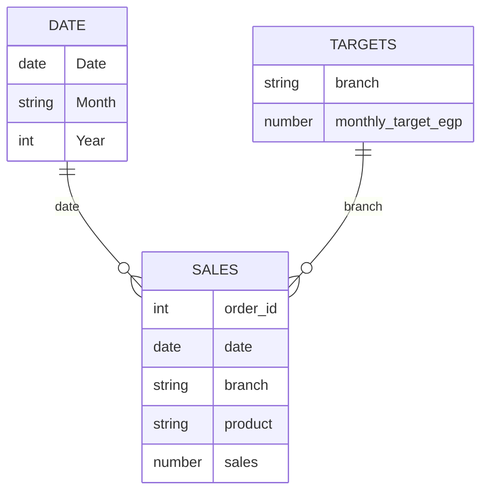

# The data model: a star

Good Power BI reports use a **star schema**: one **fact** table (things that happened: orders) and **dimension**
tables (what you slice by: dates, branches).



## Make a date table (always)

**Modeling → New table**:

```text
Date =
ADDCOLUMNS (
    CALENDAR ( DATE ( 2025, 1, 1 ), DATE ( 2025, 12, 31 ) ),
    "Month", FORMAT ( [Date], "YYYY-MM" ),
    "Month name", FORMAT ( [Date], "MMM" ),
    "Weekday", FORMAT ( [Date], "ddd" )
)
```

Then **Table tools → Mark as date table**, and in **Model view** drag `Date[Date]` onto `coffee_sales_2025[date]`,
and `branch_targets[branch]` onto `coffee_sales_2025[branch]`. Relationships should be **one-to-many**, from the
dimension (one) to the fact (many), filtering in one direction.

Why bother? Time intelligence (month-to-date, same period last year) needs a proper date table, and the model makes
every visual filter correctly.
