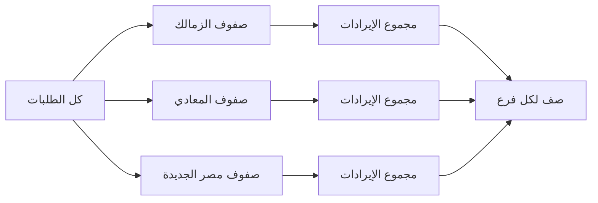

# التجميع والتلخيص ودمج الجداول

أغلب أسئلة الأعمال تبدو مثل "**لكل** شيء": المبيعات **لكل** فرع، والتقييم **لكل** صنف، والطلبات **لكل** ساعة. وفي pandas هذا هو `groupby`.

سنستخدم الملف النظيف من الدرس السابق. (‏Colab ينسى الملفات عند إعادة التشغيل. لو اختفى `cafe_clean.csv`، أعد تشغيل notebook التنظيف، أو نزّل `cafe_clean.csv` من ملفات هذا الكورس بنفس الطريقة السابقة.)

```python
import pandas as pd
df = pd.read_csv("cafe_clean.csv", parse_dates=["date"])
print(df.shape)
```

```output
(1452, 17)
```

## ‏groupby: قسّم، وطبّق، واجمع



```python
by_branch = df.groupby("branch")["revenue"].sum().sort_values(ascending=False)
print(by_branch)
```

```output
branch
Zamalek       65349
Maadi         48545
Heliopolis    38236
Name: revenue, dtype: int64
```

## عدة أرقام مرة واحدة: agg

```python
summary = df.groupby("branch").agg(
    orders=("order_id", "count"),
    revenue=("revenue", "sum"),
    avg_order=("revenue", "mean"),
    avg_rating=("rating", "mean"),
).round(1)
print(summary.to_string())
```

```output
            orders  revenue  avg_order  avg_rating
branch                                            
Heliopolis     404    38236       94.6         3.9
Maadi          479    48545      101.3         3.9
Zamalek        569    65349      114.8         4.0
```

كل سطر يُقرأ `new_name=(column, function)`. وfunctions شائعة: `count` و`sum` و`mean` و`median` و`min` و`max` و`nunique`.

## التجميع بشيئين

```python
by_cat_branch = df.groupby(["category", "branch"])["revenue"].sum().unstack().round(0)
print(by_cat_branch.to_string())
```

```output
branch    Heliopolis  Maadi  Zamalek
category                            
dessert         9007  12935    15699
drink          20084  24875    35520
food            9145  10735    14130
```

‏`unstack()` تحوّل التجميع الثاني إلى أعمدة: **جدول محوري (pivot table)**، تمامًا مثل Excel. و`pd.pivot_table(df, index="category", columns="branch", values="revenue", aggfunc="sum")` تفعل نفس الشيء في recall واحد.

## الزمن: الشهور وأيام الأسبوع والساعات

```python
monthly = df.groupby("month")["revenue"].sum()
print(monthly.idxmax(), "is the best month,", monthly.idxmin(), "the weakest")

order = ["Saturday", "Sunday", "Monday", "Tuesday", "Wednesday", "Thursday", "Friday"]
per_day = df.groupby("weekday")["order_id"].count().reindex(order)
print(per_day.to_dict())

busiest_hour = df.groupby("hour")["order_id"].count().idxmax()
print("busiest hour:", busiest_hour)
```

```output
6 is the best month, 2 the weakest
{'Saturday': 265, 'Sunday': 164, 'Monday': 177, 'Tuesday': 168, 'Wednesday': 210, 'Thursday': 189, 'Friday': 279}
busiest hour: 14
```

‏`idxmax()` تعطي اسم صاحب أكبر قيمة. و`reindex(order)` تضع أيام الأسبوع بترتيب التقويم بدل الترتيب الأبجدي.

## دمج الجداول: merge

البيانات غالبًا موجودة في عدة جداول. وهذا جدول صغير لمعلومات الفروع:

```python
branches = pd.DataFrame({
    "branch": ["Zamalek", "Maadi", "Heliopolis"],
    "seats": [40, 55, 30],
    "opened": [2019, 2021, 2023],
})
merged = summary.reset_index().merge(branches, on="branch")
merged["revenue_per_seat"] = (merged["revenue"] / merged["seats"]).round(0)
print(merged[["branch", "revenue", "seats", "revenue_per_seat"]].to_string(index=False))
```

```output
    branch  revenue  seats  revenue_per_seat
Heliopolis    38236     30            1275.0
     Maadi    48545     55             883.0
   Zamalek    65349     40            1634.0
```

‏`merge(other, on="branch")` تطابق الصفوف بعمود `branch`، مثل البحث (VLOOKUP) في Excel أو JOIN في SQL. واستخدم `how="left"` لتحتفظ بكل صفوف الجدول الأيسر حتى عندما لا يوجد تطابق.

## سؤال حقيقي

*هل تُباع المشروبات المثلجة فعلًا أكثر في الأيام الحارة؟*

```python
df["hot_day"] = df["temp_c"] >= 28
iced = df[df["item"].isin(["iced latte", "mint lemonade"])]
share = (iced.groupby("hot_day")["quantity"].sum() / df.groupby("hot_day")["quantity"].sum() * 100).round(1)
print(share.rename({False: "cooler days", True: "hot days (28C+)"}).to_dict())
```

```output
{'cooler days': 9.4, 'hot days (28C+)': 32.1}
```

في الأيام الحارة، المشروبات المثلجة نسبة أكبر بكثير من كل ما يُباع. وهذه نتيجة يستطيع المالك التصرف بناءً عليها: تخزين ثلج وحليب أكثر عندما تكون التوقعات حارة.

## الخلاصة

- `groupby(col)[value].sum()` تجيب أسئلة "لكل شيء"؛ و`agg` تعطي عدة أرقام مرة واحدة.
- جمّع بعمودين ثم `unstack` (أو `pivot_table`) للجداول المتقاطعة.
- `merge` تدمج الجداول بعمود مشترك؛ وأجب الأسئلة الحقيقية بالتجميع والنسب.

## فيديوهات اختيارية

الدرس أعلاه كامل وحده. هذه الفيديوهات للتعمق إن كنت تحب التعلم بالمشاهدة. الفيديوهات المكتوب بجانبها (بالإنجليزية) يمكنك تشغيل الترجمة لها (**CC**)، ثم **الإعدادات ← الترجمة ← ترجمة تلقائية ← العربية**.

**Complete Python pandas data science tutorial (Keith Galli) (بالإنجليزية)**

https://www.youtube.com/watch?v=vmEHCJofslg
