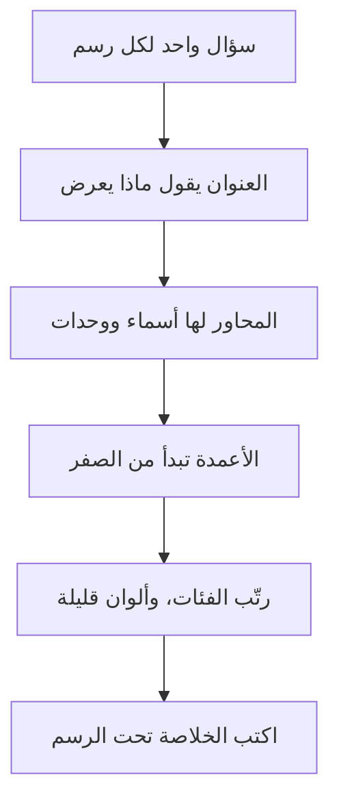

# رسوم بيانية تحكي القصة

الرسم الجيد يجيب سؤالًا واحدًا من نظرة. وهذا الدرس يعرض الرسوم الخمسة التي ستستخدمها أكثر من غيرها، بمكتبة **matplotlib**، وكيف تختار بينها.

```python
import pandas as pd
import matplotlib.pyplot as plt
df = pd.read_csv("cafe_clean.csv", parse_dates=["date"])
print("ready")
```

```output
ready
```

## أي رسم لأي سؤال؟

| السؤال | الرسم |
|---|---|
| كيف يتغير شيء مع الوقت؟ | خطي |
| كيف تقارن الفئات؟ | أعمدة (أفقية لو كانت الأسماء طويلة) |
| كيف تنتشر القيم؟ | histogram |
| هل رقمان مرتبطان؟ | نقاط مبعثرة (scatter) |
| كيف تقارن انتشار مجموعات؟ | صندوقي (box plot) |

## الخطي: التغير مع الوقت

```python
monthly = df.groupby("month")["revenue"].sum() / 1000
fig, ax = plt.subplots(figsize=(8, 4))
ax.plot(monthly.index, monthly.values, marker="o")
ax.set_title("Revenue per month (thousand EGP)")
ax.set_xlabel("Month")
ax.set_xticks(range(1, 13))
ax.grid(alpha=0.3)
fig.savefig("ds-revenue-month.png", dpi=100, bbox_inches="tight")
plt.show()
```


النمط يظهر فورًا: المبيعات أقل ما تكون في فبراير، وترتفع خلال الربيع، وتبلغ القمة في يونيو وتظل مرتفعة حتى أكتوبر، موسم إجازات الصيف. وجدول من 12 رقمًا يخفي ذلك.

- `fig, ax = plt.subplots()` تصنع شكلًا (الصورة) ومحاور (منطقة الرسم).
- أعطِ دائمًا **عنوانًا** و**محاور بأسماء**، مع الوحدات.
- `savefig` تكتب الرسم في ملف للتقارير؛ و`plt.show()` تعرضه في الـ notebook.

## الأعمدة: مقارنة الفئات

```python
items = df.groupby("item")["revenue"].sum().sort_values() / 1000
fig, ax = plt.subplots(figsize=(8, 5))
ax.barh(items.index, items.values, color="#4C78A8")
ax.set_title("Revenue per item (thousand EGP)")
fig.savefig("ds-revenue-item.png", dpi=100, bbox_inches="tight")
plt.show()
```


رتّب الأعمدة، واستخدم الأعمدة الأفقية عندما تكون الأسماء طويلة. ويجب أن تبدأ رسوم الأعمدة من الصفر، وإلا تبدو الفروق أكبر مما هي.

## الـ histogram: كيف تنتشر القيم

```python
fig, ax = plt.subplots(figsize=(8, 4))
ax.hist(df["hour"], bins=range(7, 25), edgecolor="white")
ax.set_title("Orders by hour of the day")
ax.set_xlabel("Hour")
ax.set_ylabel("Orders")
fig.savefig("ds-hours.png", dpi=100, bbox_inches="tight")
plt.show()
```


أغلب الطلبات تأتي بعد الظهر مبكرًا، وأقل في الصباح وآخر الليل: مفيد لتخطيط ورديات العاملين.

## النقاط المبعثرة: هل رقمان مرتبطان؟

```python
daily = df.groupby("date").agg(temp=("temp_c", "first"), iced=("item", lambda s: s.isin(["iced latte", "mint lemonade"]).sum()))
fig, ax = plt.subplots(figsize=(7, 4))
ax.scatter(daily["temp"], daily["iced"], alpha=0.4)
ax.set_title("Iced drinks sold per day vs temperature")
ax.set_xlabel("Temperature (C)")
ax.set_ylabel("Iced drink orders")
fig.savefig("ds-scatter.png", dpi=100, bbox_inches="tight")
plt.show()
```


كل نقطة يوم. والسحابة ترتفع ناحية اليمين: أيام أحر، مشروبات مثلجة أكثر. والوحدة 4 تقيس قوة هذه العلاقة.

## الصندوقي: مقارنة الانتشار

```python
groups = [df.loc[df["customer_type"] == t, "rating"].dropna() for t in ["new", "returning"]]
fig, ax = plt.subplots(figsize=(6, 4))
ax.boxplot(groups, tick_labels=["new", "returning"])
ax.set_title("Ratings by customer type")
ax.set_ylabel("Rating (1 to 5)")
fig.savefig("ds-box.png", dpi=100, bbox_inches="tight")
plt.show()
```


الصندوق يغطي النصف الأوسط من القيم، والخط بداخله هو الوسيط، والشوارب تبيّن المدى. والعملاء العائدون يقيّمون أعلى قليلًا.

## اجعل الرسوم صادقة وواضحة



تستطيع pandas أيضًا الرسم مباشرة: `monthly.plot(kind="line")` و`items.plot(kind="barh")`. ومكتبة **seaborn** تصنع رسومًا إحصائية في سطر واحد. وكلاهما يستخدم matplotlib من الداخل، فكل ما هنا ما زال ينطبق.

## الخلاصة

- الخطي للزمن، والأعمدة للفئات، والـ histogram للانتشار، والنقاط المبعثرة للعلاقات، والصندوقي لمقارنة المجموعات.
- `fig, ax = plt.subplots()`، ثم ارسم، وضع العنوان والأسماء، ثم `savefig` و`show`.
- كل رسم يجيب سؤالًا واحدًا؛ واكتب الخلاصة بالكلمات بجواره.

## فيديوهات اختيارية

الدرس أعلاه كامل وحده. هذه الفيديوهات للتعمق إن كنت تحب التعلم بالمشاهدة. الفيديوهات المكتوب بجانبها (بالإنجليزية) يمكنك تشغيل الترجمة لها (**CC**)، ثم **الإعدادات ← الترجمة ← ترجمة تلقائية ← العربية**.

**Matplotlib tutorial, part 1: creating and customizing plots (Corey Schafer) (بالإنجليزية)**

https://www.youtube.com/watch?v=UO98lJQ3QGI
