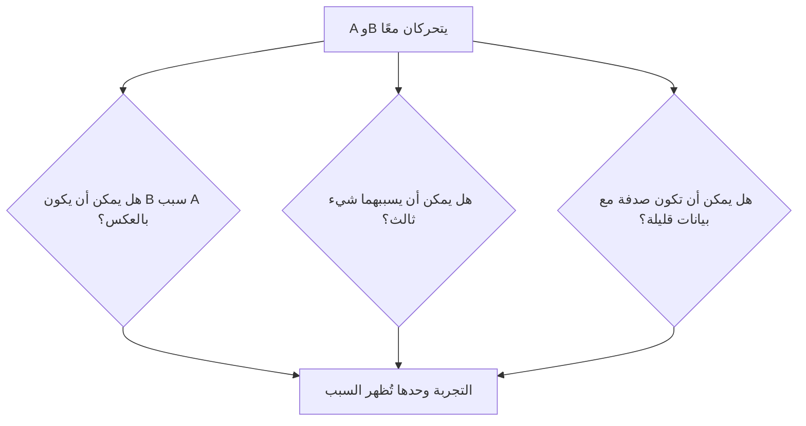

# الإحصاء 2: العلاقات والعينات واختبارات A/B

## الـ correlation

**الـ correlation** يقيس مدى قوة تحرّك رقمين معًا، من -1 إلى +1:

- قرب **+1**: عندما يرتفع أحدهما، يرتفع الآخر
- قرب **0**: لا علاقة خطية مستقيمة
- قرب **-1**: عندما يرتفع أحدهما، ينخفض الآخر

```python
import pandas as pd
import numpy as np
df = pd.read_csv("cafe_clean.csv", parse_dates=["date"])

daily = df.groupby("date").agg(
    temp=("temp_c", "first"),
    orders=("order_id", "count"),
    iced=("item", lambda s: s.isin(["iced latte", "mint lemonade"]).sum()),
    hot_drinks=("item", lambda s: s.isin(["tea", "hot chocolate"]).sum()),
)
print(daily.corr().round(2).to_string())
```

```output
            temp  orders  iced  hot_drinks
temp        1.00    0.30  0.57       -0.21
orders      0.30    1.00  0.48        0.35
iced        0.57    0.48  1.00       -0.15
hot_drinks -0.21    0.35 -0.15        1.00
```

المشروبات المثلجة ترتفع مع الحرارة (موجب)، والمشروبات الساخنة تنخفض (سالب). والطلبات عمومًا ترتفع قليلًا مع الحرارة أيضًا، لأن الشهور الحارة هي شهور الإجازات المزدحمة.

## الـ correlation ليس سببية

مبيعات الآيس كريم وحالات الغرق ترتفع معًا في الصيف. الآيس كريم لا يسبب الغرق؛ بل **الحر** يسبب الاثنين. اسأل دائمًا:



هنا الحرارة وموسم الإجازات يتحركان معًا، فمن هذه البيانات وحدها لا نستطيع أن نقول كم من الزيادة الصيفية سببه الحر وكم سببه الإجازات.

## العينات وعدم اليقين

نادرًا ما تملك **كل** البيانات (المجتمع). بل تملك **عينة**، وعينة مختلفة ستعطي إجابة مختلفة قليلًا. فكم يمكن أن تختلف؟

```python
ratings = df["rating"].dropna()
rng = np.random.default_rng(7)
means = [rng.choice(ratings, size=100, replace=True).mean() for _ in range(2000)]
low, high = np.percentile(means, [2.5, 97.5])
print(f"one sample of 100 ratings has mean {means[0]:.2f}")
print(f"95% of samples of 100 give a mean between {low:.2f} and {high:.2f}")
```

```output
one sample of 100 ratings has mean 3.85
95% of samples of 100 give a mean between 3.76 and 4.08
```

هذه الحيلة، إعادة سحب العينات من البيانات مرات كثيرة، اسمها **bootstrap**. وتبيّن عدم اليقين: مع 100 تقييم فقط، قد يبتعد المتوسط بسهولة بحوالي 0.15. ومع بيانات أكثر يضيق المدى. واذكر النتائج مع هذا المدى (**confidence interval**)، لا كرقم واحد دقيق.

## اختبارات A/B: طريقة إثبات السبب

لكي تعرف هل تغيير ما **يسبب** نتيجة أفضل، أجرِ تجربة: قسّم العملاء عشوائيًا إلى مجموعتين، وغيّر شيئًا واحدًا للمجموعة B فقط، وقارن.

افترض أن السلسلة جرّبت بطاقة ولاء جديدة عند صناديق دفع عشوائية، وتابعت هل عاد العملاء خلال شهر:

```python
rng = np.random.default_rng(42)
a_back = rng.random(400) < 0.30          # group A: no card, about 30% come back
b_back = rng.random(400) < 0.37          # group B: loyalty card, about 37% come back
print(f"A: {a_back.mean():.1%}   B: {b_back.mean():.1%}")

# How often would a gap this big appear by pure chance? Shuffle the labels and see.
observed = b_back.mean() - a_back.mean()
both = np.concatenate([a_back, b_back])
gaps = []
for _ in range(5000):
    rng.shuffle(both)
    gaps.append(both[400:].mean() - both[:400].mean())
p_value = np.mean(np.array(gaps) >= observed)
print(f"observed gap {observed:.1%}, p-value {p_value:.3f}")
```

```output
A: 30.2%   B: 38.8%
observed gap 8.5%, p-value 0.009
```

**p-value** هي احتمال رؤية فرق بهذا الحجم على الأقل لو كانت البطاقة **لا** تُحدث أي فرق. وp-value صغيرة (أقل من 0.05 حسب العرف الشائع) معناها "الصدفة وحدها تفسير غير مرجح". لكنها لا تقول إن الأثر كبير أو مهم؛ انظر إلى حجم الفرق لذلك.

ولأن العملاء وُزّعوا **عشوائيًا**، فالفرق المنهجي الوحيد بين المجموعتين هو البطاقة. وهذا ما يسمح للتجربة بإثبات السبب، وهو ما لا يستطيعه الـ correlation في البيانات التاريخية.

## فخاخ شائعة

- **العينات الصغيرة**: 5 تقييمات لا تخبرك بالكثير. تحقق من عدد القيم خلف كل متوسط.
- **مقارنة الأعداد بدل المعدلات** (الدرس السابق).
- **النظر في أشياء كثيرة وذكر الشيء الذي "نجح"**: اختبر 20 فكرة وستبدو واحدة مهمة بالصدفة.
- **انحياز الناجين**: تحليل العملاء الذين بقوا فقط يخفي لماذا غادر الآخرون.

## الخلاصة

- الـ correlation (من -1 إلى +1) يقيس كيف يتحرك رقمان معًا؛ ولا يُظهر السبب.
- النتائج من العينات غير مؤكدة؛ وbootstrap تعطي مدى (فترة ثقة).
- اختبارات A/B العشوائية تُظهر السبب؛ وp-value تسأل ما احتمال الفرق بالصدفة وحدها.

## فيديوهات اختيارية

الدرس أعلاه كامل وحده. هذه الفيديوهات للتعمق إن كنت تحب التعلم بالمشاهدة. الفيديوهات المكتوب بجانبها (بالإنجليزية) يمكنك تشغيل الترجمة لها (**CC**)، ثم **الإعدادات ← الترجمة ← ترجمة تلقائية ← العربية**.

**Pearson's correlation, clearly explained (StatQuest) (بالإنجليزية)**

https://www.youtube.com/watch?v=xZ_z8KWkhXE

**p-values: what they are and how to interpret them (StatQuest) (بالإنجليزية)**

https://www.youtube.com/watch?v=vemZtEM63GY
