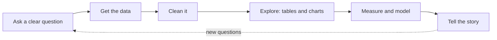

# What data science is, and your first notebook

Data science is turning data into answers and decisions. A coffee shop owner asks "which branch sells most iced drinks in summer?", a hospital asks "which patients are likely to come back?", a bank asks "is this payment fraud?". A data scientist gets the data, cleans it, explores it, measures things, builds models that predict, and explains the results to people.

This course takes you from zero to a complete small project. You'll use **Python**, the most popular language for data work, and you'll work with one realistic dataset the whole way: a year of orders at a made-up Cairo coffee chain.

## The data science workflow



Most of the time goes into the middle: getting, cleaning and exploring. Models are a small part, and they only work when the earlier steps were done well.

## Your tool: Google Colab

**Colab** (colab.research.google.com) runs Python in your browser for free, with all the data libraries already installed. Nothing to install, and it works on any computer.

1. Go to colab.research.google.com and sign in with a Google account.
2. Click **New notebook**.
3. Type in the first cell and press **Shift+Enter** to run it.

A **notebook** is a page of cells. Code cells run Python and show the result right under them. Text cells hold notes. You can run cells in any order, but notebooks are easiest to understand when you run them top to bottom.

(Prefer your own computer? Install Anaconda or Python plus `pip install pandas matplotlib scikit-learn jupyter`, then run `jupyter notebook`. Everything in this course works the same.)

## First cells

```python
print("Hello, data!")
2 + 3 * 4
```

```output
Hello, data!
```

In a notebook, the last line of a cell is shown automatically, so you'd also see `14` under the cell. In this course we use `print()` so you can see exactly what each cell shows.

```python
price = 65
cups = 3
total = price * cups
print("Total:", total, "EGP")
print(f"Average per cup: {total / cups:.1f}")
```

```output
Total: 195 EGP
Average per cup: 65.0
```

- A **variable** stores a value under a name: `price = 65`.
- `f"...{expression}..."` is an **f-string**: Python puts the value inside the text. `:.1f` means one decimal place.

## The libraries you'll use

| Library | For |
|---|---|
| **pandas** | tables of data: load, clean, filter, group, join |
| **NumPy** | fast maths on arrays of numbers (pandas is built on it) |
| **matplotlib** | charts |
| **scikit-learn** | machine learning models |

```python
import pandas as pd
import numpy as np
import matplotlib
import sklearn
print("pandas is ready:", pd.__name__)
print("numpy works:", np.mean([2, 4, 6]))
```

```output
pandas is ready: pandas
numpy works: 4.0
```

`import pandas as pd` is a universal habit: everyone writes `pd.` for pandas and `np.` for NumPy.

## Good habits from day one

- Give variables clear names: `monthly_sales`, not `x2`.
- Write a text cell above each step saying **what question it answers**.
- Restart and run everything from the top (Runtime → Restart and run all) before sharing a notebook. If it doesn't run top to bottom, it's broken.
- Keep the original data untouched; clean into a new variable.

## Summary

- Data science: question → data → clean → explore → measure/model → story.
- Colab runs Python notebooks in the browser with everything installed; Shift+Enter runs a cell.
- pandas for tables, NumPy for maths, matplotlib for charts, scikit-learn for models.

## Optional videos

The lesson above is complete on its own. These videos go deeper, if you like learning by watching.

**Get started with Google Colaboratory (TensorFlow)**

https://www.youtube.com/watch?v=inN8seMm7UI
