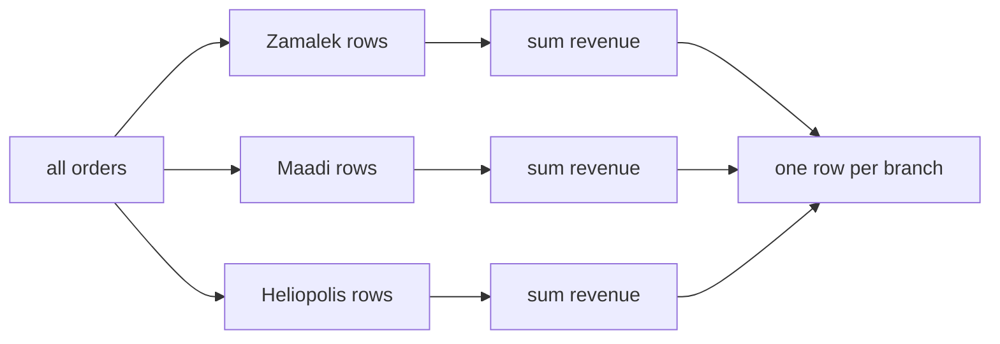

# Grouping, summarizing and combining tables

Most business questions sound like "**per** something": sales **per** branch, rating **per** item, orders **per** hour. In pandas that's `groupby`.

We'll use the clean file from the last lesson. (Colab forgets files when it restarts. If `cafe_clean.csv` is gone, rerun your cleaning notebook, or download `cafe_clean.csv` from this course's files the same way as before.)

```python
import pandas as pd
df = pd.read_csv("cafe_clean.csv", parse_dates=["date"])
print(df.shape)
```

```output
(1452, 17)
```

## groupby: split, apply, combine



```python
by_branch = df.groupby("branch")["revenue"].sum().sort_values(ascending=False)
print(by_branch)
```

```output
branch
Zamalek       65349
Maadi         48545
Heliopolis    38236
Name: revenue, dtype: int64
```

## Several numbers at once: agg

```python
summary = df.groupby("branch").agg(
    orders=("order_id", "count"),
    revenue=("revenue", "sum"),
    avg_order=("revenue", "mean"),
    avg_rating=("rating", "mean"),
).round(1)
print(summary.to_string())
```

```output
            orders  revenue  avg_order  avg_rating
branch                                            
Heliopolis     404    38236       94.6         3.9
Maadi          479    48545      101.3         3.9
Zamalek        569    65349      114.8         4.0
```

Each line reads `new_name=(column, function)`. Common functions: `count`, `sum`, `mean`, `median`, `min`, `max`, `nunique`.

## Grouping by two things

```python
by_cat_branch = df.groupby(["category", "branch"])["revenue"].sum().unstack().round(0)
print(by_cat_branch.to_string())
```

```output
branch    Heliopolis  Maadi  Zamalek
category                            
dessert         9007  12935    15699
drink          20084  24875    35520
food            9145  10735    14130
```

`unstack()` turns the second grouping into columns: a **pivot table**, just like in Excel. `pd.pivot_table(df, index="category", columns="branch", values="revenue", aggfunc="sum")` does the same in one call.

## Time: months, weekdays and hours

```python
monthly = df.groupby("month")["revenue"].sum()
print(monthly.idxmax(), "is the best month,", monthly.idxmin(), "the weakest")

order = ["Saturday", "Sunday", "Monday", "Tuesday", "Wednesday", "Thursday", "Friday"]
per_day = df.groupby("weekday")["order_id"].count().reindex(order)
print(per_day.to_dict())

busiest_hour = df.groupby("hour")["order_id"].count().idxmax()
print("busiest hour:", busiest_hour)
```

```output
6 is the best month, 2 the weakest
{'Saturday': 265, 'Sunday': 164, 'Monday': 177, 'Tuesday': 168, 'Wednesday': 210, 'Thursday': 189, 'Friday': 279}
busiest hour: 14
```

`idxmax()` gives the label of the largest value. `reindex(order)` puts the weekdays in calendar order instead of alphabetical.

## Combining tables: merge

Data often lives in several tables. Here's a small table of branch information:

```python
branches = pd.DataFrame({
    "branch": ["Zamalek", "Maadi", "Heliopolis"],
    "seats": [40, 55, 30],
    "opened": [2019, 2021, 2023],
})
merged = summary.reset_index().merge(branches, on="branch")
merged["revenue_per_seat"] = (merged["revenue"] / merged["seats"]).round(0)
print(merged[["branch", "revenue", "seats", "revenue_per_seat"]].to_string(index=False))
```

```output
    branch  revenue  seats  revenue_per_seat
Heliopolis    38236     30            1275.0
     Maadi    48545     55             883.0
   Zamalek    65349     40            1634.0
```

`merge(other, on="branch")` matches rows by the `branch` column, like a lookup (VLOOKUP) in Excel or a JOIN in SQL. Use `how="left"` to keep every row of the left table even when there's no match.

## A real question

*Do iced drinks really sell more on hot days?*

```python
df["hot_day"] = df["temp_c"] >= 28
iced = df[df["item"].isin(["iced latte", "mint lemonade"])]
share = (iced.groupby("hot_day")["quantity"].sum() / df.groupby("hot_day")["quantity"].sum() * 100).round(1)
print(share.rename({False: "cooler days", True: "hot days (28C+)"}).to_dict())
```

```output
{'cooler days': 9.4, 'hot days (28C+)': 32.1}
```

On hot days, a much larger share of everything sold is iced drinks. That's a finding the owner can act on: stock more ice and milk when the forecast is hot.

## Summary

- `groupby(col)[value].sum()` answers "per something" questions; `agg` gives several numbers at once.
- Group by two columns and `unstack` (or `pivot_table`) for cross tables.
- `merge` joins tables on a shared column; answer real questions with groups and shares.

## Optional videos

The lesson above is complete on its own. These videos go deeper, if you like learning by watching.

**Complete Python pandas data science tutorial (Keith Galli)**

https://www.youtube.com/watch?v=vmEHCJofslg
