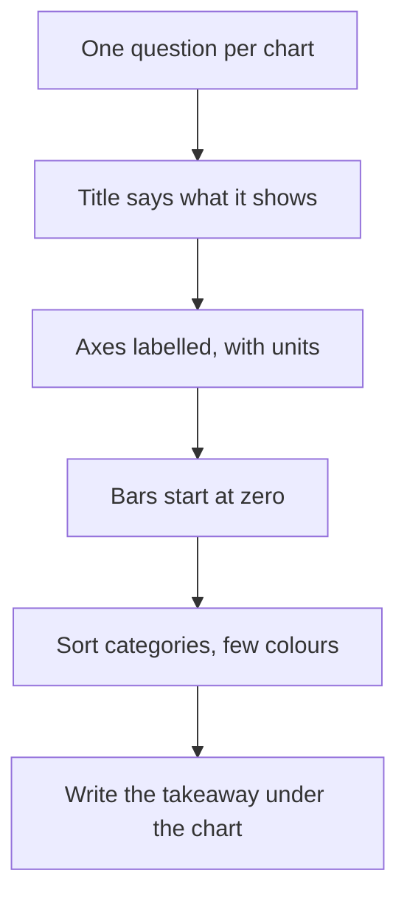

# Charts that tell the story

A good chart answers one question at a glance. This lesson shows the five charts you'll use most, with **matplotlib**, and how to choose between them.

```python
import pandas as pd
import matplotlib.pyplot as plt
df = pd.read_csv("cafe_clean.csv", parse_dates=["date"])
print("ready")
```

```output
ready
```

## Which chart for which question?

| Question | Chart |
|---|---|
| How does something change over time? | line |
| How do categories compare? | bar (horizontal if names are long) |
| How are values spread out? | histogram |
| Are two numbers related? | scatter |
| How do groups' spreads compare? | box plot |

## Line: change over time

```python
monthly = df.groupby("month")["revenue"].sum() / 1000
fig, ax = plt.subplots(figsize=(8, 4))
ax.plot(monthly.index, monthly.values, marker="o")
ax.set_title("Revenue per month (thousand EGP)")
ax.set_xlabel("Month")
ax.set_xticks(range(1, 13))
ax.grid(alpha=0.3)
fig.savefig("ds-revenue-month.png", dpi=100, bbox_inches="tight")
plt.show()
```


The pattern pops out: sales are lowest in February, climb through spring, peak in June and stay high until October, the summer holiday season. A table of 12 numbers hides that.

- `fig, ax = plt.subplots()` makes a figure (the image) and axes (the chart area).
- Always give a **title** and **labelled axes**, with units.
- `savefig` writes the chart to a file for reports; `plt.show()` displays it in the notebook.

## Bar: comparing categories

```python
items = df.groupby("item")["revenue"].sum().sort_values() / 1000
fig, ax = plt.subplots(figsize=(8, 5))
ax.barh(items.index, items.values, color="#4C78A8")
ax.set_title("Revenue per item (thousand EGP)")
fig.savefig("ds-revenue-item.png", dpi=100, bbox_inches="tight")
plt.show()
```


Sort the bars, and use horizontal bars when labels are long. Bar charts should start at zero, or differences look bigger than they are.

## Histogram: how values are spread

```python
fig, ax = plt.subplots(figsize=(8, 4))
ax.hist(df["hour"], bins=range(7, 25), edgecolor="white")
ax.set_title("Orders by hour of the day")
ax.set_xlabel("Hour")
ax.set_ylabel("Orders")
fig.savefig("ds-hours.png", dpi=100, bbox_inches="tight")
plt.show()
```


Most orders come in the early afternoon, with fewer in the morning and late evening: useful for planning staff shifts.

## Scatter: are two numbers related?

```python
daily = df.groupby("date").agg(temp=("temp_c", "first"), iced=("item", lambda s: s.isin(["iced latte", "mint lemonade"]).sum()))
fig, ax = plt.subplots(figsize=(7, 4))
ax.scatter(daily["temp"], daily["iced"], alpha=0.4)
ax.set_title("Iced drinks sold per day vs temperature")
ax.set_xlabel("Temperature (C)")
ax.set_ylabel("Iced drink orders")
fig.savefig("ds-scatter.png", dpi=100, bbox_inches="tight")
plt.show()
```


Each dot is a day. The cloud rises to the right: hotter days, more iced drinks. Module 4 measures how strong that relationship is.

## Box plot: comparing spreads

```python
groups = [df.loc[df["customer_type"] == t, "rating"].dropna() for t in ["new", "returning"]]
fig, ax = plt.subplots(figsize=(6, 4))
ax.boxplot(groups, tick_labels=["new", "returning"])
ax.set_title("Ratings by customer type")
ax.set_ylabel("Rating (1 to 5)")
fig.savefig("ds-box.png", dpi=100, bbox_inches="tight")
plt.show()
```


The box covers the middle half of the values, the line inside is the median, and the whiskers show the range. Returning customers rate a little higher.

## Make charts honest and clear



pandas can also draw directly: `monthly.plot(kind="line")`, `items.plot(kind="barh")`. And the **seaborn** library makes statistical charts in one line. Both use matplotlib underneath, so everything here still applies.

## Summary

- Line for time, bar for categories, histogram for spread, scatter for relationships, box plot for comparing groups.
- `fig, ax = plt.subplots()`, then plot, title, labels, `savefig`, `show`.
- Every chart answers one question; write the takeaway in words next to it.

## Optional videos

The lesson above is complete on its own. These videos go deeper, if you like learning by watching.

**Matplotlib tutorial, part 1: creating and customizing plots (Corey Schafer)**

https://www.youtube.com/watch?v=UO98lJQ3QGI
