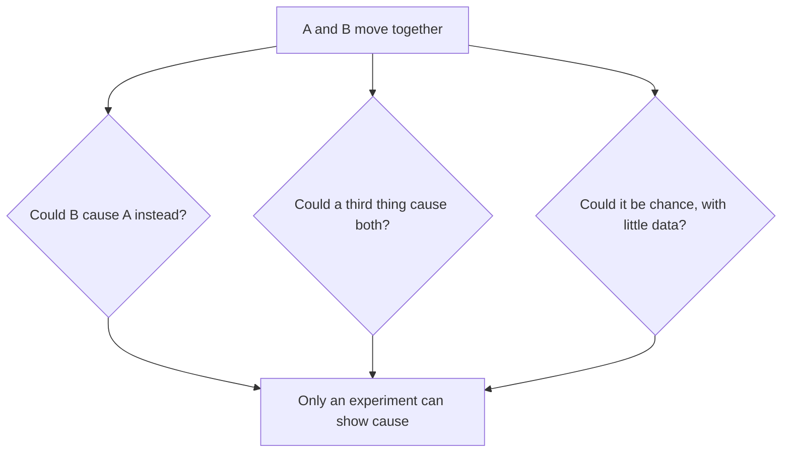

# Statistics 2: relationships, samples and A/B tests

## Correlation

**Correlation** measures how strongly two numbers move together, from -1 to +1:

- near **+1**: when one goes up, the other goes up
- near **0**: no straight-line relationship
- near **-1**: when one goes up, the other goes down

```python
import pandas as pd
import numpy as np
df = pd.read_csv("cafe_clean.csv", parse_dates=["date"])

daily = df.groupby("date").agg(
    temp=("temp_c", "first"),
    orders=("order_id", "count"),
    iced=("item", lambda s: s.isin(["iced latte", "mint lemonade"]).sum()),
    hot_drinks=("item", lambda s: s.isin(["tea", "hot chocolate"]).sum()),
)
print(daily.corr().round(2).to_string())
```

```output
            temp  orders  iced  hot_drinks
temp        1.00    0.30  0.57       -0.21
orders      0.30    1.00  0.48        0.35
iced        0.57    0.48  1.00       -0.15
hot_drinks -0.21    0.35 -0.15        1.00
```

Iced drinks rise with temperature (positive), hot drinks fall (negative). Orders overall also rise a little with temperature, because hot months are the busy holiday months.

## Correlation is not causation

Ice cream sales and drowning both rise in summer. Ice cream doesn't cause drowning; **heat** drives both. Always ask:



Here temperature and the holiday season move together, so from this data alone we can't say how much of the extra summer business is heat and how much is holidays.

## Samples and uncertainty

You almost never have **all** the data (the population). You have a **sample**, and a different sample would give a slightly different answer. How much could it differ?

```python
ratings = df["rating"].dropna()
rng = np.random.default_rng(7)
means = [rng.choice(ratings, size=100, replace=True).mean() for _ in range(2000)]
low, high = np.percentile(means, [2.5, 97.5])
print(f"one sample of 100 ratings has mean {means[0]:.2f}")
print(f"95% of samples of 100 give a mean between {low:.2f} and {high:.2f}")
```

```output
one sample of 100 ratings has mean 3.85
95% of samples of 100 give a mean between 3.76 and 4.08
```

This trick, resampling the data many times, is called the **bootstrap**. It shows the uncertainty: with only 100 ratings, the average could easily be off by about 0.15. With more data the range shrinks. Report results with that range (a **confidence interval**), not as a single exact number.

## A/B tests: the way to show cause

To know whether a change **causes** a better result, run an experiment: split customers at random into two groups, change one thing for group B only, and compare.

Suppose the chain tried a new loyalty card at random checkouts and tracked whether customers came back within a month:

```python
rng = np.random.default_rng(42)
a_back = rng.random(400) < 0.30          # group A: no card, about 30% come back
b_back = rng.random(400) < 0.37          # group B: loyalty card, about 37% come back
print(f"A: {a_back.mean():.1%}   B: {b_back.mean():.1%}")

# How often would a gap this big appear by pure chance? Shuffle the labels and see.
observed = b_back.mean() - a_back.mean()
both = np.concatenate([a_back, b_back])
gaps = []
for _ in range(5000):
    rng.shuffle(both)
    gaps.append(both[400:].mean() - both[:400].mean())
p_value = np.mean(np.array(gaps) >= observed)
print(f"observed gap {observed:.1%}, p-value {p_value:.3f}")
```

```output
A: 30.2%   B: 38.8%
observed gap 8.5%, p-value 0.009
```

The **p-value** is the chance of seeing a gap at least this large if the card made **no** difference. A small p-value (below 0.05 by common convention) means "chance alone is an unlikely explanation". It doesn't say the effect is big or important; look at the size of the gap for that.

Because customers were assigned **at random**, the only systematic difference between the groups is the card. That's what lets an experiment show cause, which correlation in historical data can't.

## Common traps

- **Small samples**: 5 ratings can't tell you much. Check how many values sit behind every average.
- **Comparing counts instead of rates** (last lesson).
- **Looking at many things and reporting the one that "worked"**: test 20 ideas and one will look significant by chance.
- **Survivorship**: analysing only customers who stayed hides why others left.

## Summary

- Correlation (-1 to +1) measures how two numbers move together; it doesn't show cause.
- Results from samples are uncertain; the bootstrap gives a range (confidence interval).
- Randomized A/B tests show cause; the p-value asks how likely the gap is by chance alone.

## Optional videos

The lesson above is complete on its own. These videos go deeper, if you like learning by watching.

**Pearson's correlation, clearly explained (StatQuest)**

https://www.youtube.com/watch?v=xZ_z8KWkhXE

**p-values: what they are and how to interpret them (StatQuest)**

https://www.youtube.com/watch?v=vemZtEM63GY
