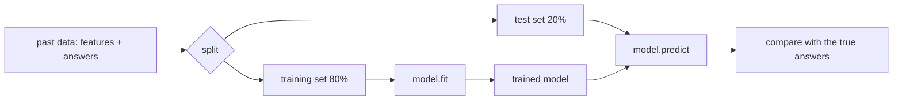

# Machine learning 1: predicting a number

**Machine learning** means letting the computer find a rule from examples instead of writing the rule yourself. You give it inputs (**features**) and the right answers (the **target**), it learns a **model**, and the model predicts answers for new inputs.



The key idea: judge a model only on data it **didn't** learn from. Otherwise you're grading a student with the exact questions they memorized.

## The question

*How many orders will the chain get tomorrow?* Staff and stock depend on it. Let's build one row per day:

```python
import pandas as pd
import numpy as np
df = pd.read_csv("cafe_clean.csv", parse_dates=["date"])

daily = df.groupby("date").agg(orders=("order_id", "count"), temp=("temp_c", "first")).reset_index()
daily["weekend"] = daily["date"].dt.dayofweek.isin([4, 5]).astype(int)    # Friday, Saturday
daily["month"] = daily["date"].dt.month
daily["summer"] = daily["month"].between(6, 9).astype(int)
print(daily.head(3).to_string(index=False))
print(len(daily), "days with orders")
```

```output
      date  orders  temp  weekend  month  summer
2025-01-01       4  10.5        0      1       0
2025-01-02       2  11.0        0      1       0
2025-01-03       3  12.0        1      1       0
352 days with orders
```

## Train and test

```python
from sklearn.model_selection import train_test_split

X = daily[["temp", "weekend", "summer"]]          # features (capital X by custom)
y = daily["orders"]                                # target
X_train, X_test, y_train, y_test = train_test_split(X, y, test_size=0.2, random_state=0)
print(len(X_train), "days to learn from,", len(X_test), "days to test on")
```

```output
281 days to learn from, 71 days to test on
```

`random_state=0` makes the random split the same every run, so your results are repeatable.

## A baseline first

Before any model, ask: what would a simple guess score? Here, "always predict the average":

```python
from sklearn.metrics import mean_absolute_error
baseline = np.full(len(y_test), y_train.mean())
print("baseline error:", round(mean_absolute_error(y_test, baseline), 2), "orders per day")
```

```output
baseline error: 1.87 orders per day
```

**Mean absolute error (MAE)**: on average, how far off the predictions are, in the target's units. A model is only useful if it beats the baseline.

## Linear regression

```python
from sklearn.linear_model import LinearRegression

model = LinearRegression()
model.fit(X_train, y_train)
pred = model.predict(X_test)
print("model error:", round(mean_absolute_error(y_test, pred), 2), "orders per day")
for name, coef in zip(X.columns, model.coef_):
    print(f"  {name:8} {coef:+.2f}")
print(f"  start    {model.intercept_:+.2f}")
```

```output
model error: 1.74 orders per day
  temp     +0.10
  weekend  +1.55
  summer   -0.14
  start    +1.39
```

Linear regression learns: **orders = start + a × temp + b × weekend + c × summer**. The coefficients are readable: a weekend day adds about 1.5 orders, and each extra degree adds about 0.1. That readability is why linear models are a great first choice.

Why is `summer` slightly negative, when summer is the busy season? Because summer days are also hot days, and `temp` already carries most of that effect. When features overlap like this, single coefficients can look odd, so read them together, not one by one.

It beats the baseline, but daily orders are noisy (each day's count is random around its typical level), so no model can be exact. Being honest about that is part of the job.

## Making a prediction

```python
tomorrow = pd.DataFrame({"temp": [33.0], "weekend": [1], "summer": [1]})
print("expected orders:", round(model.predict(tomorrow)[0], 1))
```

```output
expected orders: 6.2
```

## R²: how much is explained

```python
from sklearn.metrics import r2_score
print("R2 on test days:", round(r2_score(y_test, pred), 2))
```

```output
R2 on test days: 0.15
```

**R²** is the share of the variation the model explains: 1 is perfect, 0 is no better than the average. A modest R² is normal for noisy real-world counts. What matters is whether the predictions are good enough for the decision (here, rough staffing).

## Other regression models

`LinearRegression` draws straight-line relationships. For curved and interacting patterns, try `DecisionTreeRegressor` or `RandomForestRegressor` from scikit-learn: same `fit` / `predict` calls. Always compare against the baseline and against the simple model on the **test** set.

## Summary

- ML learns a rule from examples: features X, target y, `fit`, then `predict`.
- Split into train and test; score only on test data; compare with a baseline.
- Linear regression is readable (coefficients); MAE and R² measure how good it is.

## Optional videos

The lesson above is complete on its own. These videos go deeper, if you like learning by watching.

**Linear regression, clearly explained (StatQuest)**

https://www.youtube.com/watch?v=nk2CQITm_eo
