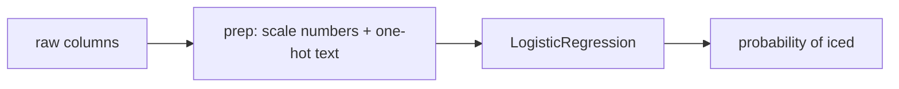

# A reliable ML workflow

A model that scores well once can still fail in real use. This lesson covers the habits that make results trustworthy: pipelines, cross-validation, and avoiding leakage.

```python
import pandas as pd
import numpy as np
df = pd.read_csv("cafe_clean.csv", parse_dates=["date"])
df["iced"] = df["item"].isin(["iced latte", "mint lemonade"]).astype(int)
df["weekend"] = df["date"].dt.dayofweek.isin([4, 5]).astype(int)
X = df[["temp_c", "hour", "weekend", "branch", "customer_type"]]
y = df["iced"]
print(X.shape)
```

```output
(1452, 5)
```

## Pipelines: preparation and model as one object

Preparing data (scaling numbers, one-hot encoding text) must be **learned from the training data only**, then applied the same way to new data. A `Pipeline` bundles the steps so that always happens:

```python
from sklearn.compose import ColumnTransformer
from sklearn.linear_model import LogisticRegression
from sklearn.pipeline import Pipeline
from sklearn.preprocessing import OneHotEncoder, StandardScaler

prep = ColumnTransformer([
    ("numbers", StandardScaler(), ["temp_c", "hour", "weekend"]),
    ("text", OneHotEncoder(handle_unknown="ignore"), ["branch", "customer_type"]),
])
pipe = Pipeline([("prep", prep), ("model", LogisticRegression(max_iter=1000))])
print([name for name, step in pipe.steps])
```

```output
['prep', 'model']
```



- `StandardScaler` puts numbers on the same scale (mean 0, std 1), which many models need.
- `OneHotEncoder(handle_unknown="ignore")` won't crash if a new branch appears later.
- The whole pipeline has `fit` and `predict`, like a single model.

## Cross-validation: a fairer score

One train/test split can be lucky or unlucky. **Cross-validation** splits the data 5 ways, trains 5 times, each time testing on a different fifth, and averages:

```python
from sklearn.model_selection import cross_val_score

scores = cross_val_score(pipe, X, y, cv=5, scoring="roc_auc")
print("AUC per fold:", np.round(scores, 3))
print(f"mean {scores.mean():.3f}, spread {scores.std():.3f}")
```

```output
AUC per fold: [0.834 0.822 0.581 0.911 0.9  ]
mean 0.810, spread 0.120
```

The spread tells you how much the score depends on which data you happened to test on. Here it's large: the rows are in date order, so each fold is a different part of the year, and the model does much worse on one season than the others. That's worth knowing before anyone relies on it. Report the mean **and** the spread.

## Comparing models fairly

```python
from sklearn.ensemble import RandomForestClassifier

forest = Pipeline([("prep", prep), ("model", RandomForestClassifier(n_estimators=200, max_depth=5, random_state=0))])
for name, m in [("logistic", pipe), ("random forest", forest)]:
    s = cross_val_score(m, X, y, cv=5, scoring="roc_auc")
    print(f"{name:14} AUC {s.mean():.3f} (+/- {s.std():.3f})")
```

```output
logistic       AUC 0.810 (+/- 0.120)
random forest  AUC 0.708 (+/- 0.112)
```

A **random forest** combines many decision trees. When two models score about the same, prefer the simpler, more explainable one.

## Leakage: the silent killer

**Leakage** is when information that wouldn't be available at prediction time sneaks into the features. The model looks brilliant in testing and fails in real use. Example:

```python
leaky = X.copy()
leaky["size"] = df["size"]             # the cup size is only known AFTER the order is placed...
leaky_pipe = Pipeline([("prep", ColumnTransformer([
    ("numbers", StandardScaler(), ["temp_c", "hour", "weekend"]),
    ("text", OneHotEncoder(handle_unknown="ignore"), ["branch", "customer_type", "size"]),
])), ("model", LogisticRegression(max_iter=1000))])
print("with leaked feature:", round(cross_val_score(leaky_pipe, leaky, y, cv=5, scoring="roc_auc").mean(), 3))
```

```output
with leaked feature: 0.922
```

Food and desserts always have size "regular", so knowing the size gives away that an order is a drink: the score jumps. But we wanted to predict iced orders **before** they're placed, when the size isn't known yet. That jump is fake.

Questions that catch leakage:

- Would I really know this feature **at the moment** I need the prediction?
- Is any feature calculated using the target, or using future data?
- Is a score suspiciously good? Investigate before celebrating.

For time-based data, also test on **later** dates than you train on (e.g. train on January to September, test on October to December), because that's how the model will be used.

## Saving a model

```python
import joblib
pipe.fit(X, y)
joblib.dump(pipe, "iced_model.joblib")
loaded = joblib.load("iced_model.joblib")
example = pd.DataFrame({"temp_c": [34.0], "hour": [15], "weekend": [1], "branch": ["Zamalek"], "customer_type": ["new"]})
print("chance of iced:", round(loaded.predict_proba(example)[0, 1], 2))
```

```output
chance of iced: 0.44
```

## Summary

- Pipelines tie preparation and model together, so preparation is learned only from training data.
- Cross-validation gives a fairer score with a spread; compare models the same way.
- Watch for leakage: only use features you'd really have at prediction time.

## Optional videos

The lesson above is complete on its own. These videos go deeper, if you like learning by watching.

**Cross validation (StatQuest)**

https://www.youtube.com/watch?v=fSytzGwwBVw

**The confusion matrix (StatQuest)**

https://www.youtube.com/watch?v=Kdsp6soqA7o
