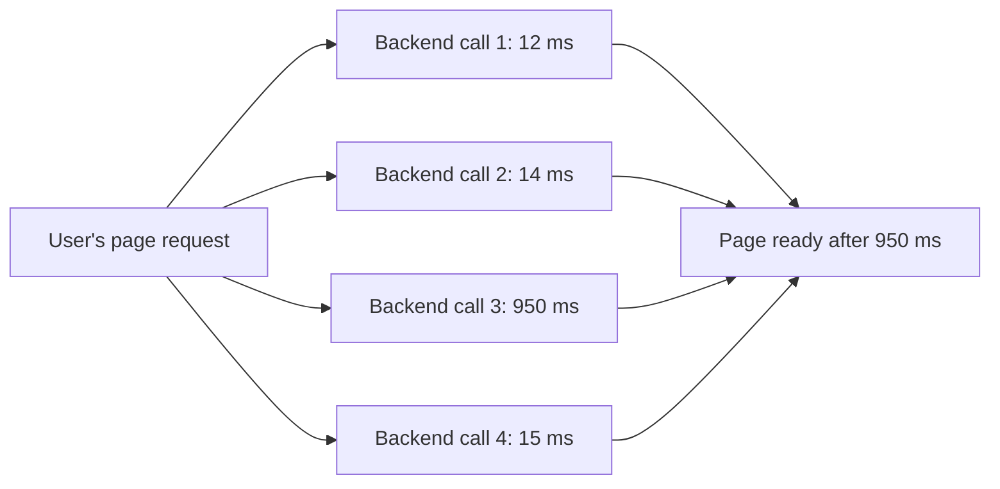

# Percentiles, fan-out and tail latency, in plain words

## Why not the average?

Ten requests take these times, in milliseconds:

```text
12  13  13  14  15  15  16  17  18  950
```

| Statistic | Value | What it tells you |
|---|---|---|
| Mean | 108 ms | Nobody waited 108 ms. One slow request dragged the average up |
| Median (p50) | 15 ms | Half the requests were faster than this |
| p90 | 18 ms | 9 out of 10 were faster |
| p99 (with more data) | about 950 ms | The experience of 1 in 100 requests |

The mean describes no real user. Percentiles describe real users: "99% of requests are faster than X". Teams write
promises about them, for example "p99 below 300 ms", in **service level objectives**.

## Tail latency amplification



If 1% of backend calls are slow and a page needs **one** call, 1% of pages are slow. If a page needs **50** calls in
parallel, it's slow whenever **any** of them is: 1 - 0.99^50, about 40% of pages. The more services a request touches,
the more the rare slow path becomes the common case. You'll measure this today.

## Fan-out: work on write or work on read

| | Fan-out on read | Fan-out on write |
|---|---|---|
| Posting | 1 write | 1 write per follower |
| Reading a timeline | Look up everyone you follow | 1 lookup of your ready-made timeline |
| Good when | Writes are common and reads rare | Reads are far more common than writes |
| Breaks when | Reads are frequent (as on Twitter) | One account has millions of followers |

Twitter moved from the first approach to the second, then to a **hybrid**: fan out on write for most accounts, and
fetch the few celebrity accounts at read time. The lesson isn't about Twitter: **the shape of your load, not its size
alone, decides the design**.

## What to take away

- Report response times as percentiles; the mean hides the slow tail.
- A request that fans out to many backends inherits their slowest response.
- Describe load with the parameters that matter for your design (ratios, distributions), not one big number.
